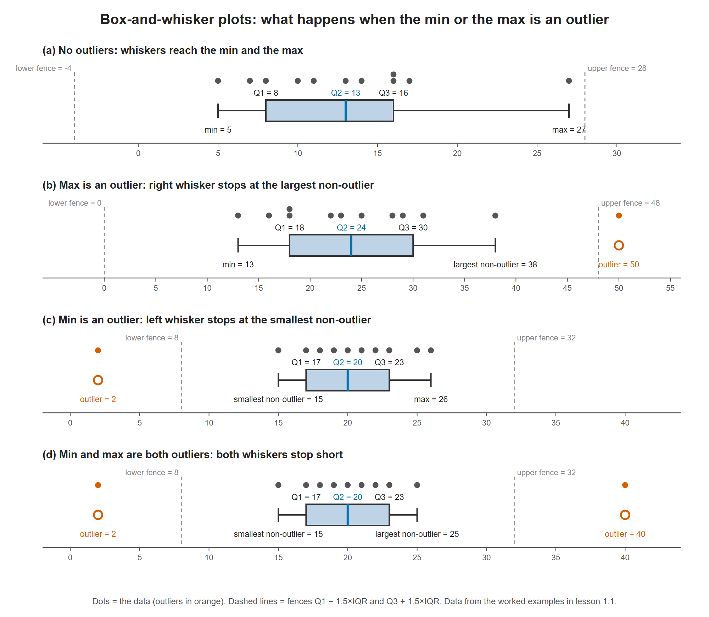
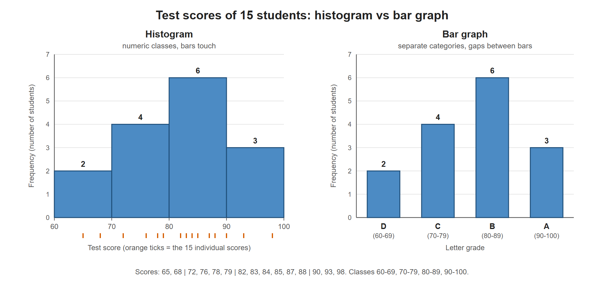

# Lesson 1.1 - Introduction to Statistics

> **Video:** [Introduction to Statistics](https://www.youtube.com/watch?v=XZo4xyJXCak) by The Organic Chemistry Tutor
> **Chapter:** [1 - Introduction to Statistics](https://www.video-tutor.net/introduction-to-statistics.html)

This lesson is a fast tour of the basic tools of **descriptive statistics**. It covers summarizing a data set with single numbers (mean, median, mode, range, quartiles), spotting outliers, and drawing the data (box plots, dot plots, stem-and-leaf plots, frequency tables, histograms). Each topic comes back in more detail in later chapters.

---

## 1. Mean, median, mode, and range

| Measure | What it is | How to get it |
|---|---|---|
| **Mean** $\bar x$ | The average | Add all values, divide by how many there are: $\bar x = \dfrac{\sum x}{n}$ |
| **Median** | The middle value | Sort the data. Odd $n$: the middle value. Even $n$: average the two middle values |
| **Mode** | The most frequent value | Count repeats. Two modes = **bimodal**; one mode = **unimodal** |
| **Range** | The spread from lowest to highest | $\text{range} = \text{highest} - \text{lowest}$ |

> **Tip:** always sort the data from smallest to largest first. It makes the median, mode and range easy to read off.

### Example 1 - an odd number of values

Data (sorted): 7, 7, 10, 14, 15, 23, 32 ($n = 7$)

- Mean: $\dfrac{7+7+10+14+15+23+32}{7} = \dfrac{108}{7} \approx 15.43$
- Median: cross off values from both ends until one is left → **14**
- Mode: 7 appears twice → **7**
- Range: $32 - 7 = 25$

### Example 2 - an even number of values

Data (sorted): 11, 15, 15, 21, 37, 41, 59, 59 ($n = 8$)

- Mean: $\dfrac{258}{8} = 32.25$
- Median: the two middle values are 21 and 37 → $\dfrac{21+37}{2} = 29$
- Mode: 15 and 59 both appear twice → **15 and 59** (bimodal)
- Range: $59 - 11 = 48$

---

## 2. Quartiles and the interquartile range (IQR)

Quartiles cut the sorted data into four parts with the same number of values in each:

| Symbol | Name | Meaning |
|---|---|---|
| Min | Minimum | Smallest value |
| $Q_1$ | First quartile (25th percentile) | Median of the **lower half** |
| $Q_2$ | Second quartile (50th percentile) | Median of the **whole** data set |
| $Q_3$ | Third quartile (75th percentile) | Median of the **upper half** |
| Max | Maximum | Largest value |

$$\text{IQR} = Q_3 - Q_1$$

When $n$ is odd, the overall median is left out of both halves, so the two halves stay the same size.

### Outliers: the 1.5 × IQR rule

A value is **not** an outlier if it lies inside the "fences":

$$Q_1 - 1.5\,\text{IQR} \quad\le\quad x \quad\le\quad Q_3 + 1.5\,\text{IQR}$$

Anything below the lower fence or above the upper fence is an **outlier**.

### Example 3 - quartiles with odd $n$

Data: 7, 11, 14, 5, 8, 27, 16, 10, 13, 17, 16

Sorted: 5, 7, 8, 10, 11, **13**, 14, 16, 16, 17, 27 ($n = 11$)

- $Q_2 = 13$ (the 6th value)
- Lower half 5, 7, **8**, 10, 11 → $Q_1 = 8$
- Upper half 14, 16, **16**, 17, 27 → $Q_3 = 16$
- $\text{IQR} = 16 - 8 = 8$
- Fences: $8 - 1.5(8) = -4$ and $16 + 1.5(8) = 28$

27 looks far from the rest, but it is inside $[-4, 28]$, so it is **not** an outlier. A value of 29 would have been.

---

## 3. Box-and-whisker plots

A box plot draws the **five-number summary**:

- The **box** runs from $Q_1$ to $Q_3$, so its length is the IQR.
- A line inside the box marks the median $Q_2$.
- The **whiskers** reach out to the smallest and largest values that are **not** outliers.
- Outliers are drawn as separate **points** (`*`) beyond the whiskers.

### The four possible shapes: is the min or the max an outlier?

Check the minimum against the lower fence and the maximum against the upper fence. That gives four cases:

**(a) Neither is an outlier.** The whiskers go all the way to the min and the max.

```
 min           Q1      Q2      Q3               max
  |-------------[=======|=======]----------------|
```

**(b) Only the max is an outlier.** The right whisker stops at the largest value that is **not** an outlier, and the max is drawn as a separate point.

```
 min           Q1      Q2      Q3     largest non-outlier     max (outlier)
  |-------------[=======|=======]-----------|                    *
```

**(c) Only the min is an outlier.** The left whisker stops at the smallest value that is **not** an outlier, and the min is drawn as a separate point.

```
 min (outlier)     smallest non-outlier   Q1      Q2      Q3          max
  *                        |---------------[=======|=======]-----------|
```

**(d) Both are outliers.** Both whiskers stop short, and the min and max are both drawn as separate points.

```
 min (outlier)   smallest           Q1      Q2      Q3       largest      max (outlier)
  *                 |----------------[=======|=======]----------|            *
```

> The **whisker ends** are therefore not always the min and max. They are always the most extreme values that are **inside** the fences.

The same four cases, drawn to scale from the worked examples below. The dots above each box are the actual data; outliers are orange.



### Worked example for case (a) - Example 3 data, no outliers

Using Example 3 from Section 2: min = 5, $Q_1 = 8$, $Q_2 = 13$, $Q_3 = 16$, max = 27, fences $[-4, 28]$. Both 5 and 27 are inside the fences, so the whiskers reach the min and the max.

```
                +---------|-----+
          |-----|         |     |---------------------|
                +---------|-----+
+---------+---------+---------+---------+---------+---------+
0         5         10        15        20        25        30
       min=5   Q1=8      Q2=13 Q3=16                 max=27
```

### Example 4 - building a box plot ($n = 12$), case (b)

Sorted data: 13, 16, 18 | 18, 22, 23 | 25, 28, 29 | 31, 38, 50

- $Q_2 = \dfrac{23+25}{2} = 24$
- Lower half 13, 16, 18, 18, 22, 23 → $Q_1 = \dfrac{18+18}{2} = 18$
- Upper half 25, 28, 29, 31, 38, 50 → $Q_3 = \dfrac{29+31}{2} = 30$
- $\text{IQR} = 30 - 18 = 12$
- Fences: $18 - 1.5(12) = 0$ and $30 + 1.5(12) = 48$

So **50 is an outlier**. In the plot, the box runs from 18 to 30 with the median at 24. The left whisker goes down to 13, and the right whisker stops at **38**, the largest value that is not an outlier. 50 is drawn as a separate dot.

```
                  +-----|-----+
             |----|     |     |-------|           *
                  +-----|-----+
+---------+---------+---------+---------+---------+
0         10        20        30        40        50
          min=13 Q1=18 Q2=24 Q3=30   38          50 (outlier)
```

### Case (c) - the min is an outlier

These two examples are my own; they are not from the video.

Sorted data ($n = 11$): **2**, 15, 17, 18, 19, **20**, 21, 22, 23, 25, 26

- $Q_2 = 20$
- Lower half 2, 15, **17**, 18, 19 → $Q_1 = 17$
- Upper half 21, 22, **23**, 25, 26 → $Q_3 = 23$
- $\text{IQR} = 23 - 17 = 6$
- Fences: $17 - 1.5(6) = 8$ and $23 + 1.5(6) = 32$

**2 is below 8, so the min is an outlier.** The left whisker stops at **15**, the smallest value that is not an outlier. The max, 26, is inside the fences, so the right whisker reaches it.

```
                                  +-----|-----+
    *                         |---|     |     |-----|
                                  +-----|-----+
+---------+---------+---------+---------+---------+---------+
0         5         10        15        20        25        30
 2 (outlier)                15   Q1=17 Q2=20 Q3=23  max=26
```

### Case (d) - both the min and the max are outliers

Change the largest value in the last data set from 26 to **40**: 2, 15, 17, 18, 19, 20, 21, 22, 23, 25, **40**

- The quartiles don't change: $Q_1 = 17$, $Q_2 = 20$, $Q_3 = 23$, $\text{IQR} = 6$, fences $[8, 32]$.
- **2 < 8** and **40 > 32**, so **both** are outliers.
- The left whisker stops at **15** and the right whisker at **25**, the most extreme values inside the fences. 2 and 40 are drawn as separate points.

```
                                  +-----|-----+
    *                         |---|     |     |---|                             *
                                  +-----|-----+
+---------+---------+---------+---------+---------+---------+---------+---------+
0         5         10        15        20        25        30        35        40
 2 (outlier)                15   Q1=17 Q2=20 Q3=23 25                   40 (outlier)
```

---

## 4. Skewness

| Shape | Tail points to | Mean vs median | Box plot clue |
|---|---|---|---|
| **Symmetric** | No long tail | mean ≈ median | Median in the middle of the box; whiskers equal |
| **Skewed right** (positive skew) | Right | mean **>** median | Right part of the box ($Q_3 - Q_2$) and/or right whisker longer |
| **Skewed left** (negative skew) | Left | mean **<** median | Left part of the box ($Q_2 - Q_1$) and/or left whisker longer |

> **Memory aid:** the mean gets pulled toward the tail. A right tail drags the mean to the right of the median.


In each panel the box plot is on the same scale as the curve above it. In the skewed panels, the longer side of the box and the longer whisker point toward the tail.

*The figures in this note were drawn for these notes. [`figures/make_figures.ipynb`](figures/make_figures.ipynb) recreates them with matplotlib, and SVG versions ([skewness](figures/skewness.svg), [box plots](figures/box_plot_outliers.svg), [histogram](figures/histogram_vs_bar_graph.svg)) are in the same folder.*

---

## 5. Dot plots

Draw a number line and put one dot above a value each time it appears. The tallest column of dots is the **mode**.

**Example 5.** Data: 5, 8, 3, 7, 1, 5, 3, 2, 3, 3, 8, 5

Counts: 1 → 1, 2 → 1, 3 → 4, 5 → 3, 7 → 1, 8 → 2

```
         •
         •     •
         •     •        •
   •  •  •     •     •  •
---+--+--+--+--+--+--+--+--
   1  2  3  4  5  6  7  8
```

The tallest column is above 3, so the **mode is 3**.

---

## 6. Stem-and-leaf plots

Split each number into a **stem** (the leading digit or digits) and a **leaf** (the last digit). Write the leaves in order, and keep a stem even if it has no leaves. Always add a **key**.

**Example 6.** Data: 4, 9, 13, 13, 17, 21, 36, 38, 38, 56

| Stem | Leaf |
|---:|:---|
| 0 | 4 9 |
| 1 | 3 3 7 |
| 2 | 1 |
| 3 | 6 8 8 |
| 4 | |
| 5 | 6 |

Key: 2 | 1 = 21

**Example 7 - three-digit numbers.** Data: 78, 85, 89, 92, 106, 107, 119

| Stem | Leaf |
|---:|:---|
| 7 | 8 |
| 8 | 5 9 |
| 9 | 2 |
| 10 | 6 7 |
| 11 | 9 |

Key: 10 | 6 = 106

**Example 8 - decimals.** Data: 1.2, 1.6, 1.8, 2.1, 2.3, 2.3, 2.5

| Stem | Leaf |
|---:|:---|
| 1 | 2 6 8 |
| 2 | 1 3 3 5 |

Key: 1 | 6 = 1.6

---

## 7. Frequency tables and the mean

A **frequency table** lists each value and how many times it occurs. Multiplying each value by its frequency lets you find the mean without writing every number out:

$$\bar x = \frac{\sum (x \cdot f)}{\sum f}$$

**Example 9.** Data: 5, 9, 8, 7, 8, 12, 9, 8, 10, 8, 9, 7

| Value $x$ | Frequency $f$ | $x \cdot f$ |
|---:|---:|---:|
| 5 | 1 | 5 |
| 7 | 2 | 14 |
| 8 | 4 | 32 |
| 9 | 3 | 27 |
| 10 | 1 | 10 |
| 12 | 1 | 12 |
| **Total** | **12** | **100** |

$$\bar x = \frac{100}{12} \approx 8.33$$

---

## 8. Histograms

A **histogram** looks like a bar graph, but its bars **touch**. Each bar covers a range of values (a *class*), and its height is the frequency. A bar graph has gaps between its bars and is used for separate categories.

**Example 10.** Test scores: 65, 72, 93, 68, 76, 98, 84, 85, 79, 88, 90, 82, 83, 87, 78

First group the scores into classes:

| Class (grade) | Scores | Frequency |
|---|---|---:|
| 60-69 (D) | 65, 68 | 2 |
| 70-79 (C) | 72, 76, 79, 78 | 4 |
| 80-89 (B) | 84, 85, 88, 82, 83, 87 | 6 |
| 90-100 (A) | 93, 98, 90 | 3 |
| **Total** | | **15** |

Then draw adjacent bars of heights 2, 4, 6 and 3 over the classes 60-70, 70-80, 80-90 and 90-100.



On the left, the histogram's bars sit on a **number line** and touch, because the classes run straight into each other (70 is where 60-69 ends and 70-79 starts). The orange ticks under the axis are the 15 individual scores, so you can see which bar each one falls into. On the right, the same counts are drawn as a **bar graph** of the letter grades D, C, B and A, which are separate categories, so the bars have gaps.

The tallest bar is 80-89, so most students got a B. The shape has a longer tail on the low side (60s), so it leans slightly left.

---

## 9. Relative and cumulative relative frequency, and percentiles

- **Relative frequency** = $\dfrac{f}{n}$, the fraction of the data at that value. The column adds up to 1.
- **Cumulative relative frequency** is the running total of the relative frequencies. It ends at 1.

**Example 11.** Data ($n = 20$): 2, 3, 5, 3, 6, 8, 7, 8, 3, 3, 5, 3, 7, 3, 8, 5, 2, 7, 8, 3

| Value | Frequency | Relative frequency | Cumulative relative frequency |
|---:|---:|---:|---:|
| 2 | 2 | 0.10 | 0.10 |
| 3 | 7 | 0.35 | 0.45 |
| 5 | 3 | 0.15 | 0.60 |
| 6 | 1 | 0.05 | 0.65 |
| 7 | 3 | 0.15 | 0.80 |
| 8 | 4 | 0.20 | 1.00 |
| **Total** | **20** | **1.00** | |

### Reading percentiles from the table

The method used in the video:

- If the percentile lands **exactly** on a cumulative value, average that value and the next one.
  - 60th percentile: the cumulative column hits 0.60 at value 5, so $\dfrac{5+6}{2} = 5.5$.
  - 80th percentile: it hits 0.80 at value 7, so $\dfrac{7+8}{2} = 7.5$.
- If the percentile falls **between** two cumulative values, take the value of the higher row.
  - 20th percentile: between 0.10 and 0.45, so it is **3**.
  - 75th percentile: between 0.65 and 0.80, so it is **7**.

You can check this by writing all 20 sorted values in a row and marking every 10%, which falls every 2 values:

```
2 2 | 3 3 | 3 3 | 3 3 | 3 5 | 5 5 | 6 7 | 7 7 | 8 8 | 8 8
   10%   20%   30%   40%   50%   60%   70%   80%   90%  100%
```

The 60% mark sits between a 5 and a 6 (→ 5.5). The 20% mark sits between two 3s (→ 3).

> Textbooks and software use several slightly different percentile rules, so small differences between methods are normal.

---

## Key takeaways

- **Sort first**, then find the median, quartiles, mode and range.
- **Mean** is affected by extreme values. The **median** and **IQR** are resistant to them.
- **Outlier fences:** $Q_1 - 1.5\,\text{IQR}$ and $Q_3 + 1.5\,\text{IQR}$.
- **Box plot:** box = IQR, line = median, whiskers = most extreme non-outliers, dots = outliers.
- **Skew:** the mean is pulled toward the tail.
- **Histograms** have touching bars over numeric classes; **bar graphs** have gaps between categories.
- **Relative frequency** = $f/n$; the **cumulative** column ends at 1 and is used to read percentiles.
