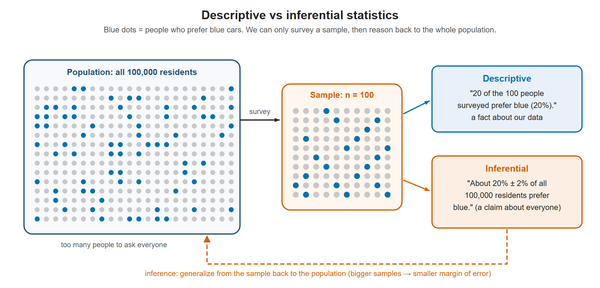

# Lesson 1.2 - Descriptive Statistics vs Inferential Statistics

> **Video:** [Descriptive Statistics vs Inferential Statistics](https://www.youtube.com/watch?v=VHYOuWu9jQI) by The Organic Chemistry Tutor
> **Chapter:** [1 - Introduction to Statistics](https://www.video-tutor.net/introduction-to-statistics.html)

## What is statistics?

**Statistics** is the science of **collecting, analyzing, interpreting and presenting data**. It has two main branches:

| | Descriptive statistics | Inferential statistics |
|---|---|---|
| Goal | **Organize and summarize** the data you have | **Draw conclusions about a population** from a sample |
| Tools | Graphs, tables, summary numbers | Probability, estimates, confidence intervals, hypothesis tests |
| Typical statement | "20 of the 100 people surveyed said yes." | "About 20% of the whole city would say yes, ± 2%." |

You usually learn descriptive statistics first, because inference is built on top of it.

---

## Descriptive statistics

Descriptive statistics describes data in two ways.

**1. With graphs and tables**

- **Bar graph:** separate bars, one per category.
- **Histogram:** like a bar graph, but the bars **touch** because they cover consecutive numeric ranges.
- **Pie chart:** shows how a whole is split into percentages.
- **Line graph:** shows change, often over time.
- **Frequency table / frequency distribution table:** counts how often each value or class occurs.
- **Shape of the data:** symmetric, skewed right, or skewed left.

**2. With numbers**

- **Measures of central tendency:**
  - **Mean** (average) = sum of values ÷ number of values.
    - *Sample mean* $\bar x$: averages the values in a sample.
    - *Population mean* $\mu$: averages every value in the population.
  - **Median**: the middle value of the sorted data.
  - **Mode**: the most frequent value.
- **Measures of spread:** range, variance, standard deviation.

---

## Inferential statistics

Inferential statistics uses **sample data** to make an **inference**, or draw a conclusion, about a **population**. It also uses probability to say **how confident** we can be in that conclusion.

### Example - who likes blue cars?

City XYZ has **100,000** residents. We want to know what share of them prefer blue cars.

1. Asking all 100,000 people is not practical, so we survey a **sample of 100** people.
2. **20 out of 100** say they prefer blue cars, so **20%** of the sample.
   → This is a fact about the data we collected: **descriptive statistics**.
3. We then say: "About 20% of *all* residents prefer blue cars, within a 2% margin of error."
   → This is a conclusion about people we did not ask: **inferential statistics**.
4. A **confidence interval** is also inferential: "We are 95% confident that 20% ± 2% of residents prefer blue cars."

Describing the 100 people we surveyed is descriptive statistics. Using them to say something about all 100,000 residents is inferential statistics.

### A bigger sample gives a better estimate

Suppose we survey **1,000** people instead and **21%** say yes. The margin of error shrinks to about **±1%**. A larger sample gives a more precise picture of the population.

| Sample size | Sample result | Margin of error |
|---:|---:|---:|
| 100 | 20% | ± 2% (as stated in the video) |
| 1,000 | 21% | ± 1% (as stated in the video) |

> **Note:** the margins of error here are illustrative numbers from the video. [Chapter 9](../09_confidence_intervals) shows how to actually calculate a margin of error for a proportion. With the standard formula, a sample of 100 at 95% confidence gives a margin of about ±8%. The idea is still the same: **more data → smaller margin of error**.

---

## Key takeaways

- **Descriptive** = summarize what you observed (graphs, tables, mean, median, mode, range, SD).
- **Inferential** = generalize from a **sample** to the **population**, with a stated level of confidence.
- Reporting "20 of 100 people said yes" is descriptive. Saying "20% of the city agrees" is inferential.
- Bigger samples give more precise inferences (smaller margin of error).
