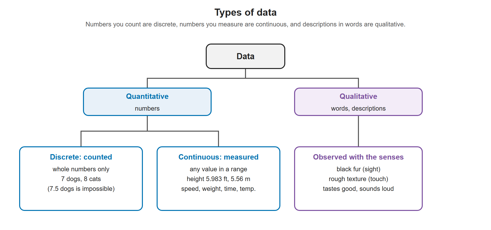

# Lesson 1.3 - Quantitative vs Qualitative Data

> **Video:** [Qualitative and Quantitative](https://www.youtube.com/watch?v=5rUVYWfZOb8) by The Organic Chemistry Tutor
> **Chapter:** [1 - Introduction to Statistics](https://www.video-tutor.net/introduction-to-statistics.html)

## Two types of data

```
                         Data
              ┌────────────┴────────────┐
       Quantitative                 Qualitative
     (numbers / numerical)      (words / descriptive)
       ┌──────┴──────┐
   Discrete      Continuous
  (counted)      (measured)
```



The same tree as above, with an example in each box.

---

## Quantitative data - numbers

Quantitative data is **numerical**, such as 5, 8 or 12. It comes in two forms.

### Discrete - things you **count**

- Only whole-number values (0, 1, 2, 3, ...); nothing in between.
- Example: **8 cats**. You cannot have 8.5 cats or 2.37 cats.

### Continuous - things you **measure**

- Any value in a range, including decimals.
- Example: a distance of 5.56 m or 7.283 m. It does not have to be a whole number.
- Other examples: **distance, speed, weight, height, time, temperature**.

> **Rule of thumb:** counted → discrete; measured → continuous. Both are quantitative.

---

## Qualitative data - words

Qualitative data is **descriptive**. It comes from **observation** and is described with **words, not numbers**. It often involves the five senses:

| Sense | Example |
|---|---|
| Sight | Color (the fur is black) |
| Touch | Texture (soft, hard, rough) |
| Taste | The food tastes good / bad |
| Hearing | The volume is low / high |
| Smell | It smells good / bad / of nothing |

---

## Quick quiz

| Statement | Quantitative or qualitative? | Discrete or continuous? | Why |
|---|---|---|---|
| There are **7 dogs** | Quantitative | **Discrete** | You count dogs; 7.5 dogs is impossible |
| The cat's fur is **black** | **Qualitative** | n/a | Color, described with a word |
| Michael is **6 feet tall** | Quantitative | **Continuous** | Height is measured; it could be 5.983 ft |
| The cat's fur is **rough** | **Qualitative** | n/a | Texture, described with a word |

---

## Key takeaways

- **Quantitative** = numbers. **Qualitative** = words or descriptions.
- Quantitative data is **discrete** (counted, whole numbers) or **continuous** (measured, any value in a range).
- Qualitative data usually describes what you see, feel, taste, hear or smell.
