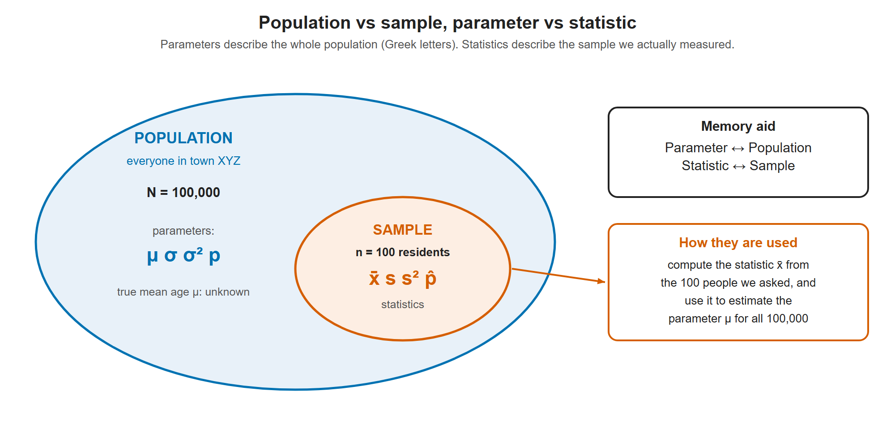

# Lesson 1.4 - Statistic vs Parameter and Population vs Sample

> **Video:** [Statistic vs Parameter & Population vs Sample](https://www.youtube.com/watch?v=Mb9BuEkbaHQ) by The Organic Chemistry Tutor
> **Chapter:** [1 - Introduction to Statistics](https://www.video-tutor.net/introduction-to-statistics.html)

## Population vs sample

- **Population:** *everyone or everything* in the group being studied.
- **Sample:** a **subset**, a smaller part of the population that is actually measured.

## Statistic vs parameter

- **Parameter:** a number that describes the **population**.
- **Statistic:** a number that describes a **sample**.

> **Memory aid:** **P**arameter ↔ **P**opulation, **S**tatistic ↔ **S**ample.

### Example - average age in town XYZ

Town XYZ has **100,000** residents, and we want their average age.

- Asking all 100,000 people is a lot of work, so we ask **100** residents and average their ages.
- The average age of those 100 people is the **sample mean** $\bar x$, which is a **statistic**.
- The true average age of all 100,000 residents is the **population mean** $\mu$, which is a **parameter**.
- Population size = 100,000; sample size = 100.

The sample is part of the population. Numbers computed from the sample (x̄, s, p̂) are statistics, and we use them to estimate the population's parameters (μ, σ, p).

---

## Symbols

| Quantity | Sample (statistic) | Population (parameter) |
|---|:---:|:---:|
| Mean | $\bar x$ ("x-bar") | $\mu$ ("mu") |
| Standard deviation | $s$ | $\sigma$ ("sigma") |
| Variance | $s^2$ | $\sigma^2$ |
| Proportion | $\hat p$ ("p-hat") | $p$ |
| Size | $n$ (lowercase) | $N$ (uppercase) |

Roman letters ($\bar x$, $s$, $\hat p$, $n$) are usually used for samples. Greek letters ($\mu$, $\sigma$) and plain $p$, $N$ are used for populations.

---

## Quick quiz - statistic or parameter?

A parameter describes **everyone** in the group. A statistic describes **only some** of them.

| # | Statement | Answer | Symbol |
|---|---|---|:---:|
| 1 | The average weight of **all** males in the United States | **Parameter** | $\mu$ |
| 2 | The average height of **100 cats** in California (out of millions) | **Statistic** | $\bar x$ |
| 3 | The average test score of **20 students** in a class of 500 | **Statistic** | $\bar x$ |
| 4 | The average test score of **all** students in the class | **Parameter** | $\mu$ |

---

## Key takeaways

- **Population** = the whole group. **Sample** = the part you actually observe.
- **Parameter** describes a population. **Statistic** describes a sample.
- In practice we usually compute statistics ($\bar x$, $s$, $\hat p$) to **estimate** unknown parameters ($\mu$, $\sigma$, $p$).
