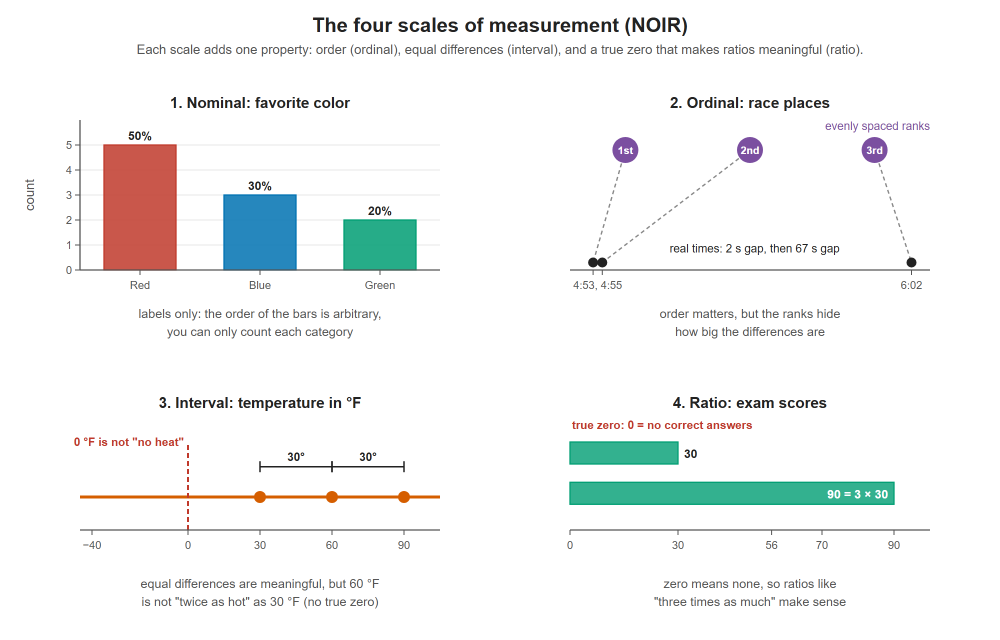

# Lesson 1.5 - Scales of Measurement

> **Video:** [Scales of Measurement - Nominal, Ordinal, Interval, & Ratio Scale Data](https://www.youtube.com/watch?v=LuBD49SFpWs) by The Organic Chemistry Tutor
> **Chapter:** [1 - Introduction to Statistics](https://www.video-tutor.net/introduction-to-statistics.html)

Data can be measured on four **scales of measurement**. Each scale adds one more property than the one before it:

**Nominal → Ordinal → Interval → Ratio**

One example per scale, from the lesson. Each panel shows the property that scale adds: nothing beyond labels (nominal), order (ordinal), equal differences (interval), and a true zero (ratio).

---

## 1. Nominal scale - names and labels

- **Qualitative** and **categorical**: names, colors, labels.
- **Order does not matter.** You might code red = 1, blue = 2, green = 3, but the numbers are arbitrary. Red is not "less than" blue.
- You cannot do arithmetic with the categories themselves, but you **can** count how many fall in each category.

**Example.** 10 people are asked their favorite color: 5 say red, 3 blue, 2 green.

| Color | Count | Percentage |
|---|---:|---:|
| Red | 5 | 50% |
| Blue | 3 | 30% |
| Green | 2 | 20% |

The percentages are calculated from the **counts**, not from the colors.

---

## 2. Ordinal scale - ranked order

- **Order matters**, so values can be ranked.
- **Differences cannot be measured**: the gap between 1st and 2nd is not necessarily the same as between 2nd and 3rd.

**Example 1 - a race.**

| Place | Finishing time |
|---|---|
| 1st | 4 min 53 s |
| 2nd | 4 min 55 s |
| 3rd | 6 min 02 s |

1st and 2nd are only 2 seconds apart, but 2nd and 3rd are more than a minute apart. The places alone (1, 2, 3) hide this. If you only know the ranking, you cannot measure the differences.

**Example 2 - a rating scale.** Excellent (1), Good (2), Satisfactory (3), Bad (4). We know excellent beats good and good beats satisfactory. We cannot say whether the step from excellent to good is the same size as the step from good to satisfactory.

---

## 3. Interval scale - equal differences, no true zero

- **Order matters.**
- **Differences can be measured**, and they have a consistent meaning.
- **Ratios are not meaningful.**
- **No true zero:** zero does not mean "none of the quantity".

**Example - temperature in °F or °C.**

- 30 °F, 60 °F, 90 °F are in order.
- 60 − 30 = 30 °F and 90 − 60 = 30 °F are equal, meaningful differences.
- But 60 °F is **not** "twice as hot" as 30 °F, even though 60 / 30 = 2.
- 0 °F is not "no heat": temperatures can be negative (−20 °F, −40 °C).

> Temperature in **kelvin** is different. It has a true zero (absolute zero), so kelvin is a **ratio** scale.

---

## 4. Ratio scale - everything, including a true zero

- **Order matters.**
- **Differences can be measured.**
- **Ratios are meaningful.**
- **True zero exists:** zero means none, and negative values are impossible.

**Example - exam scores.** Scores 70, 30, 56, 82, 90 sort to 30, 56, 70, 82, 90.

- Differences: 56 − 30 = 26, 70 − 56 = 14.
- Ratio: 90 / 30 = 3, so the top score is three times the lowest.
- A score of 0 means no correct answers (or no test taken), and a negative score is impossible.

Other ratio examples: height, weight, distance, time, money, counts.

---

## Summary table

| Property | Nominal | Ordinal | Interval | Ratio |
|---|:---:|:---:|:---:|:---:|
| Can be labeled / categorized | ✅ | ✅ | ✅ | ✅ |
| Meaningful order | ❌ | ✅ | ✅ | ✅ |
| Measurable differences | ❌ | ❌ | ✅ | ✅ |
| Meaningful ratios | ❌ | ❌ | ❌ | ✅ |
| True zero starting point | ❌ | ❌ | ❌ | ✅ |

> **Memory aid - "NOIR":** **N**ominal, **O**rdinal, **I**nterval, **R**atio, from the least information to the most.
