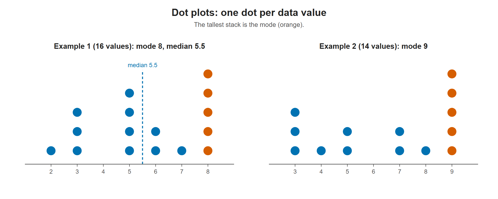

# Lesson 2.4 - Dot Plots and Frequency Tables

> **Video:** [Dot Plots and Frequency Tables](https://www.youtube.com/watch?v=Iu17mY1VfZU) by The Organic Chemistry Tutor
> **Chapter:** [2 - Graphs and Tables](https://www.video-tutor.net/graphs-and-tables.html)

## Idea

A **dot plot** is a picture of a frequency table. Draw a number line from the lowest to the highest value, then stack **one dot per data value** above it. The height of each stack equals the frequency.

---

## Example 1

Data (16 values): 5, 8, 3, 6, 8, 5, 8, 2, 3, 8, 5, 8, 3, 5, 7, 6

**Step 1 - frequency table**

| Value | Frequency |
|---:|---:|
| 2 | 1 |
| 3 | 3 |
| 5 | 4 |
| 6 | 2 |
| 7 | 1 |
| 8 | 5 |
| **Total** | **16** |

(There is no 4.)

**Step 2 - dot plot**

```
                      •
             •        •
       •     •        •
       •     •  •     •
    •  •     •  •  •  •
----+--+--+--+--+--+--+----
    2  3  4  5  6  7  8
```

**Reading the plot:**

- **Mode** = the tallest stack = **8**.
- **Median:** with $n = 16$, the median is the average of the 8th and 9th values. Removing dots from both ends leaves a 5 and a 6, so
  $$\text{median} = \frac{5 + 6}{2} = 5.5$$



The two dot plots from this lesson. The tallest stack (orange) is the mode. In Example 1 the 8th and 9th values are a 5 and a 6, so the median is 5.5 (dashed line).

---

## Example 2 (practice)

Data (14 values): 7, 4, 9, 3, 9, 5, 9, 7, 3, 9, 3, 9, 5, 8

Counts: 3 → 3, 4 → 1, 5 → 2, 7 → 2, 8 → 1, 9 → 5 (no 6)

```
                      •
                      •
    •                 •
    •     •     •     •
    •  •  •     •  •  •
----+--+--+--+--+--+--+----
    3  4  5  6  7  8  9
```

**Mode = 9** (tallest stack).

---

## Key takeaways

- A dot plot shows **every** data value, so no information is lost.
- Number of dots above a value = its **frequency**.
- **Mode** = tallest column. For the **median**, cross off dots from both ends until the middle is left.
