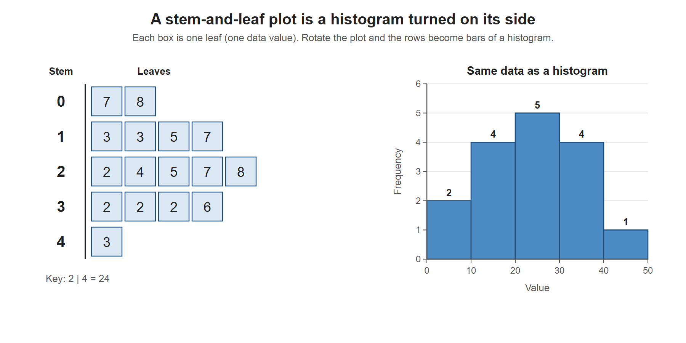

# Lesson 2.6 - Stem and Leaf Plots

> **Video:** [Stem and Leaf Plots](https://www.youtube.com/watch?v=MUCvUgGfzdo) by The Organic Chemistry Tutor
> **Chapter:** [2 - Graphs and Tables](https://www.video-tutor.net/graphs-and-tables.html)

## Idea

A **stem-and-leaf plot** sorts the data and shows its shape while keeping every original value.

- **Stem** = every digit except the last (the "tens" part for two-digit numbers).
- **Leaf** = the last digit.
- Write the leaves in **increasing order**, with **no commas**.
- Keep a stem even if it has **no leaves**, so the gap stays visible.
- Always give a **key**, such as `2 | 4 = 24`, because the same plot could mean 24, 2.4 or 240.

**Tip:** group the numbers by tens and sort them before you build the plot.

---

## Example 1 - two-digit numbers

Sorted data: 7, 8, 13, 13, 15, 17, 22, 24, 25, 27, 28, 32, 32, 32, 36, 43

| Stem | Leaf |
|---:|:---|
| 0 | 7 8 |
| 1 | 3 3 5 7 |
| 2 | 2 4 5 7 8 |
| 3 | 2 2 2 6 |
| 4 | 3 |

Key: `1 | 3 = 13`. Single-digit numbers use a stem of 0 (`0 | 7 = 7`).

Example 1 as a stem-and-leaf plot (each box is one leaf) next to a histogram of the same 16 values with classes 0-9, 10-19, .... Turn the stem-and-leaf plot 90 degrees counter-clockwise and the rows of leaves become the bars.

---

## Example 2 - numbers above 100

Data: 72, 76, 85, 88, 89, 93, 97, 102, 108, 113, 115

| Stem | Leaf |
|---:|:---|
| 7 | 2 6 |
| 8 | 5 8 9 |
| 9 | 3 7 |
| 10 | 2 8 |
| 11 | 3 5 |

Key: `8 | 5 = 85`, `10 | 2 = 102`. For three-digit numbers, the stem holds the first **two** digits.

---

## Example 3 - decimals

Data: 1.2, 1.5, 1.8, 2.3, 2.4, 2.7, 2.9, 3.2, 3.6, 4.1, 4.5, 5.8, 7.6, 9.3, 10.6, 10.9, 12.4

| Stem | Leaf |
|---:|:---|
| 1 | 2 5 8 |
| 2 | 3 4 7 9 |
| 3 | 2 6 |
| 4 | 1 5 |
| 5 | 8 |
| 6 | |
| 7 | 6 |
| 8 | |
| 9 | 3 |
| 10 | 6 9 |
| 11 | |
| 12 | 4 |

Key: `1 | 2 = 1.2`, `12 | 4 = 12.4`. The empty stems 6, 8 and 11 show there are no values in those ranges.

---

## Key takeaways

- Stem = leading digit(s), leaf = last digit, leaves sorted and without commas.
- Don't skip empty stems.
- **Always include a key**, because it tells the reader the place value.
