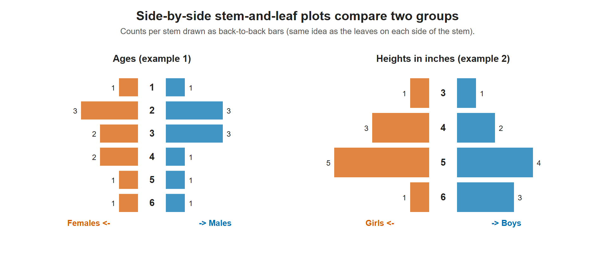

# Lesson 2.7 - Side by Side Stem and Leaf Plots

> **Video:** [Side by Side Stem and Leaf Plots](https://www.youtube.com/watch?v=wkAjnGmRPVo) by The Organic Chemistry Tutor
> **Chapter:** [2 - Graphs and Tables](https://www.video-tutor.net/graphs-and-tables.html)

## Idea

A **side-by-side** (back-to-back) stem-and-leaf plot compares **two groups** that share one stem column:

```
 Group A leaves | Stem | Group B leaves
```

- **Right side:** leaves increase **left → right**, as usual.
- **Left side:** leaves increase **right → left**, going *away* from the stem. Read the left side backwards: `8 | 1` means **18**.

---

## Example 1 - ages of females and males

| Females (leaves) | Stem | Males (leaves) |
|---:|:---:|:---|
| 8 | 1 | 9 |
| 8 7 5 | 2 | 2 6 9 |
| 5 2 | 3 | 5 5 6 |
| 7 3 | 4 | 6 |
| 2 | 5 | 8 |
| 5 | 6 | 3 |

Key: `8 | 1 |` = 18 (female); `| 1 | 9` = 19 (male).

- Males: 19, 22, 26, 29, 35, 35, 36, 46, 58, 63
- Females: 18, 25, 27, 28, 32, 35, 43, 47, 52, 65

On the female side the smallest leaf sits **next to** the stem. For the 20s, the leaves read `8 7 5`, which means 25, 27, 28.



The number of leaves on each side of each stem, drawn as back-to-back bars. The heights example makes the comparison easy to see: the girls cluster in the 50s while the boys spread further into the 60s.

---

## Example 2 - heights (inches) of girls and boys

| Girls (leaves) | Stem | Boys (leaves) |
|---:|:---:|:---|
| 9 | 3 | 7 |
| 8 6 5 | 4 | 7 8 |
| 6 4 3 2 1 | 5 | 1 6 7 8 |
| 0 | 6 | 2 3 5 |

- Girls: 39, 45, 46, 48, 51, 52, 53, 54, 56, 60
- Boys: 37, 47, 48, 51, 56, 57, 58, 62, 63, 65

Comparing the two sides shows that more boys are in the 60s, while the girls are concentrated in the 50s.

---

## Key takeaways

- One shared stem column, with one group's leaves on each side.
- Leaves on the **left** are written in reverse, smallest next to the stem.
- Side-by-side plots make it easy to compare the **center** and **spread** of two groups.
