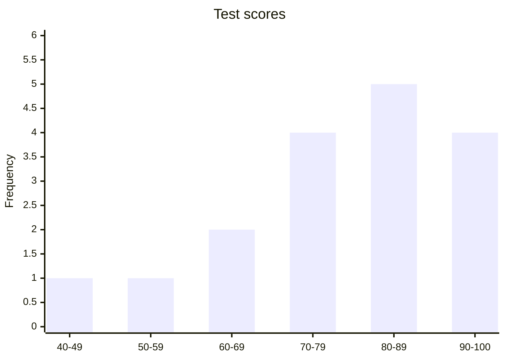

# Lesson 2.8 - How to Make a Histogram Using a Frequency Distribution Table

> **Video:** [How To Make a Histogram Using a Frequency Distribution Table](https://www.youtube.com/watch?v=AndS0RLdxtk) by The Organic Chemistry Tutor
> **Chapter:** [2 - Graphs and Tables](https://www.video-tutor.net/graphs-and-tables.html)

## Steps

1. **Group the data into classes**, ranges of equal width. For test scores, a width of 10 is natural: 40-49, 50-59, ...
2. **Count the frequency** of each class to make a **frequency distribution table**.
3. **Draw the axes:**
   - x-axis (independent variable): the classes, such as the scores.
   - y-axis (dependent variable): the frequency.
4. **Draw a bar for each class**, with height equal to its frequency. The bars **touch**, which is what makes it a histogram rather than a bar graph.

---

## Example - test scores of a class

| Score range | Grade | Frequency |
|---|:---:|---:|
| 40-49 | F | 1 |
| 50-59 | F | 1 |
| 60-69 | D | 2 |
| 70-79 | C | 4 |
| 80-89 | B | 5 |
| 90-100 | A | 4 |
| **Total** | | **17** |

(In a hand-drawn histogram the bars touch each other.)

### Shape and mode

- The bars are short on the left and tall on the right, so the **long tail is on the left**. The data is **skewed left** (negative skew).
- The **modal class** (the class with the highest frequency) is **80-89**.

---

## Answering questions from a histogram

Let $S$ be a student's score.

**1. How many students scored *at most* 69?** "At most 69" means $S \le 69$, so 69 is the maximum.
$$1 + 1 + 2 = 4 \text{ students}$$

**2. How many scored *at least* 80?** "At least 80" means $S \ge 80$, so 80 is the minimum.
$$5 + 4 = 9 \text{ students}$$

**3. How many scored between 60 and 89, inclusive?** "Inclusive" means 60 and 89 are counted.
$$2 + 4 + 5 = 11 \text{ students}$$

> "Between 60 and 89" **exclusive** would mean 61 to 88. Check whether a question says inclusive or exclusive.

---

## Key takeaways

- Build the **frequency distribution table first**, then draw the histogram.
- Histogram bars **touch**; bar-graph bars don't.
- Long tail on the left → skewed left. Long tail on the right → skewed right.
- "At most" = $\le$, "at least" = $\ge$, "inclusive" = endpoints included.
