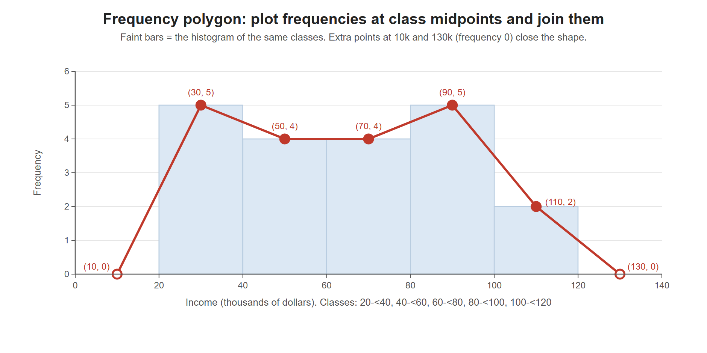

# Lesson 2.9 - How to Make a Frequency Polygon

> **Video:** [How To Make a Frequency Polygon](https://www.youtube.com/watch?v=y7Wb9AjbRjo) by The Organic Chemistry Tutor
> **Chapter:** [2 - Graphs and Tables](https://www.video-tutor.net/graphs-and-tables.html)

## Idea

A **frequency polygon** is a line graph of a frequency distribution. Plot the frequency of each class at the class's **midpoint**, then connect the points with straight lines. Add one extra point **at frequency 0** at each end, so the shape closes onto the x-axis.

## Steps

1. Make a **frequency distribution table** with equal-width classes.
2. Find each class **midpoint**: $\text{midpoint} = \dfrac{\text{lower bound} + \text{upper bound}}{2}$
3. Add one **extra midpoint below** the first (first − class width) and one **above** the last (last + class width), each with frequency **0**.
4. Plot (midpoint, frequency) and connect the dots with straight lines.

---

## Example - incomes in a town (class width $20k)

**Class boundaries.** Each class includes its lower bound but **not** its upper bound, so an income of exactly $40k goes in the 40k-60k class:

$$20 \le I < 40, \quad 40 \le I < 60, \quad \dots$$

No income is below $20k, and the highest is $115k, so the classes run from 20k to 120k.

| Income range (k = $1,000) | Frequency | Midpoint |
|---|---:|---:|
| 20k - < 40k | 5 | 30k |
| 40k - < 60k | 4 | 50k |
| 60k - < 80k | 4 | 70k |
| 80k - < 100k | 5 | 90k |
| 100k - < 120k | 2 | 110k |
| **Total** | **20** | |

For example, the 20k-40k class contains 32k, 25k, 39k, 26k and 25k, so its frequency is 5, and its midpoint is $(20 + 40)/2 = 30$k.

**Extra end points:** $30 - 20 = 10$k and $110 + 20 = 130$k, both with frequency 0.

| Midpoint | 10k | 30k | 50k | 70k | 90k | 110k | 130k |
|---|---:|---:|---:|---:|---:|---:|---:|
| Frequency | 0 | 5 | 4 | 4 | 5 | 2 | 0 |

Each point sits at a class **midpoint**, at the height of that class's bar. The two hollow points at 10k and 130k have frequency 0 and bring the polygon down to the axis at both ends.

---

## Key takeaways

- Plot frequencies at **class midpoints**, not at class edges.
- Add one point with **frequency 0** on each side (one class width beyond the first and last midpoints) so the polygon starts and ends on the x-axis.
- State clearly which class a boundary value such as 40k belongs to. A common convention is $[\text{lower}, \text{upper})$.
