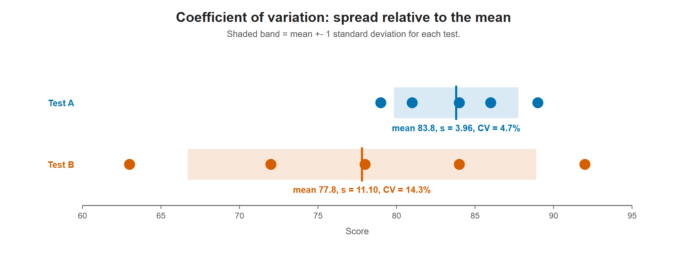

# Lesson 3.12 - Standard Deviation and Coefficient of Variation

> **Video:** [Standard Deviation and Coefficient of Variation](https://www.youtube.com/watch?v=PsJ_NgDUayI) by The Organic Chemistry Tutor
> **Chapter:** [3 - Central Tendency](https://www.video-tutor.net/central-tendency-and-variation.html)

## Formulas

**Coefficient of variation (CV):** the standard deviation as a percentage of the mean.

$$\text{CV}_{\text{sample}} = \frac{s}{\bar x} \times 100\%, \qquad \text{CV}_{\text{population}} = \frac{\sigma}{\mu} \times 100\%$$

**Standard deviation:**

$$s = \sqrt{\frac{\sum (x - \bar x)^2}{n - 1}}, \qquad \sigma = \sqrt{\frac{\sum (x - \mu)^2}{N}}$$

A CV of 20% means the standard deviation is 20% of the mean.

## Why use the CV?

- The standard deviation measures how spread out the data is around the mean.
- The CV does the same, but **relative to the mean**, and it has **no units**: in $s/\bar x$, feet divided by feet cancel.
- That makes the CV better for **comparing the variability of different data sets**, especially ones with different means or units.

---

## Example - which test has more variation?

Ten students: five took test A and five took test B.

- **Test A:** 79, 84, 86, 81, 89
- **Test B:** 63, 72, 92, 84, 78

### Step 1 - means

$$\bar x_A = \frac{419}{5} = 83.8, \qquad \bar x_B = \frac{389}{5} = 77.8$$

### Step 2 - standard deviations

**Test A:**

| $x$ | $x - 83.8$ | squared |
|---:|---:|---:|
| 79 | −4.8 | 23.04 |
| 84 | 0.2 | 0.04 |
| 86 | 2.2 | 4.84 |
| 81 | −2.8 | 7.84 |
| 89 | 5.2 | 27.04 |
| **Sum** | | **62.80** |

$$s_A = \sqrt{\frac{62.8}{4}} = \sqrt{15.7} \approx 3.962$$

**Test B:**

| $x$ | $x - 77.8$ | squared |
|---:|---:|---:|
| 63 | −14.8 | 219.04 |
| 72 | −5.8 | 33.64 |
| 92 | 14.2 | 201.64 |
| 84 | 6.2 | 38.44 |
| 78 | 0.2 | 0.04 |
| **Sum** | | **492.80** |

$$s_B = \sqrt{\frac{492.8}{4}} = \sqrt{123.2} \approx 11.10$$

### Step 3 - coefficients of variation

$$\text{CV}_A = \frac{3.962}{83.8} \times 100\% \approx 4.7\%$$

$$\text{CV}_B = \frac{11.10}{77.8} \times 100\% \approx 14.3\%$$

**Conclusion:** test B's scores vary much more relative to their mean (14.3% vs 4.7%).

Test B's scores are far more spread out. Its band (mean +- s) is almost three times as wide, and relative to its mean its spread is 14.3% versus 4.7% for test A.

---

## Key takeaways

- CV = SD ÷ mean × 100%.
- The CV is **unitless**, so it is the right tool for comparing the spread of data sets with different scales.
- Calculate the standard deviation first, then divide by the mean.
