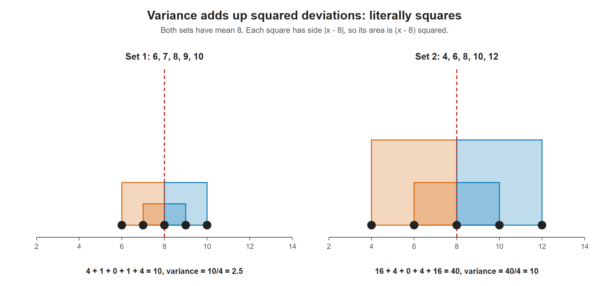

# Lesson 3.13 - How to Calculate Variance

> **Video:** [How To Calculate Variance](https://www.youtube.com/watch?v=deIQeQzPK08) by The Organic Chemistry Tutor
> **Chapter:** [3 - Central Tendency](https://www.video-tutor.net/central-tendency-and-variation.html)

## Formula (sample variance)

$$s^2 = \frac{\sum (x - \bar x)^2}{n - 1}$$

The variance is the **square of the standard deviation**, so it is the same calculation without the final square root.

---

## Example 1

Data: 6, 9, 14, 10, 5, 8, 11 → sorted: 5, 6, 8, 9, 10, 11, 14 ($n = 7$)

**Mean:** $\bar x = \dfrac{63}{7} = 9$

| $x$ | $x - \bar x$ | $(x - \bar x)^2$ |
|---:|---:|---:|
| 5 | −4 | 16 |
| 6 | −3 | 9 |
| 8 | −1 | 1 |
| 9 | 0 | 0 |
| 10 | 1 | 1 |
| 11 | 2 | 4 |
| 14 | 5 | 25 |
| **Sum** | 0 | **56** |

$$s^2 = \frac{56}{7 - 1} = \frac{56}{6} \approx 9.33$$

---

## What variance tells you

Variance measures **spread**: how far the data lies from the mean. A **larger variance means the data is more spread out**.

### Example 2 - same mean, different spread

| Data set 1 | Data set 2 |
|---|---|
| 6, 7, 8, 9, 10 | 4, 6, 8, 10, 12 |
| mean = 40/5 = **8** | mean = 40/5 = **8** |

On a number line, both sets are centered at 8. Set 1 runs from 6 to 10, while set 2 is more spread out, from 4 to 12.

```
Set 1:          •  •  •  •  •
Set 2:    •     •     •     •     •
       ---+--+--+--+--+--+--+--+--+---
          4  5  6  7  8  9 10 11 12
```

**Set 1:**
$$s^2 = \frac{2^2 + 1^2 + 0^2 + 1^2 + 2^2}{4} = \frac{10}{4} = 2.5$$

**Set 2:**
$$s^2 = \frac{4^2 + 2^2 + 0^2 + 2^2 + 4^2}{4} = \frac{40}{4} = 10$$

Set 2's variance is four times larger, because its points sit farther from the mean.



Each squared deviation is drawn as an actual square with side |x - 8|. Doubling the distances in Set 2 makes every square four times bigger, so the variance rises from 2.5 to 10.

---

## Key takeaways

- Sample variance: square each deviation, add them, divide by $n - 1$.
- Variance = SD². Its units are the **square** of the data's units.
- Two data sets can have the **same mean** but **very different variances**.
