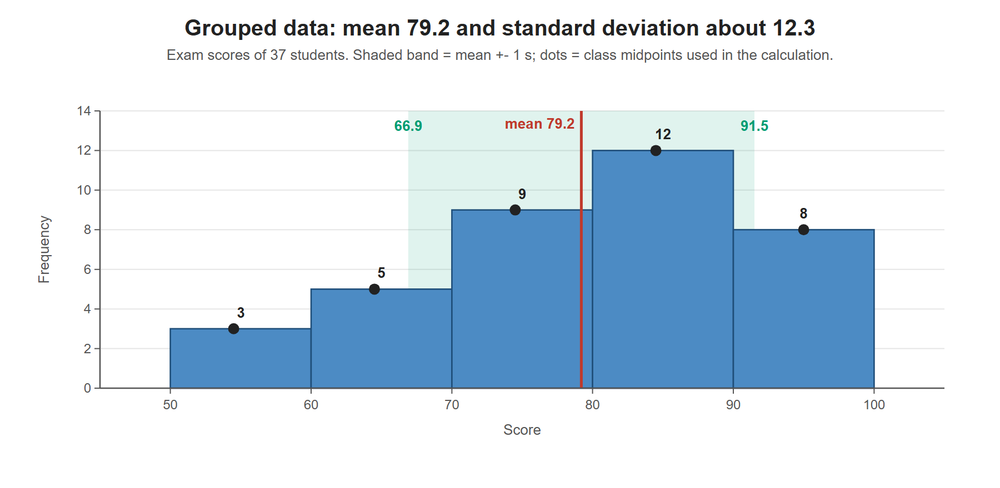

# Lesson 3.15 - Standard Deviation of Grouped Data

> **Video:** [How To Calculate The Standard Deviation of Grouped Data](https://www.youtube.com/watch?v=x6Pnf57wRAs) by The Organic Chemistry Tutor
> **Chapter:** [3 - Central Tendency](https://www.video-tutor.net/central-tendency-and-variation.html)

## Formulas

For grouped data, each class is represented by its **midpoint** $m$ and counted $f$ times:

$$\bar x \approx \frac{\sum f\,m}{\sum f}, \qquad s \approx \sqrt{\frac{\sum f\,(m - \bar x)^2}{n - 1}}, \qquad n = \sum f$$

This is the ordinary sample SD formula, with each midpoint repeated $f$ times.

## Steps

1. Midpoint of each class: $m = (\text{lower} + \text{upper})/2$.
2. Multiply $f \cdot m$, then compute $\bar x = \sum fm / \sum f$.
3. For each class: the deviation $m - \bar x$, its square, then $f \cdot (m - \bar x)^2$.
4. Add the last column, divide by $n - 1$, and take the square root.

---

## Example - exam scores (whole numbers)

The scores are whole numbers, so a value like 69.5 can't occur and the classes don't overlap.

| Score | $f$ | $m$ | $f\,m$ | $m - \bar x$ | $(m - \bar x)^2$ | $f\,(m - \bar x)^2$ |
|---|---:|---:|---:|---:|---:|---:|
| 50-59 (F) | 3 | 54.5 | 163.5 | −24.7 | 610.09 | 1830.27 |
| 60-69 (D) | 5 | 64.5 | 322.5 | −14.7 | 216.09 | 1080.45 |
| 70-79 (C) | 9 | 74.5 | 670.5 | −4.7 | 22.09 | 198.81 |
| 80-89 (B) | 12 | 84.5 | 1014.0 | 5.3 | 28.09 | 337.08 |
| 90-100 (A) | 8 | 95.0 | 760.0 | 15.8 | 249.64 | 1997.12 |
| **Total** | **37** | | **2930.5** | | | **5443.73** |

**Mean:**
$$\bar x = \frac{2930.5}{37} \approx 79.2$$

This makes sense, since most students scored between 70 and 89.

**Standard deviation:**
$$s = \sqrt{\frac{5443.73}{37 - 1}} = \sqrt{151.21} \approx 12.3$$

(The deviations above use the rounded mean 79.2. Using the unrounded mean changes the answer only in later decimals.)

Each class is represented by its midpoint (black dots) when computing the mean and standard deviation. The shaded band from 66.9 to 91.5 is the mean +- 1 standard deviation.

---

## Key takeaways

- Replace each class by its **midpoint**, weighted by its **frequency**.
- $s \approx \sqrt{\sum f(m - \bar x)^2 / (n - 1)}$ with $n = \sum f$.
- The result is an **estimate**, because the actual values inside each class are unknown.
- A spreadsheet or calculator makes the columns much faster to fill in.
