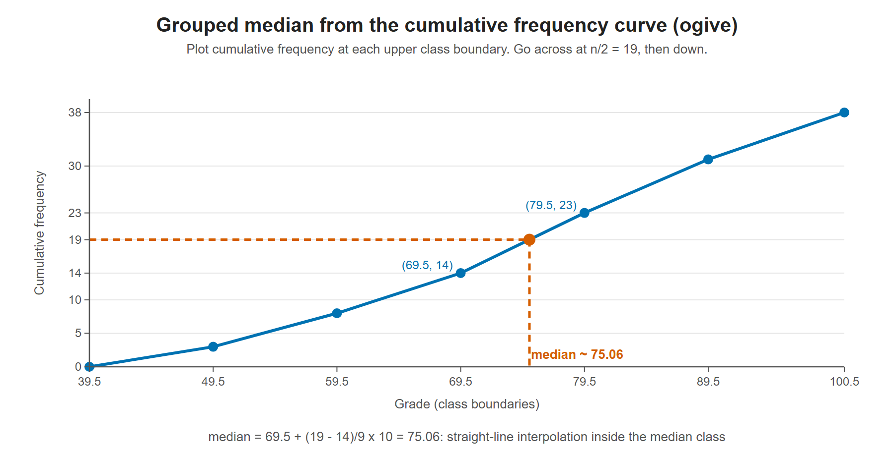

# Lesson 3.16 - How to Calculate the Median of Grouped Data

> **Video:** [How To Calculate the Median of Grouped Data](https://www.youtube.com/watch?v=8tPXYlvbRxA) by The Organic Chemistry Tutor
> **Chapter:** [3 - Central Tendency](https://www.video-tutor.net/central-tendency-and-variation.html)

## Formula

$$\text{median} = L + \left(\frac{\frac{n}{2} - C}{f}\right) h$$

| Symbol | Meaning |
|---|---|
| $L$ | **Lower boundary** of the median class |
| $n$ | Total frequency, $\sum f$ |
| $C$ | **Cumulative frequency of the class before** the median class |
| $f$ | Frequency of the median class |
| $h$ | Class width, **upper boundary − lower boundary** |

### Class boundaries vs class limits

If the classes are written 60-69, 70-79, ..., there is a gap between 69 and 70. The **boundaries** sit halfway across each gap:

- lower boundary of 70-79 = $\dfrac{69 + 70}{2} = 69.5$
- upper boundary of 70-79 = $\dfrac{79 + 80}{2} = 79.5$
- width $h = 79.5 - 69.5 = 10$, **not** $79 - 70 = 9$

---

## Example

| Grade | $f$ | Cumulative $f$ |
|---|---:|---:|
| 40-49 | 3 | 3 |
| 50-59 | 5 | 8 |
| 60-69 | 6 | **14** ← $C$ |
| **70-79** | **9** | 23 ← median class |
| 80-89 | 8 | 31 |
| 90-100 | 7 | 38 |

**Step 1 - find the median class.** $n = 38$ and $n/2 = 19$. The classes hold the scores in positions 1-3, 4-8, 9-14 and **15-23**, ... The 19th value is in the **70-79** class.

**Step 2 - collect the values.** $L = 69.5$, $C = 14$, $f = 9$, $h = 10$.

**Step 3 - substitute.**

$$\text{median} = 69.5 + \left(\frac{19 - 14}{9}\right)(10) = 69.5 + \frac{50}{9} \approx 69.5 + 5.56 = 75.06$$

The median is about **75.1**, which is inside the median class 70-79 as it should be.

> **Correction to the video:** the video gives 75.5 (repeating) as the result. But $50/9 \approx 5.56$ and $69.5 + 5.56 \approx 75.06$, so the correct median is about **75.06**.

The formula is the same as reading the cumulative frequency curve. Go across from n/2 = 19 to the curve, then straight down. The median lands about 5/9 of the way through the 69.5-79.5 class.

---

## Key takeaways

- Find the **median class** first, using the cumulative frequency to locate position $n/2$.
- Use class **boundaries** (69.5, 79.5) for $L$ and $h$ when there are gaps between class limits.
- $C$ is the cumulative frequency **before** the median class, not including it.
- Check that the answer lies inside the median class.
