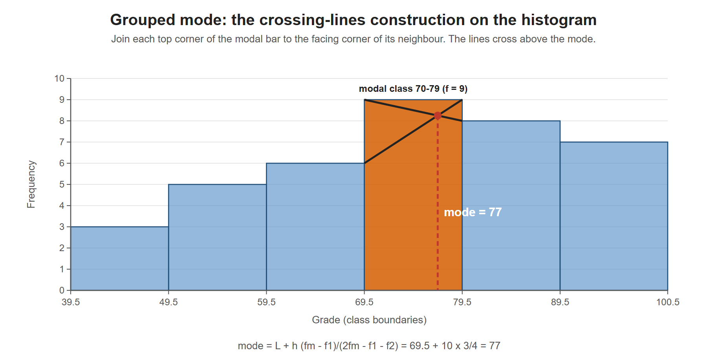

# Lesson 3.17 - How to Calculate the Mode of Grouped Data

> **Video:** [How To Calculate the Mode of Grouped Data](https://www.youtube.com/watch?v=Sqkhzdn1eOU) by The Organic Chemistry Tutor
> **Chapter:** [3 - Central Tendency](https://www.video-tutor.net/central-tendency-and-variation.html)

## Formula

$$\text{mode} = L + h\left(\frac{f_m - f_1}{2f_m - f_1 - f_2}\right)$$

| Symbol | Meaning |
|---|---|
| $L$ | **Lower boundary** of the modal class |
| $h$ | Class width (upper boundary − lower boundary) |
| $f_m$ | Frequency of the **modal class** (the highest frequency) |
| $f_1$ | Frequency of the class **before** the modal class |
| $f_2$ | Frequency of the class **after** the modal class |

---

## Example

| Grade | $f$ |
|---|---:|
| 40-49 | 3 |
| 50-59 | 5 |
| 60-69 | 6 ← $f_1$ |
| **70-79** | **9** ← $f_m$ (modal class) |
| 80-89 | 8 ← $f_2$ |
| 90-100 | 7 |

**Values.** $L = 69.5$ (halfway between 69 and 70), $h = 79.5 - 69.5 = 10$, $f_m = 9$, $f_1 = 6$, $f_2 = 8$.

$$\text{mode} = 69.5 + 10\left(\frac{9 - 6}{2(9) - 6 - 8}\right) = 69.5 + 10\left(\frac{3}{4}\right) = 69.5 + 7.5 = 77$$

**Does it make sense?** 77 lies in the modal class 70-79, and it is nearer 79 than 70. The class after the modal class has a higher frequency (8) than the class before it (6), so the mode is pulled toward the upper end.

A graphical version of the formula. The two lines joining the modal bar to its neighbours cross at grade 77. The mode leans toward 79.5 because the next class (8) is taller than the previous one (6).

---

## Key takeaways

- The modal class is the one with the **highest frequency**.
- Use **boundaries** for $L$ and $h$: 69.5 and a width of 10, not 70 and 9.
- The formula shifts the mode toward whichever neighboring class has the larger frequency.
