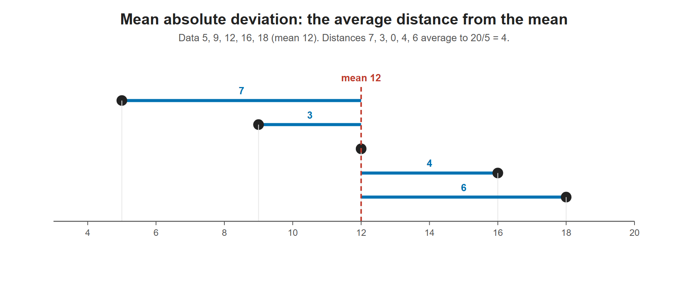

# Lesson 3.18 - Mean Absolute Deviation

> **Video:** [Mean Absolute Deviation](https://www.youtube.com/watch?v=K4heM9mSrw0) by The Organic Chemistry Tutor
> **Chapter:** [3 - Central Tendency](https://www.video-tutor.net/central-tendency-and-variation.html)

## Idea

The **mean absolute deviation (MAD)** is the **average distance** of the data values from the mean.

$$\text{MAD} = \frac{\sum |x - \bar x|}{n}$$

## Steps

1. Find the mean $\bar x$.
2. Find each deviation $x - \bar x$.
3. Take **absolute values**, so all distances are positive.
4. Add them and divide by $n$.

---

## Example 1 - with a table

Data: 7, 11, 14, 19, 22, 29

**Mean:** $\bar x = \dfrac{102}{6} = 17$

| $x$ | $x - \bar x$ | $\lvert x - \bar x \rvert$ |
|---:|---:|---:|
| 7 | −10 | 10 |
| 11 | −6 | 6 |
| 14 | −3 | 3 |
| 19 | 2 | 2 |
| 22 | 5 | 5 |
| 29 | 12 | 12 |
| **Sum** | 0 | **38** |

$$\text{MAD} = \frac{38}{6} = 6\tfrac{1}{3} \approx 6.33$$

Each bar is the distance of one value from the mean of 12. The mean absolute deviation is the average bar length, (7 + 3 + 0 + 4 + 6)/5 = 4.

---

## Example 2 - directly with the formula

Data: 5, 9, 12, 16, 18

**Mean:** $\bar x = \dfrac{60}{5} = 12$

$$\text{MAD} = \frac{|5-12| + |9-12| + |12-12| + |16-12| + |18-12|}{5} = \frac{7 + 3 + 0 + 4 + 6}{5} = \frac{20}{5} = 4$$

### What it means

Each absolute deviation is a distance from the mean 12 on the number line:

| Value | 5 | 9 | 12 | 16 | 18 |
|---|---:|---:|---:|---:|---:|
| Distance from 12 | 7 | 3 | 0 | 4 | 6 |

The MAD is the average of these five distances: $(7 + 3 + 0 + 4 + 6)/5 = 4$. On average, each value is **4 units** from the mean.

---

## Key takeaways

- MAD = average of the **absolute** deviations from the mean.
- Absolute values are needed because the plain deviations always add up to **zero** (see Lesson 3.19).
- MAD is easier to interpret than the standard deviation (no squaring), but the SD is used more often in later statistics.
