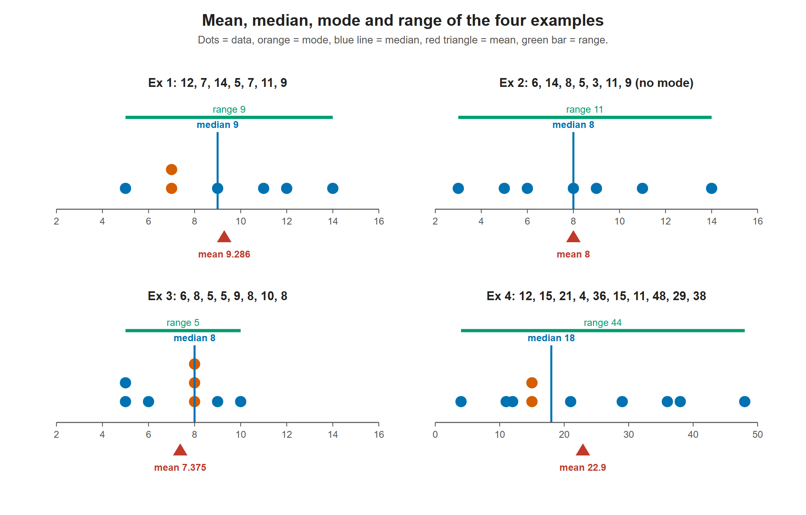

# Lesson 3.2 - Mean, Median, Mode, and Range

> **Video:** [Mean, Median, Mode, and Range - How To Find It!](https://www.youtube.com/watch?v=A1mQ9kD-i9I) by The Organic Chemistry Tutor
> **Chapter:** [3 - Central Tendency](https://www.video-tutor.net/central-tendency-and-variation.html)

## Definitions

| Measure | Rule |
|---|---|
| **Mean** (arithmetic mean, average) | Sum of the values ÷ number of values |
| **Median** | Middle value of the **sorted** data. Even $n$: average of the two middle values |
| **Mode** | Value that appears most often. It can have **no mode** or **several modes** |
| **Range** | Highest − lowest |

**Finding the median by hand:** sort the data, then cross off the first and last values, then the next pair, and so on, until one value (odd $n$) or two values (even $n$) are left.

---

## Example 1 - odd $n$ (7 values)

Data: 12, 7, 14, 5, 7, 11, 9 → sorted: 5, 7, 7, **9**, 11, 12, 14

- Mean: $\dfrac{65}{7} \approx 9.29$
- Median: **9**
- Mode: **7** (the only value that appears twice)
- Range: $14 - 5 = 9$

All four examples on number lines. In Example 2 every value appears once, so there is no mode. In Example 4 the large values (36, 38, 48) pull the mean (22.9) well to the right of the median (18).

## Example 2 - odd $n$, no mode

Data: 6, 14, 8, 5, 3, 11, 9 → sorted: 3, 5, 6, **8**, 9, 11, 14

- Mean: $\dfrac{56}{7} = 8$
- Median: **8**
- Mode: **none**, since every value appears once
- Range: $14 - 3 = 11$

## Example 3 - even $n$ (8 values)

Data: 6, 8, 5, 5, 9, 8, 10, 8 → sorted: 5, 5, 6, **8, 8**, 8, 9, 10

- Mean: $\dfrac{59}{8} = 7.375$
- Mode: **8** (appears three times)
- Median: the two middle values are both 8 → $\dfrac{8+8}{2} = 8$
- Range: $10 - 5 = 5$

## Example 4 - even $n$ (10 values)

Data: 12, 15, 21, 4, 36, 15, 11, 48, 29, 38
Sorted: 4, 11, 12, 15, **15, 21**, 29, 36, 38, 48

- Mean: $\dfrac{229}{10} = 22.9$
- Mode: **15**
- Median: $\dfrac{15 + 21}{2} = 18$, the midpoint of the two middle values
- Range: $48 - 4 = 44$

---

## Key takeaways

- **Sort first.** It makes the median, mode and range easy.
- Odd $n$: the median is a data value. Even $n$: the median is the **average of the two middle values**, which may not be in the data.
- A data set can have **no mode** (all values different) or **more than one** mode.
