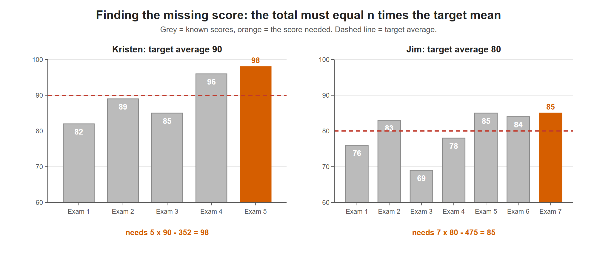

# Lesson 3.5 - How to Find the Missing Value Given the Mean

> **Video:** [How To Find The Missing Value Given The Mean](https://www.youtube.com/watch?v=l8KrAo089_U) by The Organic Chemistry Tutor
> **Chapter:** [3 - Central Tendency](https://www.video-tutor.net/central-tendency-and-variation.html)

## Idea

If you know the **target mean** and all values except one, you can solve for the missing value.

$$\bar x = \frac{x_1 + x_2 + \dots + x_n}{n} \quad\Longrightarrow\quad x_n = n\,\bar x - (x_1 + x_2 + \dots + x_{n-1})$$

In words: **missing value = (number of values × desired mean) − (sum of the known values).**

$n\bar x$ is the **total** the scores must add up to. Subtract what you already have, and the remainder is the value you need.

---

## Example 1 - what score is needed on exam 5?

Kristen scored **82, 89, 85, 96** on her first four chemistry exams. What does she need on the fifth exam to average **90**?

$$90 = \frac{82 + 89 + 85 + 96 + x_5}{5}$$

Multiply both sides by 5:

$$450 = 352 + x_5 \quad\Rightarrow\quad x_5 = 450 - 352 = 98$$

She needs a **98**.

The needed score (orange) has to make up for the scores below the target line and use up the room left by the scores above it, so that the bars balance at the target average.

---

## Example 2 - what score is needed on exam 7?

Jim's first six exam scores are **76, 83, 69, 78, 85, 84**. What does he need on the seventh exam to average **80**?

$$x_7 = 7(80) - (76 + 83 + 69 + 78 + 85 + 84) = 560 - 475 = 85$$

He needs an **85**.

---

## Key takeaways

- Required total = $n \times$ target mean.
- Missing value = required total − sum of the known values.
- If the answer is above the maximum possible score (e.g. over 100), the target average cannot be reached.
