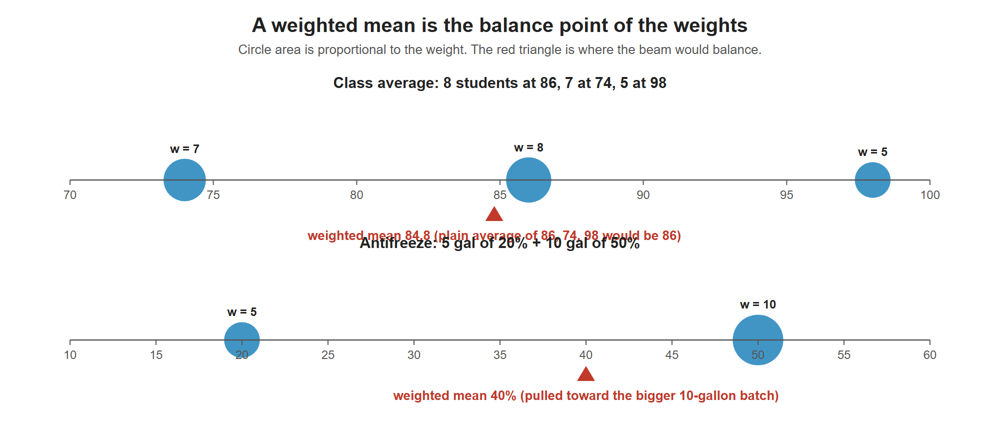

# Lesson 3.6 - How to Find the Weighted Mean

> **Video:** [How To Find The Weighted Mean and Weighted Average In Statistics](https://www.youtube.com/watch?v=LdrBNhWw9AM) by The Organic Chemistry Tutor
> **Chapter:** [3 - Central Tendency](https://www.video-tutor.net/central-tendency-and-variation.html)

## Formula

$$\bar x_w = \frac{\sum w x}{\sum w} = \frac{w_1x_1 + w_2x_2 + \dots + w_nx_n}{w_1 + w_2 + \dots + w_n}$$

- $x$ = the values you want to average.
- $w$ = the **weight** of each value: a frequency, a count of people, a percentage, credit hours, a volume, ...
- If the weights are percentages that add to 100% (or decimals that add to 1), the denominator is 1 and you only need the numerator.

> **How to decide which is $x$ and which is $w$:** $x$ is the thing you want the *average of*. $w$ is *how much each one counts*.

Picture each value as a weight on a beam. The weighted mean is where the beam balances, so it moves toward the heavier weights: 84.8 instead of 86 for the class averages, and 40% instead of 35% for the antifreeze mixture.

---

## Example 1 - a weighted mean with frequencies as weights

Data (10 values): one 10, one 12, four 16s, three 20s, one 24.

Ordinary mean: $\dfrac{170}{10} = 17$

Weighted mean, using frequencies as weights:

$$\bar x_w = \frac{1(10) + 1(12) + 4(16) + 3(20) + 1(24)}{1 + 1 + 4 + 3 + 1} = \frac{170}{10} = 17$$

The two give the same answer: a mean computed from a frequency table **is** a weighted mean.

---

## Example 2 - combining group averages

In a class of 20: 8 students averaged 86, 7 averaged 74, and 5 averaged 98. What is the class average?

$$\bar x_w = \frac{8(86) + 7(74) + 5(98)}{8 + 7 + 5} = \frac{688 + 518 + 490}{20} = \frac{1696}{20} = 84.8$$

> Averaging 86, 74 and 98 directly gives 86, which is wrong because the groups are different sizes.

---

## Example 3 - percentages as weights

At a college, 20% of students average 140 lb, 35% average 160 lb, 30% average 175 lb, and 15% average 195 lb.

$$\bar x_w = 0.20(140) + 0.35(160) + 0.30(175) + 0.15(195) = 28 + 56 + 52.5 + 29.25 = 165.75 \text{ lb}$$

(The weights add to $1$, so there is nothing to divide by.)

---

## Example 4 - final semester grade

| Category | Weight | John | Kelly |
|---|---:|---:|---:|
| Homework | 15% | 92 | 100 |
| Quizzes | 10% | 74 | 82 |
| Lab | 20% | 83 | 95 |
| Tests | 25% | 76 | 70 |
| Final exam | 30% | 88 | 76 |

**John:** $0.15(92) + 0.10(74) + 0.20(83) + 0.25(76) + 0.30(88) = 13.8 + 7.4 + 16.6 + 19 + 26.4 = \mathbf{83.2}$

**Kelly:** $0.15(100) + 0.10(82) + 0.20(95) + 0.25(70) + 0.30(76) = 15 + 8.2 + 19 + 17.5 + 22.8 = \mathbf{82.5}$

Kelly did better on homework, quizzes and lab, but those are only **45%** of the grade. John did better on tests and the final, which are **55%**, so his weighted grade is slightly higher.

---

## Example 5 - grade point average (GPA)

Points: A = 4, B = 3, C = 2. Weights = credit hours.

| Course | Credit hours $w$ | Grade | Points $x$ | $w \cdot x$ |
|---|---:|:---:|---:|---:|
| Chemistry | 3 | B | 3 | 9 |
| Physics | 3 | C | 2 | 6 |
| Lab | 1 | A | 4 | 4 |
| Calculus | 4 | A | 4 | 16 |
| English | 3 | B | 3 | 9 |
| **Total** | **14** | | | **44** |

$$\text{GPA} = \frac{44}{14} \approx 3.14$$

---

## Example 6 - mixing solutions

Rachel mixes **5 gal of 20%** antifreeze with **10 gal of 50%** antifreeze. Is the mixture closer to 20% or 50%?

- An equal-weight average would be 35%.
- The 50% solution has more volume, so it carries more weight. The answer must be between 35% and 50%.

$$C = \frac{5(20\%) + 10(50\%)}{5 + 10} = \frac{100 + 500}{15} = \frac{600}{15} = 40\%$$

The mixture is **40%**, closer to 50% as predicted. The gallons cancel, leaving a percentage.

---

## Key takeaways

- Weighted mean = $\sum wx / \sum w$.
- Use it whenever the values **don't count equally**: group averages, course grades, GPA, mixtures.
- The weighted mean is pulled toward the values with the **largest weights**.
