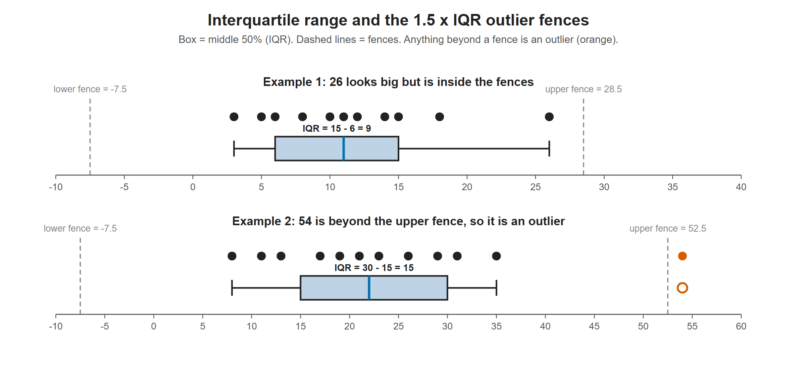

# Lesson 4.2 - How to Find the Interquartile Range

> **Video:** [How To Find The Interquartile Range & any Outliers](https://www.youtube.com/watch?v=STSP8gTSdT8) by The Organic Chemistry Tutor
> **Chapter:** [4 - Measures of Position](https://www.video-tutor.net/measures-of-position.html)

## Key ideas

```
min          Q1           Q2           Q3          max
 |-----------|------------|------------|-----------|
 0th        25th         50th         75th       100th percentile
             <------ middle 50% (IQR) ----->
```

- $Q_2$ = median of all the data (50th percentile).
- $Q_1$ = median of the **lower half** (25th percentile). $Q_3$ = median of the **upper half** (75th percentile).
- **Interquartile range:** $\text{IQR} = Q_3 - Q_1$. It is the spread of the **middle 50%** of the data.

### Outlier test (1.5 × IQR rule)

$$\text{lower fence} = Q_1 - 1.5\,\text{IQR}, \qquad \text{upper fence} = Q_3 + 1.5\,\text{IQR}$$

Any data value **outside** $[\text{lower fence}, \text{upper fence}]$ is an **outlier**.

---

## Example 1 - odd $n$, no outlier

Data: 5, 8, 15, 26, 10, 18, 3, 12, 6, 14, 11

Sorted: 3, 5, **6**, 8, 10, **11**, 12, 14, **15**, 18, 26 ($n = 11$)

- $Q_2 = 11$ (the middle value, left out of both halves)
- $Q_1$ = median of 3, 5, 6, 8, 10 = **6**
- $Q_3$ = median of 12, 14, 15, 18, 26 = **15**
- $\text{IQR} = 15 - 6 = 9$

**Fences:** $6 - 1.5(9) = 6 - 13.5 = -7.5$ and $15 + 1.5(9) = 15 + 13.5 = 28.5$

26 looks large, but it is inside $[-7.5, 28.5]$, so it is **not an outlier**. A value of 29 would have been one.



The box spans the IQR (the middle 50% of the data) and the dashed fences sit 1.5 IQR beyond each end of it. In Example 1 every value, including 26, is inside the fences. In Example 2, 54 is past the upper fence of 52.5, so it is drawn as a separate outlier point.

---

## Example 2 - even $n$, one outlier

Data: 11, 31, 21, 19, 8, 54, 35, 26, 23, 13, 29, 17

Sorted: 8, 11, 13 | 17, 19, 21 ‖ 23, 26, 29 | 31, 35, 54 ($n = 12$)

- $Q_2 = \dfrac{21 + 23}{2} = 22$
- $Q_1 = \dfrac{13 + 17}{2} = 15$ (lower half: 8, 11, 13, 17, 19, 21)
- $Q_3 = \dfrac{29 + 31}{2} = 30$ (upper half: 23, 26, 29, 31, 35, 54)
- $\text{IQR} = 30 - 15 = 15$

**Fences:** $15 - 22.5 = -7.5$ and $30 + 22.5 = 52.5$

54 is above 52.5, so **54 is an outlier** ✓.

---

## Key takeaways

- Sort the data → find $Q_2$ → find $Q_1$ and $Q_3$ from the two halves → IQR = $Q_3 - Q_1$.
- With even $n$ (or an even-sized half), average the two middle values.
- Outlier fences: $Q_1 - 1.5\,\text{IQR}$ and $Q_3 + 1.5\,\text{IQR}$. Check any value that "looks" extreme against them.
