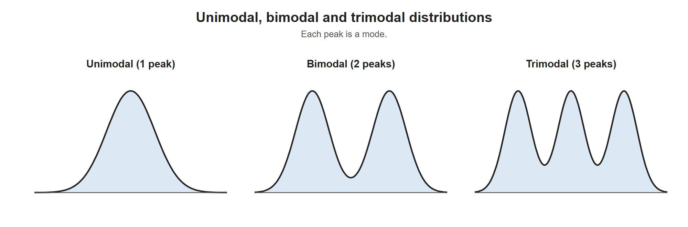
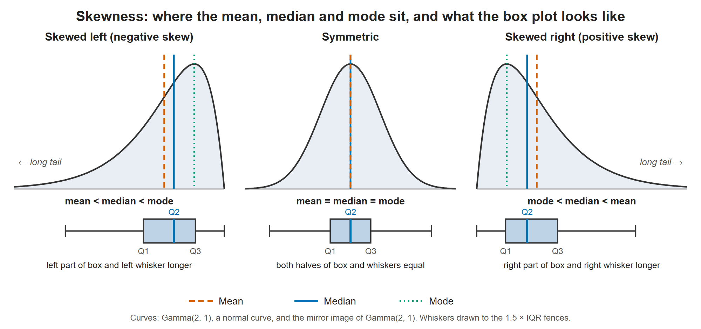
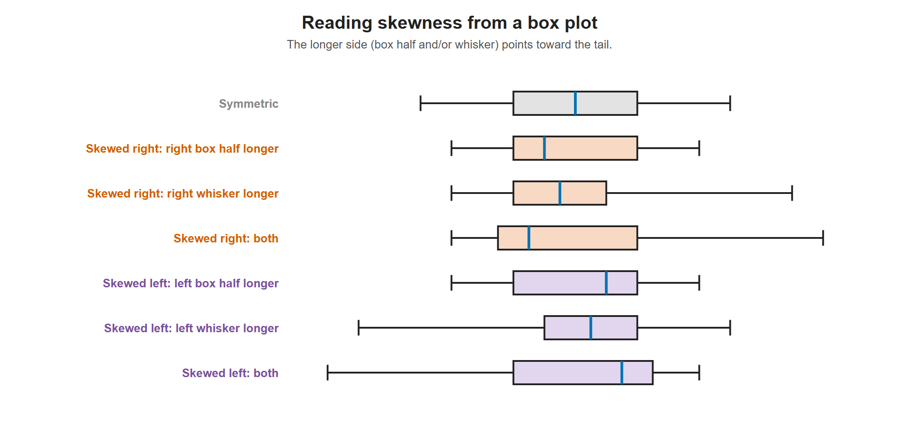

# Lesson 4.5 - Skewness with Box Plots

> **Video:** [Skewness - Right, Left & Symmetric Distribution - Mean, Median, & Mode With Boxplots](https://www.youtube.com/watch?v=U0NZu6f5TMI) by The Organic Chemistry Tutor
> **Chapter:** [4 - Measures of Position](https://www.video-tutor.net/measures-of-position.html)

## Number of modes

The **mode** is the value with the highest frequency, which is the **peak** of the distribution.

| Shape | Peaks | Name |
|---|---:|---|
| One peak | 1 | **Unimodal** |
| Two peaks | 2 | **Bimodal** |
| Three peaks | 3 | **Trimodal** (or, in general, **multimodal**) |



The number of peaks gives the number of modes.

---

## The three shapes (unimodal distributions)

| Shape | Tail | Order of mean, median, mode |
|---|---|---|
| **Symmetric** | Left and right sides mirror each other | mean = median = mode |
| **Skewed right** (positive skew) | Long tail to the **right** | mode < median < **mean** |
| **Skewed left** (negative skew) | Long tail to the **left** | **mean** < median < mode |

Reading left to right along the x-axis:

- **Skewed right:** peak (mode) → median → mean → long tail on the right
- **Skewed left:** long tail on the left → mean → median → peak (mode)

> **Memory aid:** the **mean is pulled toward the tail**. The mode stays at the peak, and the median sits between them.



Where the mean, median and mode fall for each shape, with the matching box plot underneath. The mean is always pulled toward the tail.

---

## Reading skewness from a box plot

Let the left part of the box be $Q_2 - Q_1$ and the right part be $Q_3 - Q_2$.

### Symmetric

```
|-------[=====|=====]-------|
```

- $Q_3 - Q_2 = Q_2 - Q_1$ (equal halves of the box)
- Whiskers of equal length

### Skewed right (positive)

Any of these indicates right skew:

```
(a) right half of box longer:       |----[==|=======]----|
(b) equal box halves, longer right
    whisker:                        |--[====|====]----------|
(c) both:                           |--[==|========]------------|
```

- $Q_3 - Q_2 > Q_2 - Q_1$, and/or the right whisker is longer.

### Skewed left (negative)

```
(a) left half of box longer:        |----[=======|==]----|
(b) equal box halves, longer left
    whisker:                        |----------[====|====]--|
(c) both:                           |------------[========|==]--|
```

- $Q_2 - Q_1 > Q_3 - Q_2$, and/or the left whisker is longer.



The three ways a box plot can show skew: a longer box half, a longer whisker, or both. The longer side always points toward the tail.

---

## Key takeaways

- Unimodal, bimodal, multimodal = one, two, many peaks.
- Symmetric: mean = median = mode.
- Right skew: mean > median > mode. Left skew: mean < median < mode.
- On a box plot, the **longer side** (box half and/or whisker) points in the direction of the skew.
