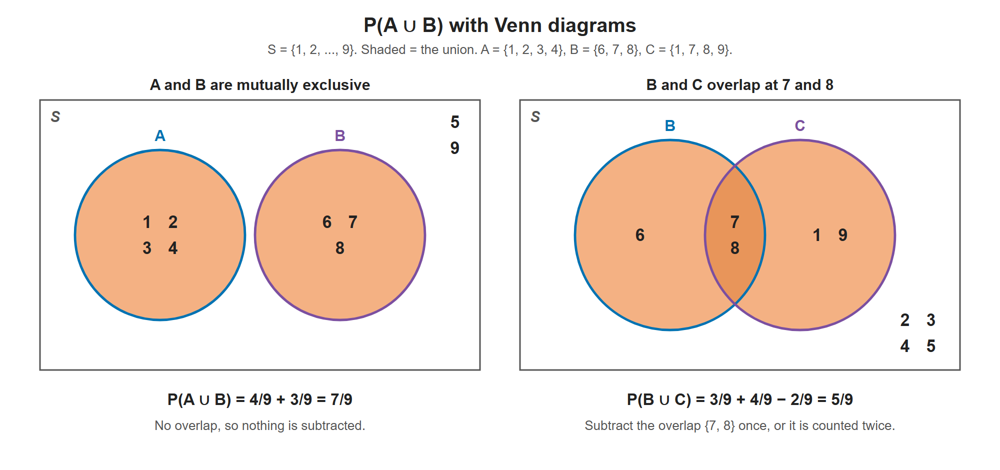

# Lesson 5.2 - Probability Formulas

> **Video:** [Probability Formulas, Symbols & Notations - Marginal, Joint, & Conditional Probabilities](https://www.youtube.com/watch?v=bddckR734aM) by The Organic Chemistry Tutor
> **Chapter:** [5 - Introduction to Probability](https://www.video-tutor.net/introduction-to-probability.html)

This lesson collects the main probability formulas and symbols in one place. All examples use this setup:

- Sample space $S = \{1, 2, 3, 4, 5, 6, 7, 8, 9\}$
- $A = \{1, 2, 3, 4\}$, $\quad B = \{6, 7, 8\}$, $\quad C = \{1, 7, 8, 9\}$

---

## 1. Marginal probability - a single event

The probability of **one** event, regardless of any others:

$$P(A) = \frac{\text{favorable outcomes}}{\text{total outcomes}}$$

- $P(A) = \tfrac49 \approx 0.444$ (44.4%)
- $P(B) = \tfrac39 = \tfrac13 \approx 0.333$ (33.3%)
- $P(C) = \tfrac49 \approx 0.444$ (44.4%)

---

## 2. Union and intersection symbols

| Symbol | Name | Meaning | Example |
|---|---|---|---|
| $A \cup B$ | Union | Everything in $A$ **or** $B$ (or both), listed once | $B \cup C = \{1, 6, 7, 8, 9\}$ |
| $A \cap B$ | Intersection | Only what is in **both** $A$ **and** $B$ | $B \cap C = \{7, 8\}$ |

$A \cap B = \varnothing$ (no shared elements), so $A$ and $B$ are **mutually exclusive**.

---

## 3. Union probability - $P(A \cup B)$ (addition rule)

$P(A \cup B)$ is read "the probability of $A$ **or** $B$" (at least one of them happens).

$$\begin{aligned}
\text{Words:}\quad & P(A \text{ or } B) = P(A) + P(B) - P(A \text{ and } B) \\
\text{Symbols:}\quad & P(A \cup B) = P(A) + P(B) - P(A \cap B)
\end{aligned}$$

The subtraction stops the overlap $A \cap B$ from being counted **twice**.

**Mutually exclusive events** can't happen together, so $A \cap B = \varnothing$ and $P(A \cap B) = 0$:

$$\begin{aligned}
\text{Words:}\quad & P(A \text{ or } B) = P(A) + P(B) \\
\text{Symbols:}\quad & P(A \cup B) = P(A) + P(B)
\end{aligned}$$

**Example - $A \cup B$ (mutually exclusive):** $A \cup B = \{1, 2, 3, 4, 6, 7, 8\}$

$$P(A \cup B) = \frac79 \approx 0.778 \quad\left(= \tfrac49 + \tfrac39\right)$$

**Example - $B \cup C$ (they overlap at 7 and 8):** $B \cap C = \{7, 8\}$, so $P(B \cap C) = \tfrac29$

$$P(B \cup C) = P(B) + P(C) - P(B \cap C) = \frac39 + \frac49 - \frac29 = \frac59$$

Check by listing: $B \cup C = \{1, 6, 7, 8, 9\}$ has 5 elements → $\tfrac59$ ✓. Without subtracting $\tfrac29$, the 7 and 8 would be counted twice.

**Venn diagrams:**

```
  A and B (mutually exclusive)          B and C (overlapping)
   ┌───────┐   ┌───────┐              ┌───────┬───┬───────┐
   │1 2 3 4│   │ 6 7 8 │              │   6   │7 8│ 1  9  │
   └───────┘   └───────┘              └───────┴───┴───────┘
       A           B                      B only  B∩C  C only
```



In the left diagram the circles don't touch, so $P(A \cup B)$ is just $\tfrac49 + \tfrac39$. In the right diagram 7 and 8 sit in both circles. Adding $\tfrac39$ and $\tfrac49$ would count them twice, so $P(B \cap C) = \tfrac29$ is subtracted once.

> **Word cue:** "**or**" → $\cup$ → **addition** rule. "**and**" → $\cap$ → **multiplication** rule.

---

## 4. Joint probability - $P(A \cap B)$ (multiplication rule)

$P(A \cap B)$ is read "the probability of $A$ **and** $B$" (both happen):

$$\begin{aligned}
\text{Words:}\quad & P(A \text{ and } B) = P(A \text{ given } B)\,P(B) = P(B \text{ given } A)\,P(A) \\
\text{Symbols:}\quad & P(A \cap B) = P(A \mid B)\,P(B) = P(B \mid A)\,P(A)
\end{aligned}$$

**Independent events** (one does not affect the other): $P(A \mid B) = P(A)$ and $P(B \mid A) = P(B)$, so

$$\begin{aligned}
\text{Words:}\quad & P(A \text{ and } B) = P(A)\,P(B) \\
\text{Symbols:}\quad & P(A \cap B) = P(A)\,P(B)
\end{aligned}$$

### Independent or dependent?

| Situation | Type | Why |
|---|---|---|
| Draw a red marble, **put it back**, then draw a blue one | **Independent** | Replacing the marble restores the bag |
| Draw a red marble, **keep it**, then draw a blue one | **Dependent** | The bag now has one fewer marble, so the second probability changes |
| Toss a coin twice | **Independent** | The first toss doesn't affect the second |

### Notation warning: $P(A \cap B)$ vs $P(AB)$

- $P(A \cap B) = P(B \cap A)$: both happen, no order implied.
- Some books write $P(AB)$ for "**$A$ first, then $B$**" and $P(BA)$ for "**$B$ first, then $A$**". These are **not always equal**.
- Read the context: are the events **simultaneous**, or does one come **before** the other?

---

## 5. Conditional probability - "A given B"

$P(A \mid B)$ is the probability of $A$ **given that $B$ has already happened**:

$$\begin{aligned}
\text{Words:}\quad & P(A \text{ given } B) = \frac{P(A \text{ and } B)}{P(B)}, \qquad P(B \text{ given } A) = \frac{P(A \text{ and } B)}{P(A)} \\[4pt]
\text{Symbols:}\quad & P(A \mid B) = \frac{P(A \cap B)}{P(B)}, \qquad P(B \mid A) = \frac{P(A \cap B)}{P(A)}
\end{aligned}$$

Conditional = joint ÷ marginal.

---

## 6. Bayes' theorem

Replacing $P(A \cap B)$ with $P(B \mid A)\,P(A)$ from the multiplication rule gives

$$P(A \mid B) = \frac{P(B \mid A)\,P(A)}{P(B)}$$

It is the conditional probability formula with the joint probability rewritten.

---

## 7. Negation (complement) probability

$$\begin{aligned}
\text{Words:}\quad & P(\text{not } A) = 1 - P(A) \\
\text{Symbols:}\quad & P(A') = 1 - P(A)
\end{aligned}$$

$P(A')$ is read "the probability of **not** $A$". The complement is also written $A^c$ (the most common form in textbooks), $\bar A$ or $\sim A$.

- $P(A') = 1 - \tfrac49 = \tfrac59$. Check: $S$ has 5 elements outside $A$ (5, 6, 7, 8, 9) ✓
- If $P(B) = 0.35$, then $P(B') = 1 - 0.35 = 0.65$, a 65% chance that $B$ does not occur.

This works because the total probability of all outcomes is 1.

---

## Formula summary

| Type | Words | Symbols |
|---|---|---|
| Marginal | $P(A) = \dfrac{\text{favorable}}{\text{total}}$ | (same) |
| Union (or) | $P(A \text{ or } B) = P(A) + P(B) - P(A \text{ and } B)$ | $P(A \cup B) = P(A) + P(B) - P(A \cap B)$ |
| Union, mutually exclusive | $P(A \text{ or } B) = P(A) + P(B)$ | $P(A \cup B) = P(A) + P(B)$ |
| Joint (and) | $P(A \text{ and } B) = P(A \text{ given } B)P(B) = P(B \text{ given } A)P(A)$ | $P(A \cap B) = P(A \mid B)P(B) = P(B \mid A)P(A)$ |
| Joint, independent | $P(A \text{ and } B) = P(A)P(B)$ | $P(A \cap B) = P(A)P(B)$ |
| Conditional | $P(A \text{ given } B) = \dfrac{P(A \text{ and } B)}{P(B)}$ | $P(A \mid B) = \dfrac{P(A \cap B)}{P(B)}$ |
| Bayes | $P(A \text{ given } B) = \dfrac{P(B \text{ given } A)P(A)}{P(B)}$ | $P(A \mid B) = \dfrac{P(B \mid A)P(A)}{P(B)}$ |
| Complement | $P(\text{not } A) = 1 - P(A)$ | $P(A') = 1 - P(A)$ |
