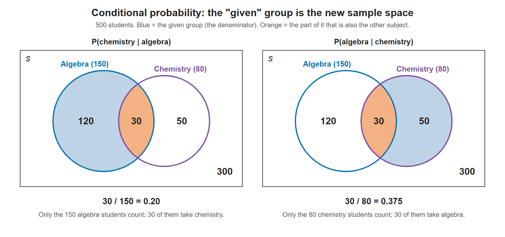
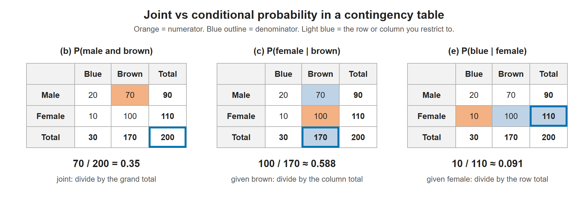

# Lesson 5.4 - Conditional Probability with Venn Diagrams and Contingency Tables

> **Video:** [Conditional Probability With Venn Diagrams & Contingency Tables](https://www.youtube.com/watch?v=sqDVrXq_eh0) by The Organic Chemistry Tutor
> **Chapter:** [5 - Introduction to Probability](https://www.video-tutor.net/introduction-to-probability.html)

## What it means

$P(A \mid B)$ is the probability that $A$ happens **given that $B$ has already happened**.

**Formula:**
$$P(A \mid B) = \frac{P(A \text{ and } B)}{P(B)}$$

**Shortcut:** ask *"how much of $B$ is also $A$?"*

$$P(A \mid B) = \frac{\text{count in both } A \text{ and } B}{\text{count in } B}$$

Once $B$ is known to have happened, $B$ becomes the new sample space.

---

## Example 1 - a die

$S = \{1, \dots, 6\}$, $\;A$ = odd = $\{1, 3, 5\}$, $\;B = \{3, 4, 5\}$

**Shortcut:** of the 3 outcomes in $B$, two (3 and 5) are in $A$:
$$P(A \mid B) = \frac23$$

**Formula:**
$$P(A \mid B) = \frac{P(A \cap B)}{P(B)} = \frac{2/6}{3/6} = \frac23 \;✓$$

---

## Example 2 - Venn diagram (algebra and chemistry)

A school has **500** students. **150** take algebra ($A$), **80** take chemistry ($C$), and **30** take both.

The four regions of the Venn diagram (two overlapping circles inside a box of 500):

| Region | Count |
|---|---:|
| Algebra only ($A$ but not $C$) | 150 − 30 = **120** |
| Both ($A \cap C$, the overlap) | **30** |
| Chemistry only ($C$ but not $A$) | 80 − 30 = **50** |
| Neither (outside both circles) | 500 − 200 = **300** |
| **Total** | **500** |

**(a) P(taking algebra)**
$$P(A) = \frac{150}{500} = \frac{3}{10} = 0.30$$

**(b) P(chemistry | algebra)**: "how much of $A$ is also $C$?"
$$P(C \mid A) = \frac{30}{150} = \frac15 = 0.20$$
20% of the 150 algebra students also take chemistry: $0.20 \times 150 = 30$ ✓.

Formula check: $\dfrac{P(C \cap A)}{P(A)} = \dfrac{30/500}{150/500} = \dfrac{30}{150}$ ✓

**(c) P(algebra | chemistry)**: "how much of $C$ is also $A$?"
$$P(A \mid C) = \frac{30}{80} = \frac38 = 0.375$$

> $P(C \mid A) \ne P(A \mid C)$. The order matters, because the denominator is the "given" group.

The given group shrinks the sample space. P(chemistry | algebra) only looks at the 150 algebra students, and P(algebra | chemistry) only at the 80 chemistry students, so the same overlap of 30 gives two different answers.

---

## Example 3 - contingency table (birds in a zoo)

200 birds: 70 male with brown eyes, 100 female with brown eyes, 20 male with blue eyes, 10 female with blue eyes.

| | Blue eyes | Brown eyes | **Total** |
|---|---:|---:|---:|
| **Male** | 20 | 70 | **90** |
| **Female** | 10 | 100 | **110** |
| **Total** | **30** | **170** | **200** |

**(a) P(female)**
$$\frac{110}{200} = \frac{11}{20} = 0.55$$

**(b) P(male *and* brown eyes)**: a joint probability, not a conditional one
$$\frac{70}{200} = 0.35$$

**(c) P(female | brown eyes)**: restrict to the 170 brown-eyed birds
$$\frac{100}{170} = \frac{10}{17} \approx 0.588$$
So 58.8% of the brown-eyed birds are female.

**(d) P(male | blue eyes)**: restrict to the 30 blue-eyed birds
$$\frac{20}{30} = \frac23 \approx 0.667$$

**(e) P(blue eyes | female)**: restrict to the 110 female birds
$$\frac{10}{110} = \frac{1}{11} \approx 0.091 = 9.1\%$$

> **Correction:** the video says 99.1% when converting this answer. $1/11 \approx 0.091$, which is **9.1%**.

The numerator is always one cell. What changes is the denominator: the grand total for a joint probability, or one row or column total for a conditional probability.

---

## Key takeaways

- $P(A \mid B) = \dfrac{P(A \cap B)}{P(B)}$, or with counts, $\dfrac{n(A \cap B)}{n(B)}$.
- The "given" event becomes the **denominator**, the new reduced sample space.
- In a contingency table, a conditional probability uses **one row or column total** as the denominator. A joint probability uses the **grand total**.
- $P(A \mid B)$ and $P(B \mid A)$ are usually different.
