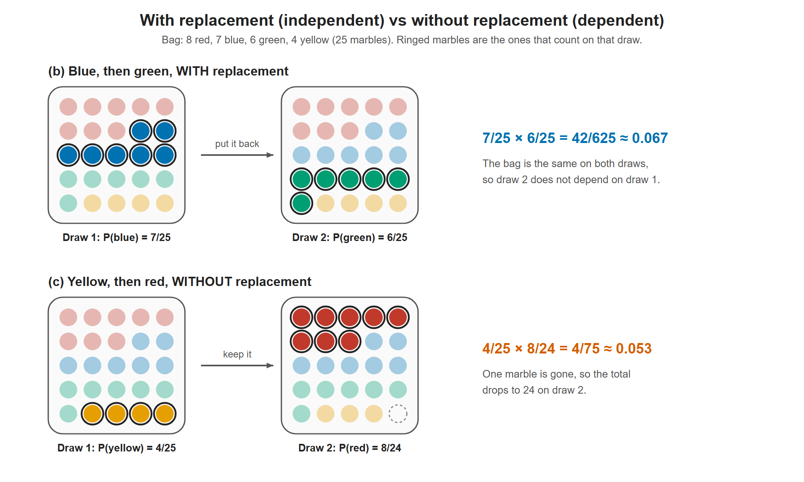

# Lesson 5.5 - Probability of Independent and Dependent Events

> **Video:** [Probability - Independent and Dependent Events](https://www.youtube.com/watch?v=lWAdPyvm400) by The Organic Chemistry Tutor
> **Chapter:** [5 - Introduction to Probability](https://www.video-tutor.net/introduction-to-probability.html)

## Notation: "A then B" as an intersection

The video says "$P(A$ then $B)$". Formally this is an **intersection** ("and"), with the order recorded by subscripts:

- $A_1$ = "$A$ happens on the 1st draw"
- $B_2$ = "$B$ happens on the 2nd draw"

$$P(A \text{ then } B) = P(A_1 \cap B_2)$$

The symbol $\cap$ means "and". Since $A \cap B = B \cap A$, the order ("then") comes from the subscripts, not from $\cap$.

### The multiplication rule (general form)

From the definition of conditional probability, $P(B \mid A) = \dfrac{P(A \cap B)}{P(A)}$, multiplying both sides by $P(A)$ gives:

$$P(A_1 \cap B_2) = P(A_1) \cdot P(B_2 \mid A_1)$$

This always holds. $P(B_2 \mid A_1)$ reads "the probability of $B$ on the 2nd draw, **given** $A$ on the 1st".

## Definitions

- **Independent events:** the outcome of one does **not** change the probability of the other, i.e. $P(B_2 \mid A_1) = P(B_2)$, so the condition drops out:
  $$P(A_1 \cap B_2) = P(A_1) \cdot P(B_2)$$
- **Dependent events:** the first outcome **changes** the probability of the second, so the conditional probability must be kept:
  $$P(A_1 \cap B_2) = P(A_1) \cdot P(B_2 \mid A_1)$$

| Drawing marbles... | Type | Why |
|---|---|---|
| **with replacement** | Independent | The marble goes back, so the bag is unchanged |
| **without replacement** | Dependent | The bag has one fewer marble (and maybe one fewer of a color) |

---

## Example - a bag of marbles

| Red | Blue | Green | Yellow | **Total** |
|---:|---:|---:|---:|---:|
| 8 | 7 | 6 | 4 | **25** |

Notation: $R_1$ = red on draw 1, $G_2$ = green on draw 2, and so on.

**(a) P(red)**
$$P(R) = \frac{8}{25} = 0.32 = 32\%$$

**(b) Blue, then green, *with* replacement** (independent)
$$P(B_1 \cap G_2) = P(B_1) \cdot P(G_2) = \frac{7}{25} \cdot \frac{6}{25} = \frac{42}{625} = 0.0672 = 6.72\%$$
The blue marble is put back, so there are still 25 marbles and 6 green ones on the second draw.

**(c) Yellow, then red, *without* replacement** (dependent)
$$P(Y_1 \cap R_2) = P(Y_1) \cdot P(R_2 \mid Y_1) = \frac{4}{25} \cdot \frac{8}{24} = \frac{4}{25} \cdot \frac{1}{3} = \frac{4}{75} \approx 0.0533 = 5.33\%$$
After the yellow marble is removed, only **24** marbles are left (still 8 red).

**(d) Two blue, *with* replacement**
$$P(B_1 \cap B_2) = P(B_1) \cdot P(B_2) = \frac{7}{25} \cdot \frac{7}{25} = \frac{49}{625} = 0.0784 = 7.84\%$$

**(e) Two green, *without* replacement**
$$P(G_1 \cap G_2) = P(G_1) \cdot P(G_2 \mid G_1) = \frac{6}{25} \cdot \frac{5}{24} = \frac{30}{600} = \frac{1}{20} = 0.05 = 5\%$$
After one green marble is removed, there are **5 green** out of **24**.

### Why (b) is independent and (c) is dependent

- In (b), $P(G_2 \mid B_1) = \tfrac{6}{25}$, which is exactly $P(G_2)$ on its own. The first draw had no effect.
- In (c), $P(R_2 \mid Y_1) = \tfrac{8}{24}$ instead of $P(R_2) = \tfrac{8}{25}$. The first draw changed it.

With replacement the second bag is identical to the first, so the draws are independent. Without replacement one marble is missing, so the second probability uses 24 marbles.

---

## Key takeaways

- **With replacement → independent:** multiply the unchanged probabilities.
- **Without replacement → dependent:** after each draw, reduce the total and (if needed) the count of the color drawn.
- "First … then …" problems use the **multiplication rule**: $P(A_1 \cap B_2) = P(A_1) \cdot P(B_2 \mid A_1)$.
- For three or more draws it chains: $P(A_1 \cap B_2 \cap C_3) = P(A_1) \cdot P(B_2 \mid A_1) \cdot P(C_3 \mid A_1 \cap B_2)$.
