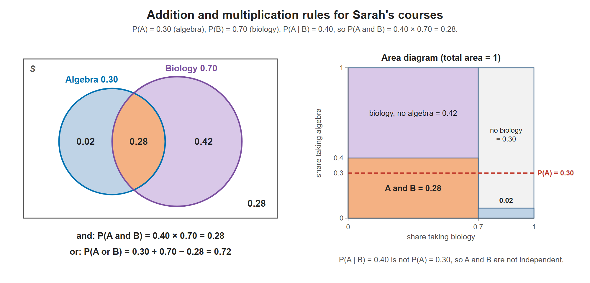

# Lesson 5.7 - Addition Rule and Multiplication Rule

> **Video:** [Multiplication & Addition Rule - Probability - Mutually Exclusive & Independent Events](https://www.youtube.com/watch?v=94AmzeR9n2w) by The Organic Chemistry Tutor
> **Chapter:** [5 - Introduction to Probability](https://www.video-tutor.net/introduction-to-probability.html)

## Addition rule - "or"

$$P(A \text{ or } B) = P(A \cup B) = P(A) + P(B) - P(A \text{ and } B)$$

- **Mutually exclusive** events: $P(A \text{ and } B) = 0$, so $P(A \text{ or } B) = P(A) + P(B)$.
- The general form **always** works.

## Multiplication rule - "and"

Start from conditional probability:

$$P(A \mid B) = \frac{P(A \text{ and } B)}{P(B)} \;\Rightarrow\; P(A \text{ and } B) = P(A \mid B)\,P(B)$$

$$P(B \mid A) = \frac{P(A \text{ and } B)}{P(A)} \;\Rightarrow\; P(A \text{ and } B) = P(B \mid A)\,P(A)$$

**Independent** events: $P(A \mid B) = P(A)$ and $P(B \mid A) = P(B)$, so

$$P(A \text{ and } B) = P(A)\,P(B)$$

> "$A$ and $B$" means both happen **together**, so $P(A \text{ and } B) = P(B \text{ and } A)$. This is not the same as "$A$ **then** $B$", where order can matter.

## Tests

| Property | Test |
|---|---|
| **Independent** | $P(A \mid B) = P(A)$, or equivalently $P(A \text{ and } B) = P(A)P(B)$ |
| **Mutually exclusive** | $P(A \text{ and } B) = 0$ |

---

## Example - Sarah's course choices

- $P(A)$ = P(enrolls in algebra) = 0.30
- $P(B)$ = P(enrolls in biology) = 0.70
- $P(A \mid B)$ = P(algebra | biology) = 0.40

**(a) P(algebra *and* biology)** - multiplication rule
$$P(A \text{ and } B) = P(A \mid B)\,P(B) = 0.40 \times 0.70 = 0.28 = 28\%$$

**(b) P(algebra *or* biology)** - addition rule
$$P(A \text{ or } B) = 0.30 + 0.70 - 0.28 = 0.72 = 72\%$$

**(c) Are the events independent?**
$P(A \mid B) = 0.40$ but $P(A) = 0.30$. They are not equal, so the events are **not independent**: taking biology makes algebra more likely.

**(d) Are the events mutually exclusive?**
$P(A \text{ and } B) = 0.28 \ne 0$, so they are **not mutually exclusive**: she can take both.

Left: the four regions add up to 1 (0.02 + 0.28 + 0.42 + 0.28). Right: the same probabilities as areas. Within the biology column, algebra fills 40%, which is higher than the overall 30% (red line), so the events are not independent.

---

## Key takeaways

- **Or → add** (and subtract the overlap). **And → multiply** (use a conditional probability unless the events are independent).
- Independent ≠ mutually exclusive:
  - independent: one doesn't affect the other, $P(A \cap B) = P(A)P(B)$
  - mutually exclusive: they can't both happen, $P(A \cap B) = 0$
