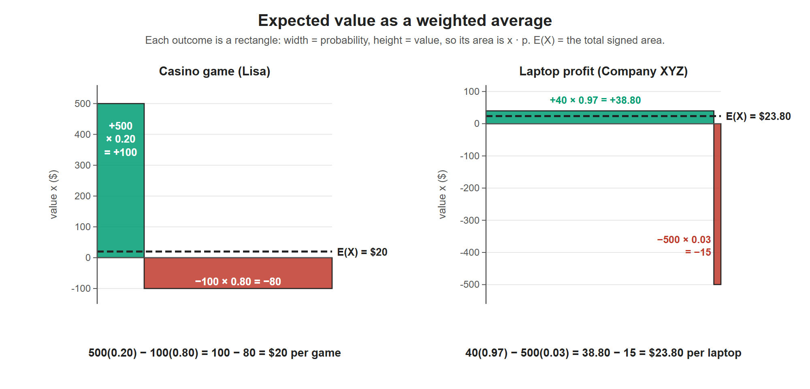

# Lesson 5.9 - How to Calculate the Expected Value

> **Video:** [How To Calculate Expected Value](https://www.youtube.com/watch?v=b6VK2VPMXNI) by The Organic Chemistry Tutor
> **Chapter:** [5 - Introduction to Probability](https://www.video-tutor.net/introduction-to-probability.html)

## Formula

The **expected value** is the long-run **average** result per trial:

$$E(X) = \sum x\,P(x) = x_1p_1 + x_2p_2 + \dots + x_np_n$$

- $x$ = the value of each outcome (gains positive, losses **negative**)
- $p$ = its probability, as a **decimal**; all the $p$'s add up to 1

**Steps:** make a table of *outcome → value → probability*, multiply each value by its probability, and add.

**Expected total over $n$ trials** = $n \times E(X)$.

---

## Example 1 - a casino game

Lisa wins **$500** with probability 20%, and otherwise loses **$100**.

| Outcome | Value $x$ | Probability $p$ | $x \cdot p$ |
|---|---:|---:|---:|
| Win | +500 | 0.20 | +100 |
| Lose | −100 | 0.80 | −80 |
| **Total** | | **1.00** | **+20** |

$$E(X) = 500(0.20) + (-100)(0.80) = 100 - 80 = \$20 \text{ per game}$$

- Over 10 games: $10 \times 20 = \$200$ expected.
- Over 100 games: $100 \times 20 = \$2{,}000$ expected.

(The probability of losing comes from the complement: $1 - 0.20 = 0.80$.)

Each outcome becomes a rectangle with area x times p. Positive areas (green) minus negative areas (red) give E(X). The dashed line at E(X) is the average height over the whole width.

---

## Example 2 - profit per laptop

Company XYZ earns **$40** on each working laptop it sells and loses **$500** on each one returned as defective. **3 in 100** laptops are defective.

| Outcome | Value $x$ | Probability $p$ | $x \cdot p$ |
|---|---:|---:|---:|
| Works | +40 | 0.97 | +38.80 |
| Defective | −500 | 0.03 | −15.00 |
| **Total** | | **1.00** | **+23.80** |

$$E(X) = 40(0.97) + (-500)(0.03) = 38.80 - 15.00 = \$23.80 \text{ per laptop}$$

Selling 100 laptops is expected to earn $100 \times 23.80 = \$2{,}380$.

---

## Key takeaways

- $E(X) = \sum x\,p$: weight each outcome's value by its probability.
- Losses go in as **negative** values.
- The expected value is an **average over many trials**. A single game never pays exactly $20.
- Total expected = number of trials × expected value per trial.
