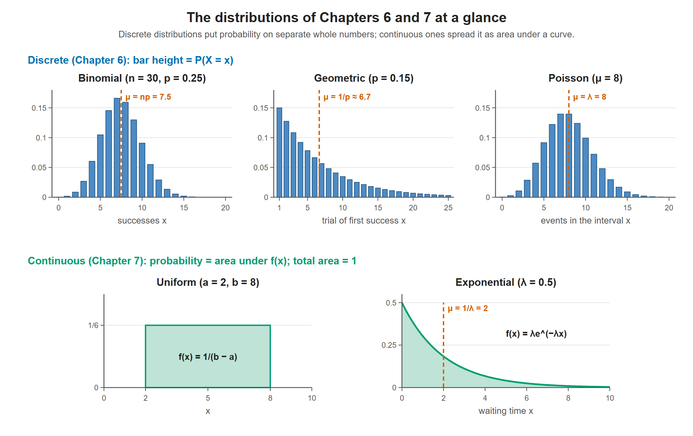

# Lesson 6.1 - Probability Distribution Formulas

> **Video:** [Probability Distribution Formulas](https://www.youtube.com/watch?v=KMLR_lOnVmI) by The Organic Chemistry Tutor
> **Chapter:** [6 - Discrete Probability Distributions](https://www.video-tutor.net/discrete-probability-distributions.html)

A reference sheet for the distributions in Chapters 6 and 7. Throughout, $p$ = probability of success and $q = 1 - p$ = probability of failure.

What each distribution looks like. The three discrete ones (top) give probability as the height of a bar at a whole number. The two continuous ones (bottom) give probability as the area under the curve, and the total area is always 1. The dashed lines mark each mean.

---

## 1. Binomial distribution

$X$ = number of successes in $n$ independent trials.

$$P(X = x) = {}_nC_x\, p^x q^{n-x}, \qquad {}_nC_x = \frac{n!}{(n-x)!\,x!}$$

| Mean | Standard deviation |
|---|---|
| $\mu = np$ | $\sigma = \sqrt{npq}$ |

---

## 2. Geometric distribution

$X$ = the trial on which the **first success** happens.

$$P(X = n) = q^{\,n-1}p$$

*Why:* for the first success to be on trial 4, trials 1-3 must fail ($q \cdot q \cdot q$) and trial 4 must succeed ($p$), so $P(X = 4) = q^3p$.

| Probability | Formula |
|---|---|
| $P(X > n)$ | $q^n$ |
| $P(X \ge n)$ | $q^{n-1}$ |
| $P(X \le n)$ | $1 - q^n$ |
| $P(X < n)$ | $1 - q^{n-1}$ |

| Mean | Variance | Standard deviation |
|---|---|---|
| $\mu = \dfrac1p$ | $\sigma^2 = \dfrac1p\left(\dfrac1p - 1\right) = \mu(\mu - 1) = \dfrac{q}{p^2}$ | $\sigma = \dfrac{\sqrt{1-p}}{p}$ |

---

## 3. Poisson distribution

$X$ = number of events in a fixed interval, where the average number of events is $\mu = \lambda$.

$$P(X = n) = \frac{\mu^n e^{-\mu}}{n!} = \frac{\lambda^n e^{-\lambda}}{n!}$$

| Probability | Formula |
|---|---|
| $P(X \le n)$ | $e^{-\mu}\displaystyle\sum_{x=0}^{n} \frac{\mu^x}{x!}$ |
| $P(X > n)$ | $1 - e^{-\mu}\displaystyle\sum_{x=0}^{n} \frac{\mu^x}{x!}$ |

| Mean | Variance | Standard deviation |
|---|---|---|
| $\mu = \lambda$ ($= np$ when approximating a binomial) | $\sigma^2 = \lambda$ | $\sigma = \sqrt{\lambda}$ |

> In the video the Poisson denominator is spoken as "n squared". The correct denominator is **$n!$** ($n$ factorial), as in the other form written on screen.

---

## 4. Uniform distribution (continuous)

$X$ is equally likely to be anywhere between $a$ and $b$. The graph is a **rectangle** of width $b - a$, and its total area must be 1:

$$\text{area} = \text{base} \times \text{height} = (b - a) \cdot f(x) = 1 \;\Rightarrow\; f(x) = \frac{1}{b - a}$$

**Probability = partial width ÷ total width:**

$$P(c \le X \le d) = \frac{d - c}{b - a}$$

For example, $P(a \le X \le c) = \dfrac{c - a}{b - a}$ and $P(c \le X \le b) = \dfrac{b - c}{b - a}$.

| Mean | Standard deviation |
|---|---|
| $\mu = \dfrac{a + b}{2}$ | $\sigma = \dfrac{b - a}{\sqrt{12}}$ |

---

## 5. Exponential distribution (continuous)

Waiting times. $\lambda$ = rate parameter, and $\mu = 1/\lambda$.

$$f(x) = \lambda e^{-\lambda x}, \quad x \ge 0$$

| Probability | Formula | From calculus |
|---|---|---|
| $P(X \le n)$ (left area) | $1 - e^{-\lambda n}$ | $\displaystyle\int_0^n \lambda e^{-\lambda x}\,dx$ |
| $P(X \ge n)$ (right area) | $e^{-\lambda n}$ | $\displaystyle\int_n^\infty \lambda e^{-\lambda x}\,dx$ |

| Mean | Variance | Rate |
|---|---|---|
| $\mu = \dfrac1\lambda$ | $\sigma^2 = \dfrac{1}{\lambda^2}$ | $\lambda = \dfrac1\mu$ |

In general, a probability for a continuous distribution is the **area under** $f(x)$: $P(a \le X \le b) = \int_a^b f(x)\,dx$.

---

## Where each one is used

| Distribution | Typical question |
|---|---|
| Binomial | "Exactly / at least $x$ successes in $n$ trials" (Lesson 6.2) |
| Geometric | "First success on trial $n$" (Lesson 6.3) |
| Poisson | "Number of events in a time or space interval" (Lesson 6.4) |
| Uniform | "Equally likely anywhere between $a$ and $b$" (Lesson 7.3) |
| Exponential | "Waiting time until the next event" (Lesson 7.4) |
