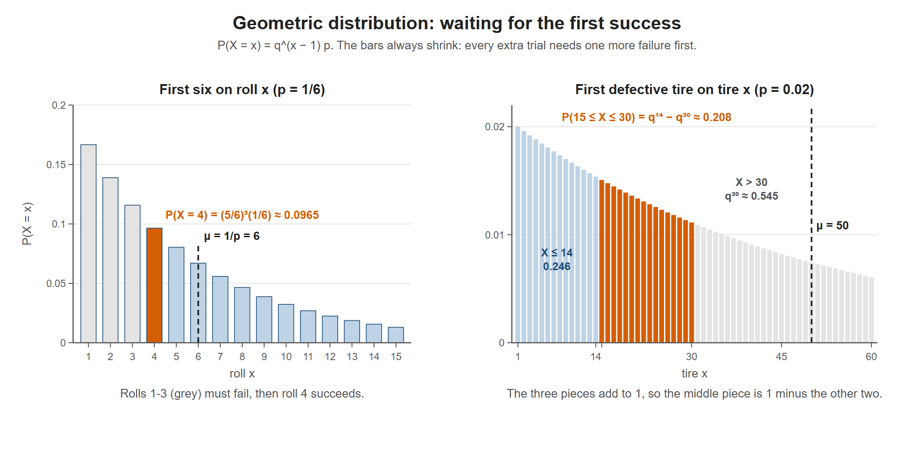

# Lesson 6.3 - The Geometric Distribution

> **Video:** [Geometric Distribution - Probability, Mean, Variance, & Standard Deviation](https://www.youtube.com/watch?v=d5iAWPnrH6w) by The Organic Chemistry Tutor
> **Chapter:** [6 - Discrete Probability Distributions](https://www.video-tutor.net/discrete-probability-distributions.html)

## The idea

A **geometric distribution** answers: *on which trial does the **first** success happen?*

If the first success is on trial $x$, then the first $x - 1$ trials failed and trial $x$ succeeded:

$$P(X = x) = q^{\,x-1}\,p, \qquad q = 1 - p$$

## All the formulas

| Question | Formula |
|---|---|
| First success **on** trial $x$ | $P(X = x) = q^{x-1}p$ |
| First success **by** trial $x$ (within the first $x$) | $P(X \le x) = 1 - q^x$ |
| First success **before** trial $x$ | $P(X < x) = 1 - q^{x-1}$ |
| First success **after** trial $x$ | $P(X > x) = q^x$ |
| First success on trial $x$ **or later** | $P(X \ge x) = q^{x-1}$ |
| Mean (expected trial of the first success) | $\mu = \dfrac1p$ |
| Variance | $\sigma^2 = \dfrac1p\left(\dfrac1p - 1\right) = \dfrac{1-p}{p^2}$ |
| Standard deviation | $\sigma = \sqrt{\dfrac{1-p}{p^2}} = \dfrac{\sqrt{1-p}}{p}$ |

**Why $P(X > x) = q^x$:** "no success in the first $x$ trials" means $x$ failures in a row. Then $P(X \le x) = 1 - q^x$ is its complement.

**Tip for $<$ and $\ge$:** shift by one so you can use the formulas above. $P(X < 7) = P(X \le 6)$ and $P(X \ge 18) = P(X > 17)$.

---

## Example 1 - first six on the fourth roll

$p = \tfrac16$ (rolling a 6), $q = \tfrac56$:

$$P(X = 4) = \left(\tfrac56\right)^3 \cdot \tfrac16 = \frac{125}{1296} \approx 0.0965 = 9.6\%$$

Three failures, then one success.

## Example 2 - first blue car is the 7th car

15% of cars are blue: $p = 0.15$, $q = 0.85$.

$$P(X = 7) = (0.85)^6(0.15) \approx 0.0566 = 5.7\%$$

## Example 3 - the 10th person you meet is the first teacher

4% of a town's residents are teachers: $p = 0.04$, $q = 0.96$.

**(a)**
$$P(X = 10) = (0.96)^9(0.04) \approx 0.0277 = 2.77\%$$

**(b) Mean, variance, standard deviation**
$$\mu = \frac{1}{0.04} = 25, \qquad \sigma^2 = 25(25 - 1) = 600, \qquad \sigma = \sqrt{600} \approx 24.49$$

---

## Example 4 - defective tires ($p = 0.02$, $q = 0.98$)

2% of tires are defective, and a sample of tires is tested one at a time.

**(a) The 8th tire is the first defective one**
$$P(X = 8) = (0.98)^7(0.02) \approx 0.0174 = 1.7\%$$

**(b) The first defect is found within the first 5 tires**
Adding each case:
$$P(X \le 5) = p + qp + q^2p + q^3p + q^4p = p(1 + q + q^2 + q^3 + q^4) \approx 0.0961$$
With the cumulative formula, which is much faster:
$$P(X \le 5) = 1 - (0.98)^5 \approx 0.0961 = 9.6\%$$

**(c) The first defect is found within the first 10**
$$P(X \le 10) = 1 - (0.98)^{10} \approx 0.1829 = 18.3\%$$

**(d) How many tires do you expect to test to find the first defect?**
$$\mu = \frac{1}{0.02} = 50 \text{ tires}$$

---

## Example 5 - more cumulative questions (same tires)

**(a) First defect before the 7th tire**
$$P(X < 7) = P(X \le 6) = 1 - (0.98)^6 \approx 0.1142 = 11.4\%$$

**(b) First defect after the 12th tire**
$$P(X > 12) = (0.98)^{12} \approx 0.7847 = 78.5\%$$

**(c) First defect on the 18th tire or later**
$$P(X \ge 18) = P(X > 17) = (0.98)^{17} \approx 0.7093 = 70.9\%$$

**(d) First defect between tire 15 and tire 30 (inclusive)**

Split the whole range (total probability 1) into three pieces: A = $X \le 14$, B = $15 \le X \le 30$, C = $X > 30$.

$$P(15 \le X \le 30) = 1 - P(X \le 14) - P(X > 30)$$
$$= 1 - \left[1 - (0.98)^{14}\right] - (0.98)^{30} = (0.98)^{14} - (0.98)^{30} \approx 0.7536 - 0.5455 = 0.2082 = 20.8\%$$

**(e) First defect after tire 20 but no later than tire 45** ($21 \le X \le 45$)
$$= 1 - P(X \le 20) - P(X > 45) = (0.98)^{20} - (0.98)^{45} \approx 0.6676 - 0.4029 = 0.2647 = 26.5\%$$

> **Shortcut:** $P(a \le X \le b) = q^{a-1} - q^{b}$. Check: (d) is $q^{14} - q^{30}$ ✓ and (e) is $q^{20} - q^{45}$ ✓. Make sure no trial is counted twice or left out.

Left: the first six on roll 4 needs three failures (grey) and then a success. Right: for the tires, the range 15 to 30 (orange) is whatever is left after removing X ≤ 14 and X > 30, which is q^14 − q^30.

---

## Key takeaways

- Geometric = waiting for the **first** success: $P(X = x) = q^{x-1}p$.
- Cumulative: $P(X \le x) = 1 - q^x$ and $P(X > x) = q^x$. Convert $<$ and $\ge$ by shifting by 1.
- $\mu = 1/p$ is the expected number of trials until the first success.
