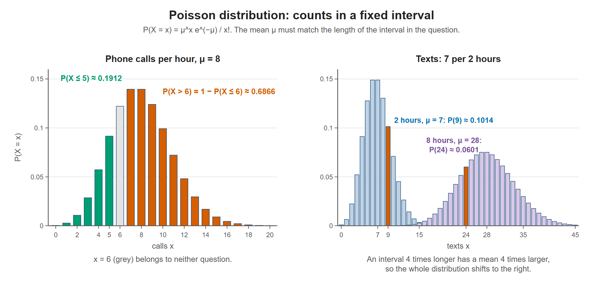

# Lesson 6.4 - The Poisson Distribution

> **Video:** [Introduction to Poisson Distribution - Probability & Statistics](https://www.youtube.com/watch?v=m0o-585xwW0) by The Organic Chemistry Tutor
> **Chapter:** [6 - Discrete Probability Distributions](https://www.video-tutor.net/discrete-probability-distributions.html)

## The idea

The **Poisson distribution** gives the probability of **exactly $x$ events in a fixed interval** (of time, area, ...) when the events happen at a known **average rate** $\mu$ (also written $\lambda$).

$$P(X = x) = \frac{\mu^x\, e^{-\mu}}{x!}$$

- $e \approx 2.71828$
- $x! = x(x-1)\cdots 2 \cdot 1$, with $0! = 1$

### The mean must match the interval

If the interval changes, scale the mean in proportion:

$$\frac{\mu_2}{\mu_1} = \frac{t_2}{t_1}$$

---

## Example 1 - customers per day

A business averages **12 customers per day**. What is the probability of exactly **8** customers in one day?

$$P(X = 8) = \frac{12^8 e^{-12}}{8!} \approx 0.0655 = 6.55\%$$

---

## Example 2 - text messages

A student receives on average **7 texts per 2 hours**.

**(a) Exactly 9 texts in 2 hours.** The interval is the same, so $\mu = 7$:
$$P(X = 9) = \frac{7^9 e^{-7}}{9!} \approx 0.1014 = 10.14\%$$

**(b) Exactly 24 texts in 8 hours.** The interval is 4 times longer, so the mean is 4 times larger:
$$\frac{\mu_2}{7} = \frac{8}{2} \;\Rightarrow\; \mu_2 = 28$$
$$P(X = 24) = \frac{28^{24} e^{-28}}{24!} \approx 0.0601 = 6.01\%$$

---

## Example 3 - phone calls ($\mu = 8$ per hour)

**(a) Exactly 7 calls in one hour**
$$P(X = 7) = \frac{8^7 e^{-8}}{7!} \approx 0.1396 = 13.96\%$$

**(b) At most 5 calls** ($X \le 5$, so $X = 0, 1, \dots, 5$)

Factor out $e^{-\mu}$, since only $\mu^x / x!$ changes from term to term:

$$P(X \le 5) = e^{-8}\left(\frac{8^0}{0!} + \frac{8^1}{1!} + \frac{8^2}{2!} + \frac{8^3}{3!} + \frac{8^4}{4!} + \frac{8^5}{5!}\right)$$
$$= e^{-8}\,(1 + 8 + 32 + 85.33 + 170.67 + 273.07) = e^{-8}(570.07) \approx 0.1912 = 19.12\%$$

**(c) More than 6 calls** ($X > 6$, which runs on to infinity)

Use the complement, since the total probability is 1:

$$P(X > 6) = 1 - P(X \le 6) = 1 - e^{-8}\sum_{x=0}^{6}\frac{8^x}{x!} = 1 - e^{-8}(934.16) \approx 1 - 0.3134 = 0.6866 = 68.7\%$$

This is likely, which makes sense: the average is 8 calls, so more than 6 is the usual case.

Left: "at most 5" adds the green bars and "more than 6" is everything orange, found as 1 − P(X ≤ 6). Right: changing the interval from 2 hours to 8 hours multiplies the mean by 4, which moves and spreads out the whole distribution.

---

## Key takeaways

- Poisson: $P(X = x) = \dfrac{\mu^x e^{-\mu}}{x!}$ counts events in a fixed interval.
- **Adjust $\mu$** whenever the interval in the question differs from the one in the given rate.
- "At most $k$" → add $x = 0$ to $k$. "More than $k$" → $1 - P(X \le k)$.
- Mean = variance = $\mu$, and the standard deviation is $\sqrt{\mu}$.
