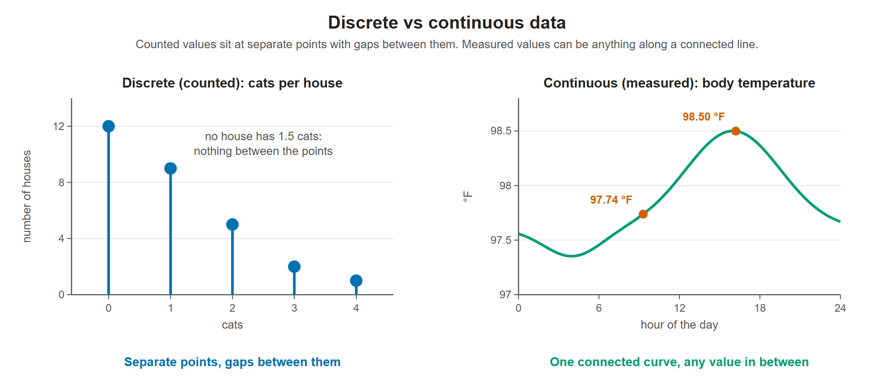

# Lesson 6.5 - Continuous vs Discrete Data

> **Video:** [Continuous vs Discrete Data](https://www.youtube.com/watch?v=cz4nPSA9rlc) by The Organic Chemistry Tutor
> **Chapter:** [6 - Discrete Probability Distributions](https://www.video-tutor.net/discrete-probability-distributions.html)

## Definitions

| | Continuous data | Discrete data |
|---|---|---|
| Values | **Any** value in an interval | Only **specific** values (often whole numbers) |
| How it's obtained | **Measured** | **Counted** |
| Values between 1 and 10 | 1, 1.3, 2.46, 5.389, ... | 1, 2, 3, ..., 10 |
| Example | Temperature: 83.6 °F, 99.46 °F | Rolling a die: 1-6 only (never 2.37) |

---

## Practice - continuous (C) or discrete (D)?

| # | Quantity | Answer | Reason |
|---|---|:---:|---|
| 1 | Speed of a car | **C** | Measured: 25.6 mph, 42.86 mph, ... |
| 2 | Number of cats in a neighborhood | **D** | Counted; no half cats |
| 3 | Your body weight | **C** | Measured: 160 lb, 173.4 lb, ... |
| 4 | Number of doctors in a town | **D** | Counted |
| 5 | Number of books on a shelf | **D** | Counted |
| 6 | Height of a student | **C** | Measured: 5.84 ft, 6.3 ft, ... |
| 7 | Number of students in a classroom | **D** | Counted |
| 8 | Your age **rounded** to the nearest whole number | **D** | Only whole numbers: 16, 19, 22, 24 |
| 9 | Your **exact** age | **C** | Measured: 16.2, 19.3, 21.76, 23.958 years |

Items 8 and 9 show that **rounding** a continuous quantity turns it into discrete data.

---

## Recognizing them on a graph

- **Continuous:** one connected line or curve with no jumps or gaps.
- **Discrete:** **separate points**, or bars/steps that don't connect into a smooth line.

Counted data (left) can only sit at whole numbers, so the graph is separate points. Measured data (right) can take any value, so the graph is one connected curve.

---

## Key takeaways

- **Measured → continuous** (any value in a range). **Counted → discrete** (specific values only).
- Rounding turns continuous data into discrete data.
- Graphs: a smooth connected line means continuous; isolated points mean discrete.
- This distinction decides which distributions apply: binomial, geometric and Poisson are **discrete** (Chapter 6); uniform, exponential and normal are **continuous** (Chapters 7-8).
