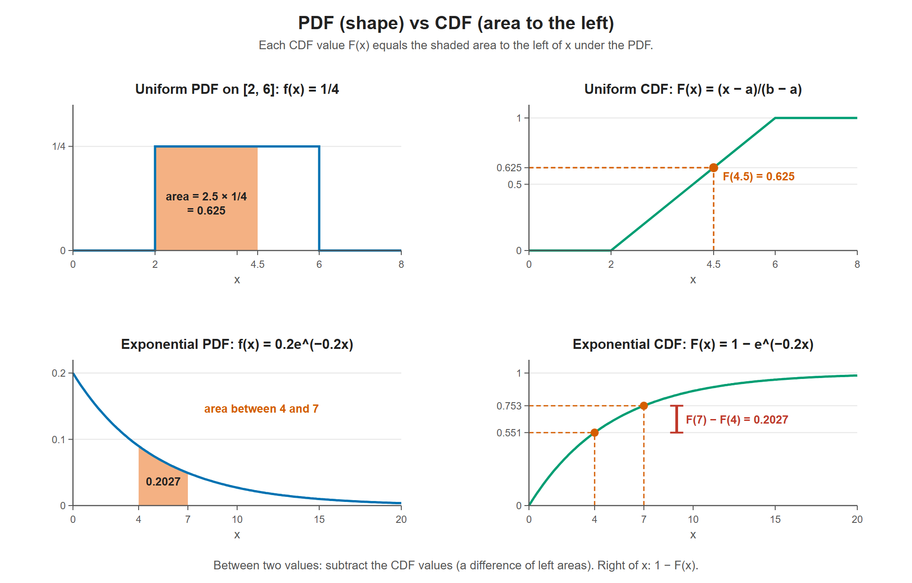

# Lesson 7.2 - Cumulative Distribution Functions and Probability Density Functions

> **Video:** [Cumulative Distribution Functions and Probability Density Functions](https://www.youtube.com/watch?v=3xAIWiTJCvE) by The Organic Chemistry Tutor
> **Chapter:** [7 - Continuous Distributions](https://www.video-tutor.net/continuous-probability-distributions.html)

## PDF vs CDF

| | **PDF**, probability density function | **CDF**, cumulative distribution function |
|---|---|---|
| Notation | $f(x)$ | $F(x) = P(X \le x)$ |
| Tells you | The **shape** of the distribution and the curve's **height** at $x$ | The **area to the left** of $x$, the probability accumulated up to $x$ |
| Range | $f(x) \ge 0$ | $0 \le F(x) \le 1$ |

The total area under any PDF is 1.

---

## Uniform distribution on $[a, b]$

**PDF** (a constant height; no $x$ in it):
$$f(x) = \frac{1}{b - a}$$

**CDF** (the area of the rectangle from $a$ to $x$ = base × height):
$$F(x) = P(X \le x) = (x - a) \cdot \frac{1}{b - a} = \frac{x - a}{b - a}$$

---

## Exponential distribution

**PDF** (it starts at height $\lambda$ and decays, with $\lambda = 1/\mu$):
$$f(x) = \lambda e^{-\lambda x}$$

**CDF** (area to the left):
$$F(x) = P(X \le x) = 1 - e^{-\lambda x}$$

**Area to the right** (not a CDF, because the CDF is always the left area):
$$P(X \ge x) = 1 - F(x) = 1 - (1 - e^{-\lambda x}) = e^{-\lambda x}$$

**Area between $a$ and $b$:** subtract two left areas.
$$P(a \le X \le b) = F(b) - F(a) = (1 - e^{-\lambda b}) - (1 - e^{-\lambda a}) = e^{-\lambda a} - e^{-\lambda b}$$

Picture: the region left of $b$ minus the region left of $a$ leaves the region between $a$ and $b$.

Left column: the PDF, whose shaded area is a probability. Right column: the CDF, whose height at x is the area to the left of x. The area between 4 and 7 under the exponential PDF (0.2027) equals the jump F(7) − F(4) on its CDF.

---

## Reminders for continuous distributions

- $P(a \le X \le b) = P(a < X < b)$, because the endpoints don't change the area.
- $P(X = a) = 0$: a single line has height but no width.

---

## Key takeaways

- **PDF $f(x)$** gives the **shape and height**. **CDF $F(x)$** gives the **area to the left** (cumulative probability).
- Right area = $1 - F(x)$. Area between = $F(b) - F(a)$.
- Uniform: $F(x) = \dfrac{x-a}{b-a}$. Exponential: $F(x) = 1 - e^{-\lambda x}$.
