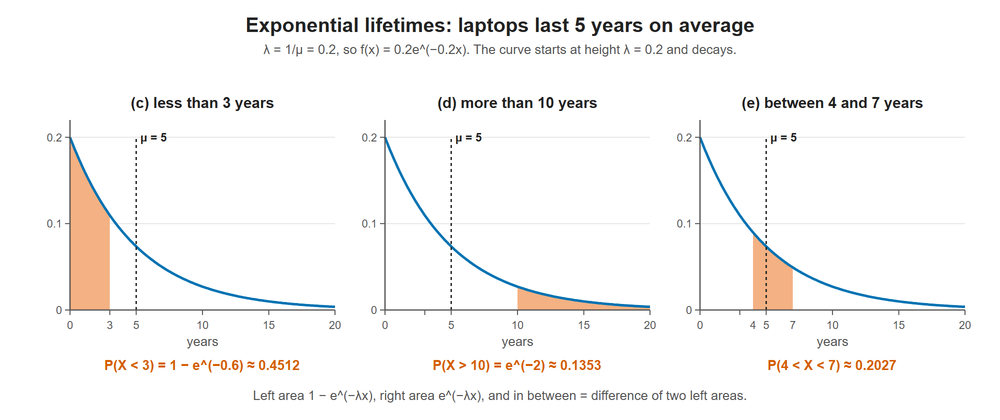

# Lesson 7.4 - Probability of an Exponential Distribution

> **Video:** [Probability Exponential Distribution Problems](https://www.youtube.com/watch?v=J3KSjZFVbis) by The Organic Chemistry Tutor
> **Chapter:** [7 - Continuous Distributions](https://www.video-tutor.net/continuous-probability-distributions.html)

## Formulas

| Quantity | Formula |
|---|---|
| Rate parameter | $\lambda = \dfrac{1}{\mu}$ |
| PDF | $f(x) = \lambda e^{-\lambda x}$, $\;x \ge 0$ |
| Area to the **left** | $P(X < x) = 1 - e^{-\lambda x}$ |
| Area to the **right** | $P(X > x) = e^{-\lambda x}$ |
| Area **between** $a$ and $b$ | $P(a < X < b) = P(X < b) - P(X < a) = e^{-\lambda a} - e^{-\lambda b}$ |

($e \approx 2.71828$. The video once says "rate parameter = 1/λ"; it means $\lambda = 1/\mu$.)

---

## Example - laptop lifespan

Laptops from company XYZ last **5 years** on average, and the lifespan follows an exponential distribution.

**(a) Rate parameter**
$$\lambda = \frac{1}{5} = 0.20 \text{ per year}$$

**(b) PDF and graph**
$$f(x) = 0.20\,e^{-0.20x}$$

The graph starts at the **y-intercept $f(0) = 0.20 = \lambda$** (since $e^0 = 1$) and decays toward 0 as $x$ grows.

**(c) Lasts less than 3 years** (left area)
$$P(X < 3) = 1 - e^{-0.20(3)} = 1 - e^{-0.6} \approx 0.4512 = 45.12\%$$

**(d) Lasts more than 10 years** (right area)
$$P(X > 10) = e^{-0.20(10)} = e^{-2} \approx 0.1353 = 13.53\%$$

**(e) Lasts between 4 and 7 years**

The area left of 7 minus the area left of 4 leaves the region between them:

$$P(4 < X < 7) = \left(1 - e^{-1.4}\right) - \left(1 - e^{-0.8}\right) \approx 0.75340 - 0.55067 = 0.20273 \approx 20.3\%$$

(Equivalently, $e^{-0.8} - e^{-1.4} \approx 0.4493 - 0.2466 = 0.2027$.)

The three laptop questions as areas under f(x) = 0.2e^(−0.2x). The curve starts at λ = 0.2, and the mean lifetime is 5 years.

---

## Key takeaways

- Find $\lambda = 1/\mu$ first. The PDF's y-intercept equals $\lambda$.
- Left area $1 - e^{-\lambda x}$; right area $e^{-\lambda x}$; between = difference of the left areas.
- The exponential distribution models **waiting times and lifetimes**. Short times are most likely, and long times become less and less likely.
