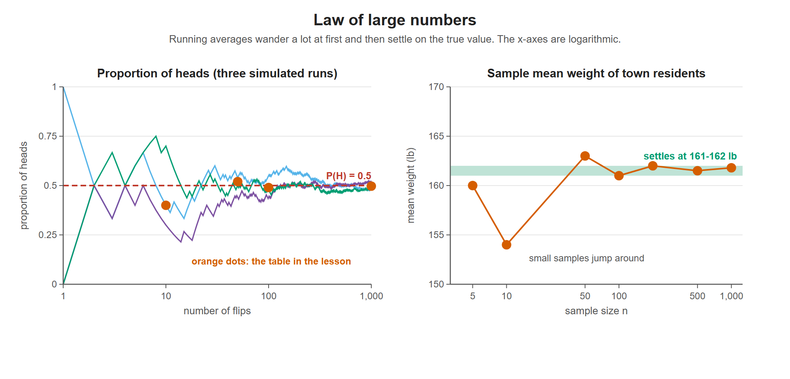

# Lesson 8.3 - Law of Large Numbers

> **Video:** [Law of Large Numbers](https://www.youtube.com/watch?v=ihTpK6dXSas) by The Organic Chemistry Tutor
> **Chapter:** [8 - Normal Probability Distributions](https://www.video-tutor.net/normal-probability-distributions.html)

## Statement

> If an experiment is repeated many times, the **observed average** (or observed proportion) gets **closer and closer to the true, theoretical value** as the number of trials increases.

---

## Example 1 - flipping coins

The theoretical probability of heads is $P(H) = \tfrac12 = 0.5$. A few trials can stray far from 0.5, but many trials land close to it:

| Number of flips | Heads observed (example) | Observed proportion |
|---:|---:|---:|
| 10 | 4 | 0.40 |
| 50 | 26 | 0.52 |
| 100 | 49 | 0.49 |
| 1,000 | 497 | 0.497 |

As the number of flips grows, the observed proportion **approaches 0.5**.

Left: three simulated runs of 1,000 coin flips. Each wanders early on, then all three close in on 0.5. Right: the sample mean weights from the lesson, which jump around for small samples and settle near 161-162 lb.

---

## Example 2 - estimating an average weight

A town has 20,000 residents. Instead of weighing everyone, take samples of increasing size:

| Sample size $n$ | Sample mean weight (example) |
|---:|---:|
| 5 | 160 lb |
| 10 | 154 lb |
| 50 | 163 lb |
| 100 | 161 lb |
| 200 | 162 lb |
| 500 | 161.5 lb |
| 1,000 | 161.8 lb |

- **Small samples** jump around, because one unusually heavy (230 lb) or light (110 lb) person has a big effect.
- **Large samples** settle down. Here they converge to about **161-162 lb**, which estimates the population mean.

---

## Key takeaways

- More trials or a bigger sample → the observed average gets closer to the true average.
- This is why large samples give reliable estimates of population **parameters**.
- The law says nothing about any single trial. Even after many heads in a row, the next flip is still 50/50.
