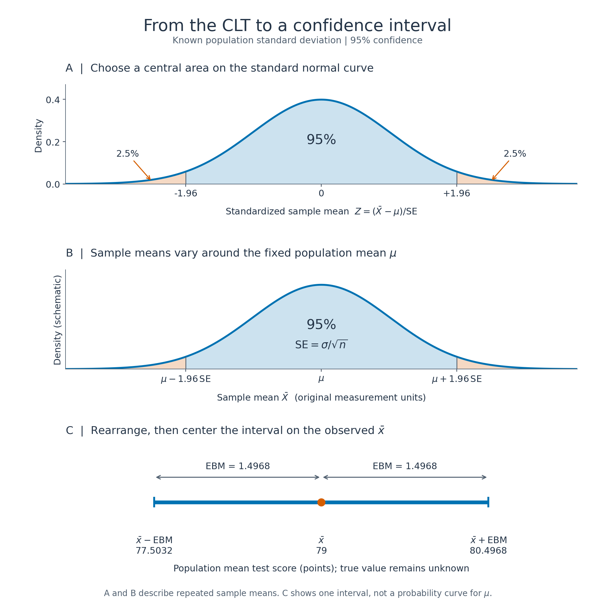
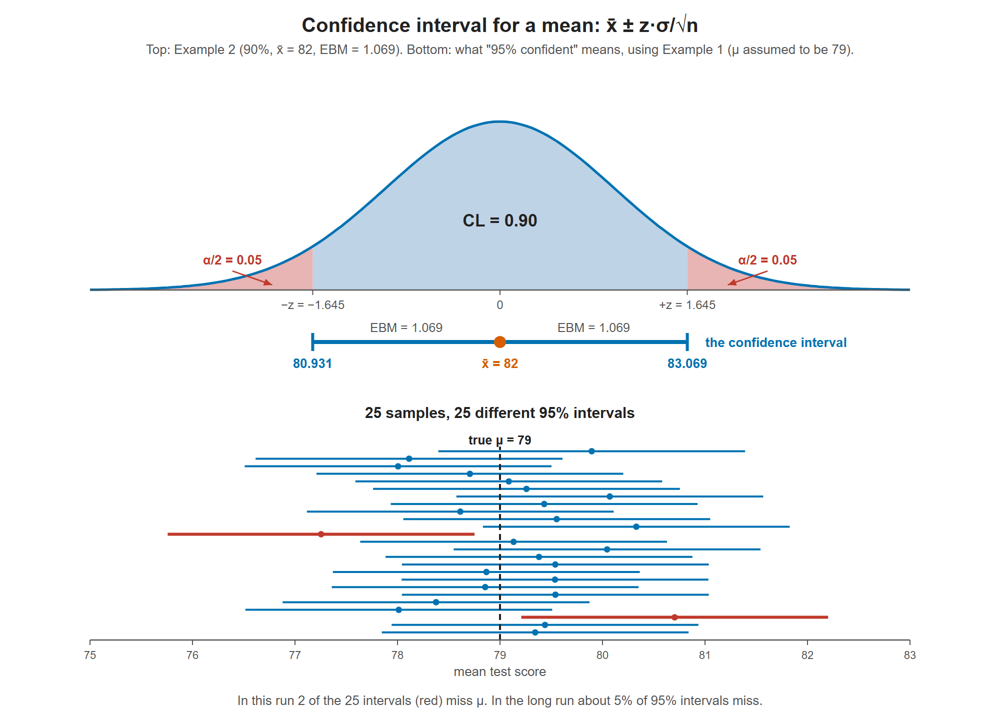

# Lesson 9.1 - Z-Scores, Confidence Intervals, and Margin of Error

> **Video:** [How To Find The Z Score, Confidence Interval, and Margin of Error for a Population Mean](https://www.youtube.com/watch?v=DT-fPG0Hff8) by The Organic Chemistry Tutor
> **Chapter:** [9 - Confidence Intervals](https://www.video-tutor.net/confidence-intervals.html)

## Confidence interval for $\mu$ (when $\sigma$ is known)

$$\bar x - z\,\frac{\sigma}{\sqrt n} \;<\; \mu \;<\; \bar x + z\,\frac{\sigma}{\sqrt n} \qquad\text{or}\qquad \bar x \pm \text{EBM}$$

**Margin of error**, also called the **error bound for the mean (EBM)**:

$$\text{EBM} = z\,\frac{\sigma}{\sqrt n}$$

The interval is centered on the **observed sample mean**. Its margin of error accounts for how much sample means vary from sample to sample.

## Why this formula follows from the CLT

Recall [Lesson 8.4 - The Central Limit Theorem](../08_normal_probability_distributions/8-4-the_central_limit_theorem.md): even when individual observations are not normally distributed, their sample mean is approximately normal for a sufficiently large sample.

| Symbol | Meaning |
|---|---|
| $\mu$ | The fixed, unknown population mean we want to estimate |
| $\sigma$ | The known population standard deviation: the spread of individual observations |
| $n$ | The number of observations in one sample |
| $\bar X$ | The sample mean as a random variable, before observing the sample |
| $\bar x$ | The numerical mean of the sample we actually observed |
| $\text{SE} = \sigma/\sqrt n$ | The standard error: the standard deviation of the sample mean |
| $z^*$ | The positive critical z-value for the chosen confidence level; this is the $z$ in the original formula |

### Step 1 - Find the center and spread of the sample mean

Suppose $X_1,\ldots,X_n$ are independent observations from the same population, each with mean $\mu$ and finite variance $\sigma^2 > 0$. Their sample mean is

$$\bar X = \frac{X_1 + \cdots + X_n}{n}.$$

Taking the expectation gives

$$E(\bar X) = \frac{n\mu}{n} = \mu.$$

Independence lets us add the variances. Dividing a random variable by $n$ divides its variance by $n^2$, so

$$\operatorname{Var}(\bar X) = \frac{1}{n^2}\sum_{i=1}^{n}\operatorname{Var}(X_i) = \frac{n\sigma^2}{n^2} = \frac{\sigma^2}{n}.$$

Taking the square root gives the **standard error**:

$$\boxed{\text{SE} = \operatorname{SD}(\bar X) = \frac{\sigma}{\sqrt n}}.$$

These mean and variance results are exact under the assumptions above. The **CLT adds the approximately normal shape** of the sampling distribution when $n$ is sufficiently large.

### Step 2 - Standardize the sample mean

Subtract its mean and divide by its standard deviation:

$$Z = \frac{\bar X - \mu}{\sigma/\sqrt n} \quad\text{is approximately standard normal.}$$

For one individual observation, the denominator would be $\sigma$. Here we are studying an **average**, so the denominator is the smaller quantity $\sigma/\sqrt n$.

### Step 3 - Select the central probability

Let the confidence level be $1-\alpha$. Choose $z^*$ so that the standard normal curve has central area $1-\alpha$, leaving $\alpha/2$ in each tail:

$$P(-z^* \le Z \le z^*) \approx 1-\alpha.$$

For **95% confidence**, $\alpha=0.05$, so each tail has area $0.025$. The left area at the positive cutoff is $0.975$, giving $z^* \approx 1.96$.

Substitute the standardized sample mean:

$$P\left(-z^* \le \frac{\bar X-\mu}{\sigma/\sqrt n} \le z^*\right) \approx 1-\alpha.$$

### Step 4 - Rearrange to put the unknown mean in the middle

Multiply the inequalities inside the probability statement by the positive standard error:

$$-z^*\text{SE} \le \bar X-\mu \le z^*\text{SE}.$$

Solve each side for $\mu$:

$$\bar X-\mu \le z^*\text{SE}
\quad\Longrightarrow\quad
\mu \ge \bar X-z^*\text{SE},$$

$$\bar X-\mu \ge -z^*\text{SE}
\quad\Longrightarrow\quad
\mu \le \bar X+z^*\text{SE}.$$

Combining these gives the equivalent probability statement:

$$\boxed{P\left(\bar X-z^*\frac{\sigma}{\sqrt n} \le \mu \le \bar X+z^*\frac{\sigma}{\sqrt n}\right) \approx 1-\alpha}.$$

**The key switch:** initially, we ask how far the random sample mean can be from the fixed population mean. After rearranging, we construct random interval endpoints around the sample mean and ask whether they contain that same fixed population mean.

### Step 5 - Insert the observed sample mean

Once we collect the sample, replace $\bar X$ with its observed value $\bar x$:

$$\boxed{\text{CI} = \left[\bar x-z^*\frac{\sigma}{\sqrt n},\;\bar x+z^*\frac{\sigma}{\sqrt n}\right]}.$$

The distance from the center to either endpoint is the margin of error:

$$\boxed{\text{EBM} = z^*\times\text{SE} = z^*\frac{\sigma}{\sqrt n}}.$$

The confidence interval estimates **one population mean**. It does not describe where 95% of individual observations lie.

### Illustration - from the normal curve to an interval



- **A: Standardized scale.** About 95% of the standard normal area is between $-1.96$ and $+1.96$.
- **B: Sampling distribution.** Returning to the original units, about 95% of sample means fall within $1.96\,\text{SE}$ of the fixed $\mu$. The center is $\mu$, not the observed $\bar x$.
- **C: Observed interval.** Rearranging gives an interval centered on $\bar x$. Using Example 1 below, $\text{SE}=5.4/\sqrt{50}\approx0.76368$ and $\text{EBM}\approx1.4968$, so the interval is $[77.5032,\;80.4968]$. The true $\mu$ remains unknown; the figure does not assume that it equals 79.

Panel C is an interval on a number line, **not a probability distribution for $\mu$**.

### When this derivation applies

- The observations should be an independent random sample from the same population, with finite variance. When sampling without replacement from a finite population, independence is an approximation; the usual check is that the sample is no more than about 10% of the population.
- The population standard deviation $\sigma$ must be known. If it is estimated by the sample standard deviation $s$, the usual method is a **t confidence interval**.
- If the population is normal, the sampling distribution of $\bar X$ is exactly normal for any $n$, and the interval has exact coverage using the exact normal critical value.
- Otherwise, the interval relies on the CLT approximation. $n\ge30$ is only a rule of thumb: strong skewness or heavy tails can require a much larger sample.

## Finding the critical z-value

The area to the **left** of the positive critical value $z$ is

$$\text{left area} = \frac{\text{CL} + 1}{2}$$

where CL is the confidence level as a decimal. Look this area up in a z-table that gives **left** areas.

| Confidence level | Left area | $z$ |
|---:|---:|---:|
| 90% | 0.95 | 1.645 |
| 95% | 0.975 | 1.96 |
| 99% | 0.995 | 2.576 |

For 90%, the table has 0.94950 at $z = 1.64$ and 0.95053 at $z = 1.65$. 0.95 is about halfway between them, so average: $z = 1.645$.

---

## Example 1 - physics test, 95% CI

$\sigma = 5.4$, $n = 50$, $\bar x = 79$

1. $z$: left area $= (0.95 + 1)/2 = 0.975$ → $z = 1.96$
2. Standard error: $\dfrac{5.4}{\sqrt{50}} \approx 0.76368$
3. **(b) Margin of error:** $\text{EBM} = 1.96 \times 0.76368 \approx 1.4968$
4. **(a) Interval:** $79 \pm 1.4968$

$$77.5032 < \mu < 80.4968$$

We are 95% confident that the mean score of the whole class lies between about **77.50 and 80.50**.

## Example 2 - chemistry test, 90% CI

$\sigma = 6.5$, $n = 100$, $\bar x = 82$

1. $z$: left area $= (0.90 + 1)/2 = 0.95$ → $z = 1.645$
2. **(b) Margin of error:** $\text{EBM} = 1.645 \times \dfrac{6.5}{\sqrt{100}} = 1.645 \times 0.65 = 1.06925$
3. **(a) Interval:** $82 \pm 1.06925$

$$80.93075 < \mu < 83.06925$$

---

## Confidence interval vs confidence level

| Term | Meaning | Example |
|---|---|---|
| **Confidence interval (CI)** | The **range of values** $(\bar x - \text{EBM},\; \bar x + \text{EBM})$ | 80.93 to 83.07 |
| **Confidence level (CL)** | The target long-run proportion of intervals covering $\mu$; the central standard normal area between $-z^*$ and $+z^*$ determines the cutoff | 0.90 |
| $\alpha$ | The total standard normal **tail area**: $\alpha = 1 - \text{CL}$, split as $\alpha/2$ in each tail | 0.10 → 0.05 per tail |

```
Standard normal scale (90% central area):

    5%      |           90%          |      5%
 -----------+------------------------+-----------
         -1.645          0         +1.645

Observed confidence interval (original measurement units):

       xbar - EBM       xbar       xbar + EBM
            |------------*------------|
```

### Interpreting "95% confidence"

If we took many samples and built a 95% interval from each one, about **95% of those intervals would contain the true mean $\mu$**, and about 5% would miss it. The mean $\mu$ stays fixed; the sample means and interval endpoints change.

After observing one sample, the resulting interval either contains $\mu$ or it does not. In this frequentist interpretation, 95% describes the long-run success rate of the **method**, rather than a probability assigned to the fixed $\mu$ after the interval has been calculated.



Top: the confidence level is the middle area between $-z^*$ and $+z^*$ on the standard normal scale. The separate number line shows the observed interval, reaching one EBM either side of $\bar x$. Bottom: 25 simulated samples give 25 different intervals, with $\mu=79$ assumed only for this simulation. Most cover the true mean (dashed line), but two miss it. A small batch need not have exactly 95% coverage; 95% describes the long-run rate.

---

## What changes the margin of error?

$$\text{EBM} = z\,\frac{\sigma}{\sqrt n}$$

| Change | Effect on EBM | Why |
|---|---|---|
| **Higher** confidence level (90% → 95%) | **Larger** | $z$ grows, so the interval gets wider |
| **Larger** sample size $n$ | **Smaller** | $\sqrt n$ is in the denominator |
| **Larger** population standard deviation $\sigma$ | **Larger** | More variable observations give a more variable sample mean |

Each row holds the other quantities fixed. To get a smaller margin of error, **increase the sample size**, or accept a **lower confidence level**. For a fixed population and confidence level, quadrupling $n$ halves the EBM because $\sqrt{4n}=2\sqrt n$.

The EBM is half the width of the confidence interval.

---

## Key takeaways

- The CLT supplies the approximately normal shape of the sampling distribution; its center is $\mu$ and its standard error is $\sigma/\sqrt n$.
- Rearrange $-z^* \le (\bar X-\mu)/(\sigma/\sqrt n) \le z^*$ to obtain an interval for $\mu$ centered on $\bar X$.
- CI = $\bar x \pm z\,\sigma/\sqrt n$, and EBM = $z\,\sigma/\sqrt n$.
- Critical $z$: look up the left area $(\text{CL} + 1)/2$. 90% → 1.645, 95% → 1.96.
- Higher confidence gives a wider interval. A bigger sample gives a narrower one.
- 95% confidence refers to repeated intervals covering the fixed population mean, not to 95% of individual observations.
