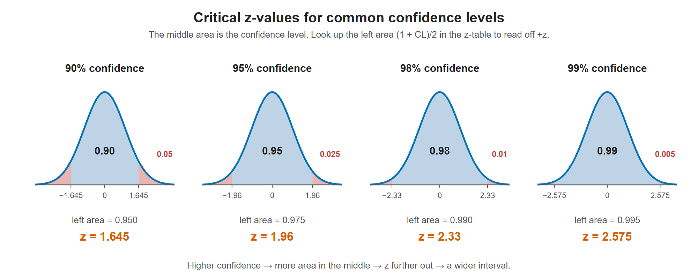

# Lesson 9.2 - How to Find the Z-score Given the Confidence Intervals

> **Video:** [How To Find The Z Score Given The Confidence Level of a Normal Distribution](https://www.youtube.com/watch?v=sJyZ9vRhP7o) by The Organic Chemistry Tutor
> **Chapter:** [9 - Confidence Intervals](https://www.video-tutor.net/confidence-intervals.html)

## Common values to memorize

| Confidence level | $z$ |
|---:|---:|
| 90% | 1.645 |
| 95% | 1.96 |
| 98% | 2.33 |
| 99% | 2.575 |

## Method for any confidence level

**Step 1 - area to the left of $+z$:**

$$\text{left area} = \frac{1 + \text{CL}}{2}$$

**Why:** the confidence level is the area between $-z$ and $+z$. The leftover $1 - \text{CL}$ is split evenly between the two tails. For 95%:

```
  0.025  |          0.95           |  0.025
 ────────┼─────────────────────────┼────────
        -z           mean         +z
 left area up to +z = 0.95 + 0.025 = 0.975
```

**Step 2 - find that area inside a positive z-table** (one that gives **left** areas). Read the row (ones and tenths digits) and the column (hundredths digit), then add them.

*Example:* 0.975 sits in row **1.9**, column **0.06**, so $z = 1.9 + 0.06 = 1.96$.



The confidence level is the middle area, and each tail gets half of what is left. The left area up to +z is (1 + CL)/2, which is the number to look up in the z-table.

---

## Practice

**97% confidence**
$$\text{left area} = \frac{1 + 0.97}{2} = 0.985 \;\Rightarrow\; \text{row } 2.1,\ \text{column } 0.07 \;\Rightarrow\; z = 2.17$$

**92% confidence**
$$\text{left area} = \frac{1 + 0.92}{2} = 0.96$$
The closest table entry is 0.95994, in row **1.7**, column **0.05**, so $z = 1.75$.

---

## Key takeaways

- Left area $= (1 + \text{CL})/2$. Look it up in the body of the z-table to read off $z$.
- If the exact area isn't in the table, use the closest entry, or average two entries that are equally close (e.g. 90% → 1.645).
- Know 1.645, 1.96, 2.33 and 2.575 by heart.
