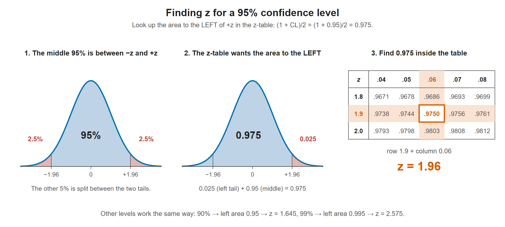
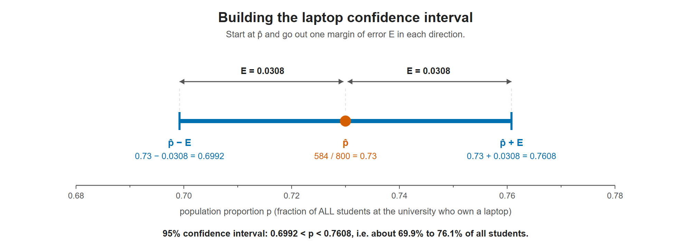
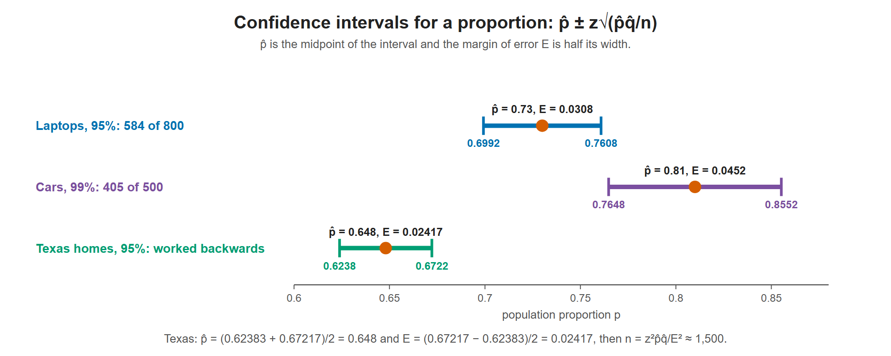
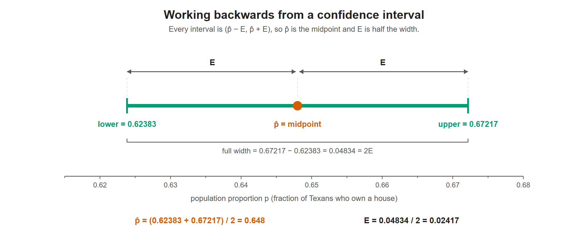

# Lesson 9.4 - Finding a Confidence Interval of a Population Proportion

> **Video:** [Finding The Confidence Interval of a Population Proportion Using The Normal Distribution](https://www.youtube.com/watch?v=_aQTgv_OOSU) by The Organic Chemistry Tutor
> **Chapter:** [9 - Confidence Intervals](https://www.video-tutor.net/confidence-intervals.html)

## The big idea

You want to know what **fraction** of a large group has some property, for example "what percent of students at this university own a laptop?" Asking everyone (maybe 10,000 people) is too much work, so you ask a **sample** instead.

The sample gives you **one estimate**. Because it's only a sample, that estimate is probably a little off. A confidence interval turns the single estimate into a **range** and says how confident you are that the true value is inside it:

$$\underbrace{\hat p}_{\text{your estimate}} \;\pm\; \underbrace{E}_{\text{margin of error}}$$

Earlier lessons did this for a **mean** (an average of numbers). This lesson does the same thing for a **proportion** (a percentage of yes answers).

---

## The symbols

The letters are the most confusing part of this lesson, so here they all are in one place:

| Symbol | Name | Meaning | Laptop example |
|---|---|---|---|
| $n$ | sample size | how many people you asked | 800 |
| $x$ | number of successes | how many said **yes** | 584 |
| $p$ | population proportion | the **true** fraction of everyone. Unknown, and it's what we're trying to estimate | ? |
| $\hat p$ ("p-hat"), also written $p'$ ("p-prime") | sample proportion | the fraction of **your sample** that said yes: $\hat p = x/n$ | $584/800 = 0.73$ |
| $\hat q$ ("q-hat") | proportion of failures | the fraction of your sample that said **no**: $\hat q = 1 - \hat p$ | $0.27$ |
| CL | confidence level | how sure you want to be, as a decimal | 95% → 0.95 |
| $z$ | critical value | how many standard errors wide the interval is; depends only on CL | 1.96 |
| $E$ or EBP | margin of error, or "error bound for a proportion" | how far the interval reaches on each side of $\hat p$ | 0.0308 |

> **$p$ vs $\hat p$:** $p$ (no hat) is the true answer for the whole population, which you never actually know. $\hat p$ (with hat) is what your sample gave you. The confidence interval is a range of believable values for $p$, built around $\hat p$.

$\hat p$ and $\hat q$ always add up to 1. If 73% said yes, then 27% said no.

---

## Formulas

| Quantity | Formula |
|---|---|
| Sample proportion | $\hat p = \dfrac{x}{n}$ |
| Proportion of failures | $\hat q = 1 - \hat p$ |
| Check: is the normal distribution OK? | $n\hat p\hat q \ge 10$ |
| Area to the left of $z$ | $\dfrac{1 + \text{CL}}{2}$ |
| Margin of error | $E = z\sqrt{\dfrac{\hat p\,\hat q}{n}}$ |
| Confidence interval | $\hat p - E < p < \hat p + E$ |
| Sample size needed | $n = \dfrac{z^2\,\hat p\,\hat q}{E^2}$, always rounded **up** |

Common $z$ values:

| Confidence level | Area to the left | $z$ |
|---:|---:|---:|
| 90% | 0.95 | 1.645 |
| 95% | 0.975 | 1.96 |
| 98% | 0.99 | 2.33 |
| 99% | 0.995 | 2.575 |

---

## The recipe (do these steps in order)

1. **Write down $n$ and $x$** from the problem.
2. **Find $\hat p = x/n$ and $\hat q = 1 - \hat p$.**
3. **Check $n\hat p\hat q \ge 10$.** If it is, the normal distribution is a good approximation and you can use $z$.
4. **Find $z$** from the confidence level (see the next section).
5. **Find the margin of error** $E = z\sqrt{\hat p\hat q/n}$.
6. **Build the interval:** lower end $\hat p - E$, upper end $\hat p + E$.
7. **Write a sentence** saying what it means.

---

## Step 3 in detail - why check $n\hat p\hat q \ge 10$?

Each person gives one of two answers (yes or no), so the number of yeses follows a **binomial distribution**. The confidence interval formula uses the **normal** (bell) curve instead, because $z$ values come from the normal curve.

That's only allowed when the binomial distribution looks enough like a bell curve, which happens when the sample is big enough and $\hat p$ isn't too close to 0 or 1. The rule of thumb $n\hat p\hat q \ge 10$ tests this.

> Many textbooks use a slightly different check: $n\hat p \ge 10$ **and** $n\hat q \ge 10$, meaning at least 10 yeses and at least 10 noes. Use whichever your course uses.

---

## Step 4 in detail - finding $z$ from the confidence level

**The picture.** A 95% confidence level means the middle 95% of the bell curve, between $-z$ and $+z$. The other 5% is split equally between the two tails: 2.5% on the left and 2.5% on the right.

The three steps for 95%. Left: the confidence level is the middle area, and the leftover 5% is split into two 2.5% tails. Middle: the z-table measures from the far left, so the area it wants also includes the left tail, 0.975 in total. Right: 0.9750 sits in row 1.9 and column 0.06, so z = 1.96.

A z-table gives the area to the **left** of a z-score. The area to the left of $+z$ is the middle 95% plus the left tail 2.5%:

$$\text{CL} + \frac{1 - \text{CL}}{2} = 0.95 + 0.025 = 0.975$$

**The shortcut formula** gives the same answer without the picture:

$$\text{area to the left} = \frac{1 + \text{CL}}{2} = \frac{1 + 0.95}{2} = \frac{1.95}{2} = 0.975$$

**Looking it up in the table.** Find 0.975 **inside** the positive z-table, then read off its row and column:

- Row: 1.9
- Column: 0.06
- So $z = 1.9 + 0.06 = 1.96$

**If the exact area isn't in the table**, take the two closest entries and average their z-scores. For example, for 90% the area to the left is 0.95. The table has 0.9495 (at $z = 1.64$) and 0.9505 (at $z = 1.65$). 0.95 is exactly halfway, so

$$z = \frac{1.64 + 1.65}{2} = 1.645$$

---

## Step 5 in detail - what the margin of error formula means

$$E = z \times \underbrace{\sqrt{\frac{\hat p\,\hat q}{n}}}_{\text{standard error}}$$

- The square-root part is the **standard error**: roughly how much $\hat p$ would vary if you repeated the survey with different random people.
- $z$ sets how many standard errors you allow on each side. More confidence means a bigger $z$ and a wider interval.
- A bigger $n$ makes the standard error smaller, because larger samples are more reliable. That gives a narrower interval.

For why $\hat p\hat q$ appears here, see "The logic behind the formulas" in Lesson 9.5.

---

## Example 1 - laptop ownership

800 randomly selected college students at university XYZ were asked if they own a laptop. 584 said yes.

### (a) Can the binomial distribution be approximated by a normal distribution?

**Write down what you know.** $n = 800$ and $x = 584$. The true proportion $p$ (all students at the university) is unknown, so we estimate it with $\hat p$.

**Find $\hat p$ and $\hat q$.**

$$\hat p = \frac{x}{n} = \frac{584}{800} = 0.73 \qquad \hat q = 1 - \hat p = 1 - 0.73 = 0.27$$

So 73% of the sample said yes and 27% said no.

**Check the condition.**

$$n\hat p\hat q = 800(0.73)(0.27) = 157.68 \ge 10 \;✓$$

**Yes**, the normal distribution can be used.

### (b) 95% confidence interval and margin of error

**Find $z$.** The area to the left is $(1 + 0.95)/2 = 0.975$, which gives $z = 1.96$.

**Find the margin of error.** Work from the inside out:

$$\frac{\hat p\,\hat q}{n} = \frac{0.73 \times 0.27}{800} = \frac{0.1971}{800} = 2.46375 \times 10^{-4}$$

$$\sqrt{\frac{\hat p\,\hat q}{n}} = \sqrt{2.46375 \times 10^{-4}} = 0.015696$$

$$E = z\sqrt{\frac{\hat p\,\hat q}{n}} = 1.96 \times 0.015696 = 0.0307648 \approx 0.0308$$

**Build the interval.**

$$\text{lower} = \hat p - E = 0.73 - 0.0308 = 0.6992$$
$$\text{upper} = \hat p + E = 0.73 + 0.0308 = 0.7608$$

$$\boxed{0.6992 < p < 0.7608}$$

The interval is built outward from the sample result. The dot is p̂ = 0.73, and each arm is one margin of error, so the two ends are p̂ − E = 0.6992 and p̂ + E = 0.7608.

**Interpretation.** We are 95% confident that between about **69.9% and 76.1%** of **all** students at university XYZ own a laptop.

The margin of error is 0.0308, about **±3.1 percentage points**.

### (c) What sample size gives a 2% margin of error at 90% confidence?

This time we're **not** building an interval. We're asking how many people we would need to survey.

**What changes.** $\hat p = 0.73$ and $\hat q = 0.27$ stay the same. The margin of error is now $E = 2\% = 0.02$, the confidence level is 90%, and $n$ is the unknown.

**Solve the margin of error formula for $n$.**

$$E = z\sqrt{\frac{\hat p\hat q}{n}}$$

Square both sides. The square and the square root cancel:

$$E^2 = \frac{z^2\,\hat p\hat q}{n}$$

Multiply both sides by $n$:

$$nE^2 = z^2\,\hat p\hat q$$

Divide both sides by $E^2$:

$$n = \frac{z^2\,\hat p\,\hat q}{E^2}$$

**Find $z$ for 90%.** The area to the left is $(1 + 0.90)/2 = 0.95$, which gives $z = 1.645$. This is the "average two table values" case from Step 4.

**Plug in.** Don't forget to square **both** $z$ and $E$:

$$n = \frac{z^2\,\hat p\,\hat q}{E^2} = \frac{(1.645)^2(0.73)(0.27)}{(0.02)^2} = \frac{2.706025 \times 0.1971}{0.0004} = \frac{0.53336}{0.0004} \approx 1333.39$$

**Round up**, even though normal rounding would give 1333:

$$n = 1334 \text{ students}$$

> **Why always round up?** With 1333 students the margin of error would be slightly **more** than 2%. We need **at least** enough people to reach 2%, so we go up to the next whole person.

The three intervals from the lesson. The dot is p̂, the midpoint, and each arm is the margin of error E. The 99% car interval is the widest, because higher confidence uses a larger z.

---

## Example 2 - car ownership

500 residents in town ABC were asked if they own a car. 405 said yes.

**Write down what you know and find $\hat p$, $\hat q$.**

$$n = 500, \quad x = 405, \quad \hat p = \frac{x}{n} = \frac{405}{500} = 0.81, \quad \hat q = 1 - \hat p = 1 - 0.81 = 0.19$$

So 81% of the sample own a car.

### (a) 99% confidence interval

**Find $z$.** The area to the left is $(1 + 0.99)/2 = 1.99/2 = 0.995$. In the table, 0.995 falls between $z = 2.57$ and $z = 2.58$, so average them:

$$z = \frac{2.57 + 2.58}{2} = 2.575$$

**Find the margin of error.**

$$\frac{\hat p\,\hat q}{n} = \frac{0.81 \times 0.19}{500} = \frac{0.1539}{500} = 0.0003078 \qquad \sqrt{\frac{\hat p\,\hat q}{n}} = \sqrt{0.0003078} = 0.01754$$

$$E = z\sqrt{\frac{\hat p\,\hat q}{n}} = 2.575 \times 0.01754 \approx 0.0452$$

**Build the interval.**

$$\hat p - E = 0.81 - 0.0452 = 0.7648 \qquad \hat p + E = 0.81 + 0.0452 = 0.8552$$

$$\boxed{0.7648 < p < 0.8552}$$

**Interpretation.** We are 99% confident that between about **76.5% and 85.5%** of all residents of town ABC own a car.

> Compare with Example 1: the margin of error here (±4.5 points) is wider than the laptop one (±3.1 points). Partly that's because 99% confidence uses a bigger $z$ (2.575 vs 1.96), and partly because the sample is smaller (500 vs 800).

### (b) What sample size gives a 3% margin of error at 98% confidence?

**Find $z$.** The area to the left is $(1 + 0.98)/2 = 1.98/2 = 0.99$. The closest table entry is 0.9901, at $z = 2.33$.

**Plug in**, with $E = 3\% = 0.03$:

$$n = \frac{z^2\,\hat p\,\hat q}{E^2} = \frac{(2.33)^2(0.81)(0.19)}{(0.03)^2} = \frac{5.4289 \times 0.1539}{0.0009} = \frac{0.83551}{0.0009} \approx 928.34$$

**Round up:** $n = 929$ residents.

---

## Example 3 - working backwards from an interval

Some number of people in Texas were asked if they own a house. The 95% confidence interval for the true proportion of homeowners was $(0.62383,\; 0.67217)$.

This time the interval is **given**, and we work back to find the pieces that built it. The key fact is that every confidence interval has the shape

$$(\hat p - E,\;\; \hat p + E)$$

so $\hat p$ sits **exactly in the middle**, and $E$ is the distance from the middle to either end.

Only the two ends are given. Because the interval is p̂ ± E, p̂ is the point halfway between them (0.648), and E is half of the full width (0.04834 / 2 = 0.02417).

### (a) What is the sample proportion?

$\hat p$ is the **midpoint**, the average of the two ends:

$$\hat p = \frac{\text{lower} + \text{upper}}{2} = \frac{0.62383 + 0.67217}{2} = \frac{1.296}{2} = 0.648$$

### (b) What is the error bound?

**Method 1: upper end minus the middle.**

$$E = \text{upper} - \hat p = 0.67217 - 0.648 = 0.02417$$

**Method 2: half the width of the interval.** The full width is 2E, so

$$E = \frac{\text{upper} - \text{lower}}{2} = \frac{0.67217 - 0.62383}{2} = \frac{0.04834}{2} = 0.02417$$

Both methods give the same answer.

### (c) How many people were surveyed?

That's $n$, so use the sample-size formula. At 95% confidence $z = 1.96$, and $\hat q = 1 - \hat p = 1 - 0.648 = 0.352$:

$$n = \frac{z^2\,\hat p\,\hat q}{E^2} = \frac{(1.96)^2(0.648)(0.352)}{(0.02417)^2} = \frac{3.8416 \times 0.228096}{0.000584189} = \frac{0.87625}{0.000584189} \approx 1499.95$$

So about **1500 people** were surveyed.

> Here 1499.95 is just rounding noise in the given interval, so the real answer is 1500. Rounding up and rounding to the nearest whole number both give 1500.

### (d) How many said yes?

$\hat p$ is the **fraction** who said yes, and $x$ is the **number** who said yes. Since $\hat p = x/n$, multiply both sides by $n$:

$$x = n\,\hat p = 1500 \times 0.648 = 972$$

So **972 people** said yes, which is 64.8% of 1500.

---

## Common mistakes

- **Mixing up $p$ and $\hat p$.** $\hat p$ comes from the sample, and you calculate it. $p$ is the true population value, and you never know it exactly. The interval is a guess for $p$.
- **Forgetting to convert percentages.** A 2% margin of error is $E = 0.02$, not 2. A 95% confidence level is 0.95.
- **Looking up the confidence level directly in the z-table.** Look up the **area to the left**, $(1 + \text{CL})/2$. For 95%, look up 0.975, not 0.95.
- **Forgetting to square** $z$ or $E$ in the sample-size formula.
- **Rounding $n$ down.** Sample sizes always round **up**.
- **Misreading what "95% confident" means.** It does **not** mean there's a 95% chance that $p$ is in this particular interval. $p$ is a fixed number, and it either is or isn't inside. It means the **method** works 95% of the time: if you repeated the survey many times and built an interval each time, about 95% of those intervals would contain the true $p$.

---

## Key takeaways

- $\hat p = x/n$ is your estimate, and $\hat q = 1 - \hat p$. Check $n\hat p\hat q \ge 10$ before using the normal curve.
- Find $z$ by looking up the area to the left, $(1 + \text{CL})/2$, in the z-table.
- Confidence interval: $\hat p \pm z\sqrt{\hat p\hat q/n}$.
- Higher confidence means a bigger $z$ and a wider interval. A bigger sample means a narrower interval.
- Given an interval: its midpoint is $\hat p$, and half its width is $E$.
- Sample size: $n = z^2\hat p\hat q/E^2$, always rounded **up**. Lesson 9.5 covers sample size in more depth.
