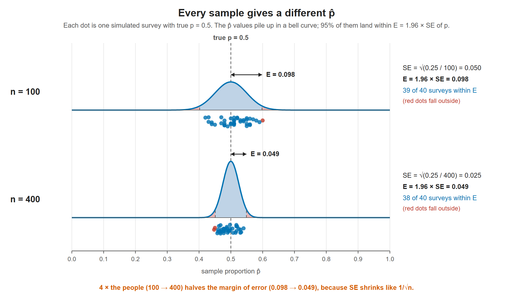
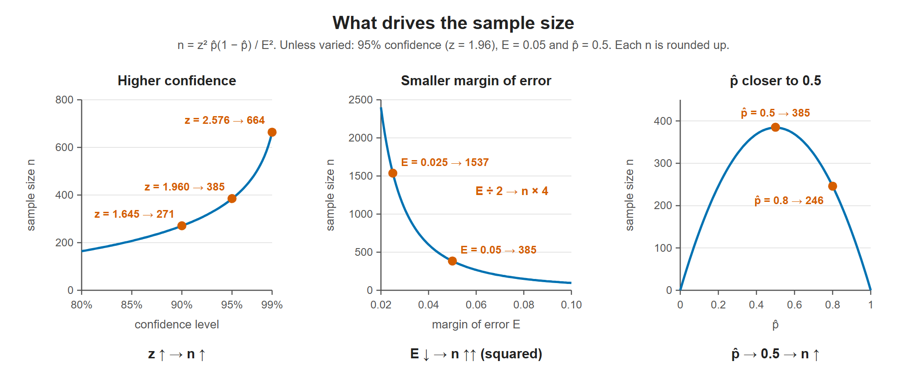
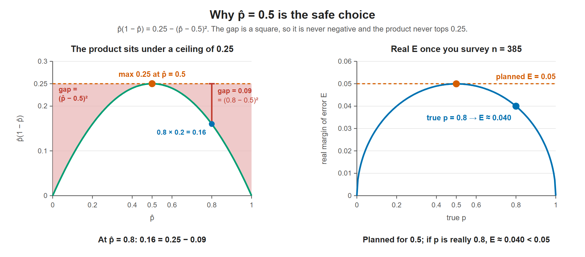
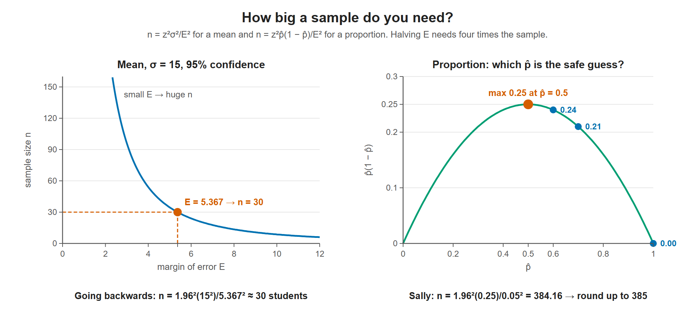

# Lesson 9.5 - How to Calculate the Sample Size

> **Video:** [How To Calculate The Sample Size Given The Confidence Level & Margin of Error](https://www.youtube.com/watch?v=nkkxu09K3ZA) by The Organic Chemistry Tutor
> **Chapter:** [9 - Confidence Intervals](https://www.video-tutor.net/confidence-intervals.html)

## Formulas

**For a mean.** Start from the margin of error:

$$E = z\,\frac{\sigma}{\sqrt n} \;\xrightarrow{\text{square both sides}}\; E^2 = \frac{z^2\sigma^2}{n} \;\Rightarrow\; \boxed{n = \frac{z^2\sigma^2}{E^2}}$$

**For a proportion.** Same algebra, starting from the proportion's margin of error (Lesson 9.4):

$$E = z\sqrt{\frac{\hat p(1-\hat p)}{n}} \;\xrightarrow{\text{square both sides}}\; E^2 = \frac{z^2\,\hat p(1-\hat p)}{n} \;\Rightarrow\; \boxed{n = \frac{z^2\,\hat p\,(1 - \hat p)}{E^2}}$$

It is the mean formula with $\sigma^2$ replaced by $\hat p(1-\hat p)$, as explained below.

If $\hat p$ is unknown, use **$\hat p = 0.5$**. That makes $\hat p(1 - \hat p)$ as large as possible, so the resulting $n$ is big enough whatever the true proportion is.

Always **round $n$ up** to the next whole number.

---

## The logic behind the formulas

**1. Every sample gives a different answer.** Survey $n$ people and you get a sample proportion $\hat p$. A different random group would give a slightly different $\hat p$. Across many samples, the $\hat p$ values form a bell curve centred on the true $p$. The spread of that curve is the **standard error**:

$$SE = \sqrt{\frac{p(1-p)}{n}}$$

**Why $p$ here and not $\hat p$?** The SE describes how much $\hat p$ wobbles from sample to sample. That wobble comes from the population the samples are drawn from, so the exact formula uses the true $p$. But $p$ is exactly what we don't know. In practice we plug in the best stand-in available: the sample's $\hat p$ when building an interval from data (Lesson 9.4), or a guess, or 0.5, when planning a survey before any data exists (point 6). That swap is why the formulas at the top are written with $\hat p$. With a decent-sized sample $\hat p$ is close to $p$, so the estimated SE is close to the true one.

**2. The margin of error is $z$ standard errors.** On a bell curve, 95% of values lie within 1.96 standard deviations of the centre. So 95% of the time, $\hat p$ lands within $1.96 \times SE$ of the truth:

$$E = z \times SE$$

$E$ is how far off you are willing to be, and $z$ is how sure you want to be of staying within that distance.

Each dot is one simulated survey. Its $\hat p$ misses the true $p = 0.5$ by a different amount each time, but about 95% of the dots land inside $\pm E$. The bottom row previews point 4: four times as many people makes the curve half as wide.

**3. Why $p(1-p)$ plays the role of $\sigma^2$.** Code each answer as 1 (yes) or 0 (no). Then $\hat p$ is just the average of those 0s and 1s, and their variance is

$$\sigma^2 = E[X^2] - (E[X])^2 = p - p^2 = p(1-p)$$

since $1^2 = 1$ and $0^2 = 0$. Intuitively:

- If everyone says yes ($p = 1$), every sample looks the same: $p(1-p) = 0$, so there is no uncertainty.
- If the population is split 50/50, samples can easily tilt either way, so the variation is largest: $p(1-p) = 0.25$.

A single answer can only be 0 or 1 (the dots), but the average of 100 answers clusters tightly around $p$ (the curve). The more mixed the 0s and 1s, the bigger $p(1-p)$, and the wider $\hat p$ spreads from survey to survey. $p = 0.2$ and $p = 0.8$ give the same spread, since $0.2 \times 0.8 = 0.8 \times 0.2$: only how mixed the answers are matters, not which side is the majority.

**4. Why divide by $n$.** In a small sample, a few unusual answers move $\hat p$ a lot. In a large one they get diluted. The variance shrinks like $1/n$, so $SE$ shrinks like $1/\sqrt n$. Because of the square root, **halving** the margin of error takes **4 times** as many people.

**5. Turn it around.** Normally you collect data and then compute $E$. Sample-size planning runs the other way: you choose the $E$ you want and solve for the $n$ that achieves it.

| Change | Effect on $n$ | Why |
|---|---|---|
| Higher confidence ($z$ ↑) | $n$ ↑ | Being more sure needs more evidence |
| Smaller margin of error ($E$ ↓) | $n$ ↑↑ (squared) | More precision needs more data |
| $p$ closer to 0.5 | $n$ ↑ | A more mixed population is less predictable |

Each panel changes one ingredient and holds the others at 95%, $E = 0.05$, $\hat p = 0.5$. The middle panel is the steepest: halving $E$ multiplies $n$ by 4.

**6. Why $\hat p = 0.5$ is the safe choice.** You plan the survey before you have data, so $p$ is unknown. The safe move is to use the $\hat p$ that makes $n$ as large as possible. Since $z$ and $E$ are fixed, that means finding the maximum of

$$f(\hat p) = \hat p(1-\hat p) = \hat p - \hat p^2, \qquad 0 \le \hat p \le 1$$

*With calculus.* Set the first derivative to zero:

$$f'(\hat p) = 1 - 2\hat p = 0 \;\Rightarrow\; \hat p = 0.5$$

The second derivative is $f''(\hat p) = -2 < 0$, so the curve bends downward everywhere and $\hat p = 0.5$ is a maximum, not a minimum. Its value is $f(0.5) = 0.5 \times 0.5 = 0.25$. At the ends, $f(0) = f(1) = 0$, so 0.25 is the largest value on the whole range $0 \le \hat p \le 1$.

*Without calculus.* Completing the square gives the same answer:

$$\hat p(1-\hat p) = 0.25 - (\hat p - 0.5)^2$$

The squared term is never negative, so the product can never exceed 0.25, which happens only at $\hat p = 0.5$.

Planning for this worst case guarantees $n$ is large enough. If the true $p$ turns out to be, say, 0.8, the real margin of error simply comes out a bit smaller than planned.

Left: the shaded gap between the curve and 0.25 is $(\hat p - 0.5)^2$, which is zero only at $\hat p = 0.5$. Right: survey the planned $n = 385$, and if $p$ turns out to be 0.8 the margin of error is $1.96\sqrt{0.16/385} \approx 0.040$, comfortably inside the 0.05 you asked for.

> **In one sentence:** sample answers wobble around the truth. The wobble grows with how mixed the population is and shrinks with $\sqrt n$, so you pick $n$ large enough that $z$ times the wobble fits inside the error you'll accept.

---

## Example 1 - working backwards to the class size

The mean test score was 84 with standard deviation $\sigma = 15$. The margin of error at 95% confidence was $E = 5.367$. How many students were sampled?

$$n = \frac{z^2\sigma^2}{E^2} = \frac{(1.96)^2(15)^2}{(5.367)^2} \approx 30.0 \;\Rightarrow\; n = 30 \text{ students}$$

(The mean, 84, isn't needed.)

---

## Example 2 - planning a survey on a proportion

Sally wants to estimate the proportion of high-school students planning to go to college, with **95%** confidence and a **5%** margin of error ($E = 0.05$). She has no prior estimate of $\hat p$.

**Which $\hat p$ makes $\hat p(1 - \hat p)$ largest?**

| $\hat p$ | $1 - \hat p$ | Product |
|---:|---:|---:|
| 1.0 | 0.0 | 0.00 |
| 0.7 | 0.3 | 0.21 |
| 0.6 | 0.4 | 0.24 |
| **0.5** | **0.5** | **0.25** (largest) |

$$n = \frac{z^2\,\hat p(1 - \hat p)}{E^2} = \frac{(1.96)^2(0.5)(0.5)}{(0.05)^2} = \frac{0.9604}{0.0025} = 384.16 \;\Rightarrow\; n = 385$$

Round **up**: 384 students would not quite reach the 5% margin.

Left: the required n grows fast as the margin of error shrinks, and Example 1's E = 5.367 corresponds to n = 30. Right: $\hat p(1 - \hat p)$ is largest at $\hat p = 0.5$, so using 0.5 when nothing is known gives the safest (largest) sample size.

---

## Key takeaways

- Mean: $n = z^2\sigma^2/E^2$. Proportion: $n = z^2\hat p(1-\hat p)/E^2$.
- Both come from solving $E = z \times SE$ for $n$. For yes/no data the variance is $p(1-p)$, which takes the place of $\sigma^2$.
- With no estimate of $\hat p$, use 0.5. This gives the largest, safest $n$.
- Always round **up**.
- A smaller margin of error or a higher confidence level requires a larger sample.
