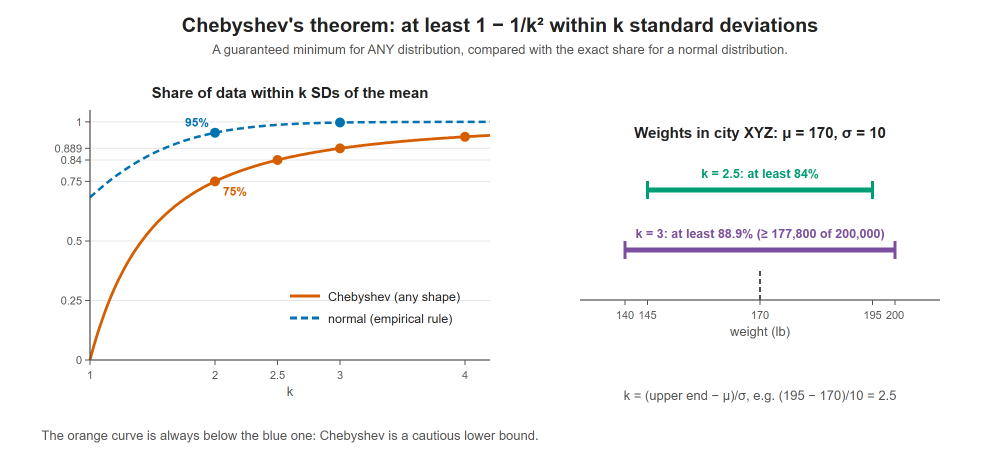
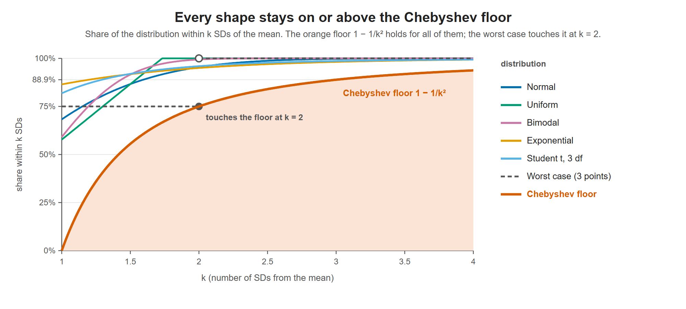

# Lesson 9.6 - Chebyshev's Theorem

> **Video:** [Chebyshev's Theorem](https://www.youtube.com/watch?v=ZXq0ygaZuwg) by The Organic Chemistry Tutor
> **Chapter:** [9 - Confidence Intervals](https://www.video-tutor.net/confidence-intervals.html)

## Statement

For **any** distribution, whatever its shape, the proportion of data within $k$ standard deviations of the mean is **at least**

$$1 - \frac{1}{k^2}, \qquad k > 1$$

- It gives a **minimum**, not an exact value. The true proportion can be higher.
- It works for **all** distributions, not only normal ones.
- In the video the formula is spoken as "1 over 1 minus k squared". The correct form is **$1 - 1/k^2$**.

## Chebyshev vs the empirical rule

| Within | Empirical rule (normal only) | Chebyshev (any distribution, minimum) |
|---|---:|---:|
| $1\sigma$ | 68% | — ($k$ must be $> 1$) |
| $2\sigma$ | 95% | $1 - \tfrac14 = 75\%$ |
| $3\sigma$ | 99.7% | $1 - \tfrac19 \approx 88.9\%$ |
| $4\sigma$ | ≈ 99.99% | $1 - \tfrac1{16} = 93.75\%$ |

Left: Chebyshev's guaranteed minimum (orange) is always below the exact share for normal data (blue). For example, it guarantees 75% within 2 SDs, while a normal distribution has 95%. Right: the two intervals from the weight example.

## Chebyshev on other famous distributions

"Any distribution" is a strong claim, so here it is tested on six very different shapes. Each one is rescaled to the same mean $\mu$ and standard deviation $\sigma$, so the axis reads directly in SDs from the mean.

| Share within $k\sigma$ of $\mu$ | $k = 1.5$ | $k = 2$ | $k = 3$ |
|---|---:|---:|---:|
| Normal | 86.6% | 95.4% | 99.7% |
| Uniform | 86.6% | 100% | 100% |
| Bimodal (two humps) | 91.6% | 99.4% | ≈ 100% |
| Exponential (skewed) | 91.8% | 95.0% | 98.2% |
| Student $t$, 3 df (heavy tails) | 92.0% | 95.9% | 98.6% |
| Worst case (three points) | 75% | 75% | 100% |
| **Chebyshev minimum** $1 - 1/k^2$ | **55.6%** | **75%** | **88.9%** |

- **Every row is at or above the Chebyshev row.** Very different shapes all satisfy the guarantee.
- **Real shapes beat the bound by a lot.** At $k = 2$, five of the six have 95% or more, far above the promised 75%.
- **The bound can't be raised, though.** The worst case puts $\tfrac18$ of the data at $\mu - 2\sigma$, $\tfrac34$ at $\mu$ and $\tfrac18$ at $\mu + 2\sigma$. Its SD is exactly $\sigma$, since $\sqrt{\tfrac18 (2\sigma)^2 + \tfrac18 (2\sigma)^2} = \sigma$, yet only 75% lies strictly inside $\mu \pm 2\sigma$. Because one shape lands exactly on 75%, no rule that covers all shapes can promise more.

The orange curve is the floor $1 - 1/k^2$. Each coloured line shows the true share within $k$ SDs for one shape, and none dips below the floor. The dashed worst case touches it at $k = 2$, which is why Chebyshev's theorem is sometimes called "sharp".

**What "sharp" means.** A bound is *sharp* (or *tight*) when it can't be improved. Suppose someone proposed a stronger rule, such as "at least 80% of any data lies within $2\sigma$". The worst case breaks it, because it has only 75%. So 75% is the best guarantee that holds for every possible shape. Real data usually beats it easily, but no universal rule can promise more.

**A worst case for any $k$.** The example above touches the floor only at $k = 2$ because it was built for $k = 2$. The same recipe works for any $k > 1$:

| Value | $\mu - k\sigma$ | $\mu$ | $\mu + k\sigma$ |
|---|---:|---:|---:|
| Share of the data | $\dfrac{1}{2k^2}$ | $1 - \dfrac{1}{k^2}$ | $\dfrac{1}{2k^2}$ |

- **Its mean is $\mu$**, because the two outer points balance each other.
- **Its SD is exactly $\sigma$.** Only the outer points are away from the mean, each by $k\sigma$:

$$\text{variance} = \frac{1}{2k^2}(k\sigma)^2 + \frac{1}{2k^2}(k\sigma)^2 = \frac{\sigma^2}{2} + \frac{\sigma^2}{2} = \sigma^2$$

- **Exactly $1/k^2$ of the data sits $k\sigma$ from the mean**, so the share strictly inside $\mu \pm k\sigma$ is exactly $1 - 1/k^2$, right on the floor.

With $k = 2$ this gives $\tfrac18$, $\tfrac34$, $\tfrac18$, the worst case in the figures. With $k = 3$ it gives $\tfrac1{18}$ at each end and $\tfrac89$ at $\mu$, which touches the floor at 88.9%. So the bound is sharp at every $k$; each worst-case example just touches the curve at its own $k$.

## Finding $k$

If an interval is centered on the mean, $\mu \pm k\sigma$, then

$$k = \frac{x - \mu}{\sigma}$$

using the upper end $x$ (the lower end gives the same $k$).

---

## Example - weights in city XYZ

Mean weight $\mu = 170$ lb, $\sigma = 10$ lb, distribution shape unknown.

**(a) Minimum percentage of people weighing between 145 and 195 lb**

Both ends are 25 lb from the mean, so
$$k = \frac{x - \mu}{\sigma} = \frac{195 - 170}{10} = 2.5$$
$$1 - \frac{1}{k^2} = 1 - \frac{1}{2.5^2} = 1 - \frac{1}{6.25} = 0.84$$

**At least 84%** of residents weigh between 145 and 195 lb. The real figure could be 86%, 89%, 95%, ...

**(b) The city has 200,000 residents. What is the minimum number weighing between 140 and 200 lb?**

Both ends are 30 lb from the mean, so
$$k = \frac{x - \mu}{\sigma} = \frac{200 - 170}{10} = 3, \qquad 1 - \frac{1}{k^2} = 1 - \frac19 = \frac89 \approx 0.889$$

$$\left(1 - \frac{1}{k^2}\right) \times N = \frac89 \times 200{,}000 \approx 177{,}778 \text{ people}$$

(The video rounds to 0.889 first and gets 177,800.)

So $P(140 \le X \le 200) \ge 0.889$, and **at least about 177,800** residents weigh between 140 and 200 lb.

---

## Key takeaways

- Chebyshev: at least $1 - 1/k^2$ of any data set lies within $k$ SDs of the mean ($k > 1$).
- Use it when the distribution is **unknown or not normal**. Use the empirical rule only for normal data.
- $k = (x - \mu)/\sigma$ for an interval centered on the mean.
- Answers are **lower bounds**: say "at least".
