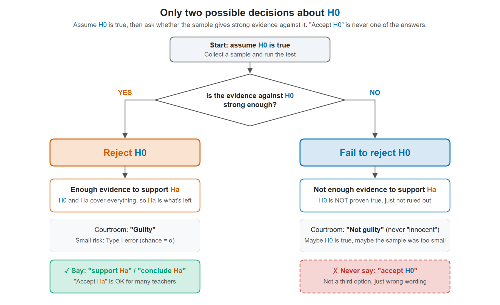
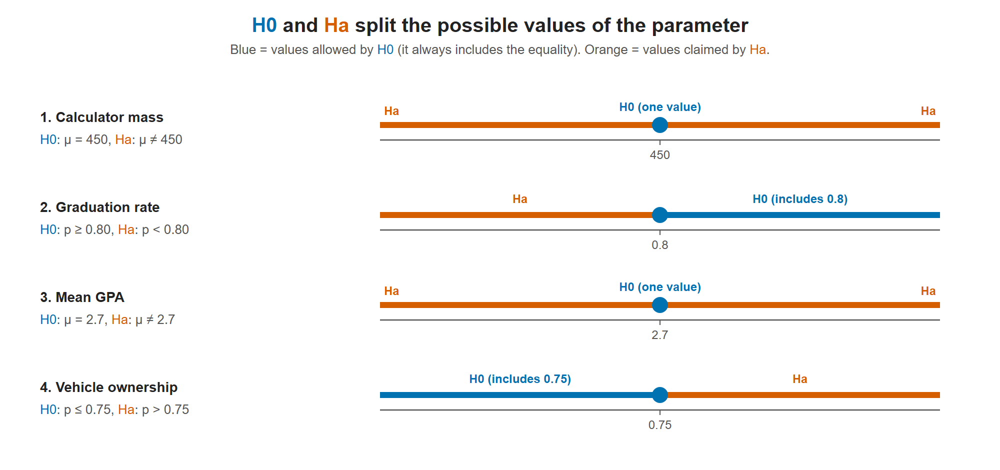

# Lesson 10.1 - Hypothesis Testing - Null and Alternative Hypotheses

> **Video:** [Hypothesis Testing - Null and Alternative Hypotheses](https://www.youtube.com/watch?v=wiYJWyfdGg4) by The Organic Chemistry Tutor
> **Chapter:** [10 - Hypothesis Testing - 1 Sample](https://www.video-tutor.net/hypothesis-testing-with-one-sample.html)

## The two hypotheses

| | Null hypothesis ${\color{#0072B2}H_0}$ | Alternative hypothesis ${\color{#D55E00}H_a}$ (or ${\color{#D55E00}H_1}$) |
|---|---|---|
| What it is | The **status quo**: the currently accepted value or claim | The **challenger**: what the researcher is trying to show |
| Sign | Contains the **equality**: $=$, $\le$, $\ge$ | **Strict** inequality: $\ne$, $<$, $>$ |

The researcher tries to gather enough evidence to **reject** ${\color{#0072B2}H_0}$ in favor of ${\color{#D55E00}H_a}$.

> **Careful wording:** if the evidence isn't strong enough, we **fail to reject** ${\color{#0072B2}H_0}$. That doesn't prove ${\color{#0072B2}H_0}$ is true, or even that it is "likely" true. It only means the data didn't rule it out.

## Steps

1. **Mean or proportion?**
   - "average", "mean" → population mean $\mu$
   - "percent", "proportion", "fraction" → population proportion $p$, written as a decimal (80% → 0.80)
2. **Find the accepted value** (the status quo) and write ${\color{#0072B2}H_0}$ with the equality.
3. **Find what the researcher suspects** and write ${\color{#D55E00}H_a}$ with the strict inequality. Together, ${\color{#0072B2}H_0}$ and ${\color{#D55E00}H_a}$ cover every possibility.

| Wording | ${\color{#0072B2}H_0}$ | ${\color{#D55E00}H_a}$ |
|---|---|---|
| "is different from", "is not" | $=$ | $\ne$ |
| "at least", "no less than" | $\ge$ | $<$ |
| "at most", "no more than" | $\le$ | $>$ |

## Why the signs go this way

**1. ${\color{#0072B2}H_0}$ gets the equality because the math needs one exact number.** A test starts by assuming ${\color{#0072B2}H_0}$ is true, then asks: "If that were true, how surprising is my sample?" To measure "how surprising" you need one specific value to plug into the formula.

- $\mu = 10$ gives you 10, so you can calculate.
- $\mu < 10$ doesn't. Is it 9.9? 7? 2? You can't compute anything from that.

So the exact number (the equality) always lives in ${\color{#0072B2}H_0}$. Even when ${\color{#0072B2}H_0}$ is $\ge$ or $\le$, the calculation uses the boundary value, the "=" part.

**2. ${\color{#0072B2}H_0}$ gets the benefit of the doubt.** Think of a courtroom:

- ${\color{#0072B2}H_0}$ = **innocent** (the default, believed until proven otherwise)
- ${\color{#D55E00}H_a}$ = **guilty** (what the prosecutor has to prove)

The researcher is the prosecutor. The burden of proof is on ${\color{#D55E00}H_a}$, so ${\color{#D55E00}H_a}$ gets the strict claim ($\ne$, $<$, $>$).

**3. Together they cover every possibility, with no overlap.** That's why they come in fixed pairs:

| ${\color{#0072B2}H_0}$ | ${\color{#D55E00}H_a}$ | Together |
|---|---|---|
| $=$ | $\ne$ | equal or not equal → everything |
| $\ge$ | $<$ | at least, or below → everything |
| $\le$ | $>$ | at most, or above → everything |

**Example.** A company says its battery lasts **at least 10 hours**. You suspect it's less.
$${\color{#0072B2}H_0}: \mu \ge 10 \qquad {\color{#D55E00}H_a}: \mu < 10$$
${\color{#0072B2}H_0}$ is the company's claim (status quo, includes the "="). ${\color{#D55E00}H_a}$ is your suspicion (strict).

## What "fail to reject" means

**"Fail to reject ${\color{#0072B2}H_0}$" = "not enough evidence to say ${\color{#0072B2}H_0}$ is wrong." It does NOT mean "${\color{#0072B2}H_0}$ is right."**

- **Courtroom:** the jury says "not guilty", never "innocent". Maybe the person really is innocent, or maybe the prosecutor just didn't have enough evidence. The verdict only says the case wasn't proven.
- **Lost keys:** you search your room for 30 seconds and don't find your keys. That doesn't prove they aren't there. You just didn't find them. Maybe you didn't look long enough, which in statistics is like having too small a sample.
- **Battery:** you test 5 batteries and get an average of 9.8 hours. That's a bit below 10, but with only 5 batteries it could easily be random luck. So you fail to reject ${\color{#0072B2}H_0}$. You haven't proven the batteries last 10+ hours. You just can't call the company a liar yet.

| Decision | Meaning |
|---|---|
| **Reject ${\color{#0072B2}H_0}$** | Strong evidence. ${\color{#0072B2}H_0}$ looks wrong, so we side with ${\color{#D55E00}H_a}$. |
| **Fail to reject ${\color{#0072B2}H_0}$** | Not enough evidence. We can't say ${\color{#0072B2}H_0}$ is wrong. (Never say "accept ${\color{#0072B2}H_0}$".) |

## Only two decisions: reject or fail to reject

There are only **two** possible decisions about ${\color{#0072B2}H_0}$. "Accept ${\color{#0072B2}H_0}$" is **not** a third option; it's just a wrong way of saying "fail to reject". A test can only collect evidence **against** ${\color{#0072B2}H_0}$, never evidence **for** it.

The courtroom has the same two verdicts:

- **Guilty** = reject ${\color{#0072B2}H_0}$
- **Not guilty** = fail to reject ${\color{#0072B2}H_0}$

There's no "innocent" verdict, just as there's no "accept ${\color{#0072B2}H_0}$".

**Reject ${\color{#0072B2}H_0}$ means you support ${\color{#D55E00}H_a}$.** ${\color{#0072B2}H_0}$ and ${\color{#D55E00}H_a}$ cover every possibility with no overlap. If you have strong evidence that ${\color{#0072B2}H_0}$ is wrong, the only option left is ${\color{#D55E00}H_a}$. It doesn't work the other way: failing to reject ${\color{#0072B2}H_0}$ says nothing in favor of ${\color{#0072B2}H_0}$.

| Decision | What you can say about ${\color{#D55E00}H_a}$ |
|---|---|
| **Reject ${\color{#0072B2}H_0}$** | Enough evidence to **support ${\color{#D55E00}H_a}$** |
| **Fail to reject ${\color{#0072B2}H_0}$** | Not enough evidence to support ${\color{#D55E00}H_a}$ (and ${\color{#0072B2}H_0}$ is not proven true) |

> **Small caution:** "support ${\color{#D55E00}H_a}$" or "conclude ${\color{#D55E00}H_a}$" is safer wording than "accept ${\color{#D55E00}H_a}$", because rejecting ${\color{#0072B2}H_0}$ isn't 100% proof. There's a small chance you rejected ${\color{#0072B2}H_0}$ when it was actually true. That's a **Type I error**, and its chance is $\alpha$ (for example 5%). See Lesson 10.2.

**Exam-friendly wording:**

- ✅ "Reject ${\color{#0072B2}H_0}$. There is sufficient evidence to support the claim that $\mu < 10$."
- ✅ "Fail to reject ${\color{#0072B2}H_0}$. There is not enough evidence to support the claim that $\mu < 10$."
- ❌ "Accept ${\color{#0072B2}H_0}$." (Some older textbooks use it, but most teachers mark it wrong.)

---

## Examples

**1. Calculator mass.** Company XYZ's calculators average **450 g**. An engineer thinks the average is different and weighs 50 calculators.
$${\color{#0072B2}H_0}: \mu = 450 \qquad {\color{#D55E00}H_a}: \mu \ne 450$$
("Average" means a mean.)

**2. Graduation rate.** Teachers believe **at least 80%** of students graduate. A student disagrees.
$${\color{#0072B2}H_0}: p \ge 0.80 \qquad {\color{#D55E00}H_a}: p < 0.80$$
("Percent" means a proportion. "At least 80%" means 80% or more.)

**3. GPA.** A teacher wants to test whether the mean GPA is **different from 2.7**. Here it is easier to start with ${\color{#D55E00}H_a}$, the teacher's claim.
$${\color{#0072B2}H_0}: \mu = 2.7 \qquad {\color{#D55E00}H_a}: \mu \ne 2.7$$

**4. Vehicle ownership.** The share of residents who own a vehicle is **no more than 75%**. A researcher disagrees and surveys 100 residents.
$${\color{#0072B2}H_0}: p \le 0.75 \qquad {\color{#D55E00}H_a}: p > 0.75$$
("No more than" means ≤. Surveying 100 residents gives the sample size, which is not part of either hypothesis.)

${\color{#0072B2}H_0}$ and ${\color{#D55E00}H_a}$ always cover every possible value between them. ${\color{#0072B2}H_0}$ holds the boundary value (the equality). With "≠", ${\color{#0072B2}H_0}$ is a single point and ${\color{#D55E00}H_a}$ is everything else.

---

## Key takeaways

- ${\color{#0072B2}H_0}$ = status quo with the equality ($=$, $\le$, $\ge$). ${\color{#D55E00}H_a}$ = the claim being tested, with a strict sign ($\ne$, $<$, $>$).
- Hypotheses are about **population parameters** ($\mu$ or $p$), never about sample values like $\bar x$ or $\hat p$.
- Translate the wording carefully: "at least" → $\ge$, "no more than" → $\le$, "different" → $\ne$.
- ${\color{#0072B2}H_0}$ holds the equality because the test needs one exact value to calculate with, and ${\color{#0072B2}H_0}$ gets the benefit of the doubt (like "innocent until proven guilty").
- "Fail to reject ${\color{#0072B2}H_0}$" means "not proven wrong", not "proven right". Never say "accept ${\color{#0072B2}H_0}$".
- Only two decisions exist: **reject ${\color{#0072B2}H_0}$** (→ support ${\color{#D55E00}H_a}$) or **fail to reject ${\color{#0072B2}H_0}$** (→ not enough evidence for ${\color{#D55E00}H_a}$).
