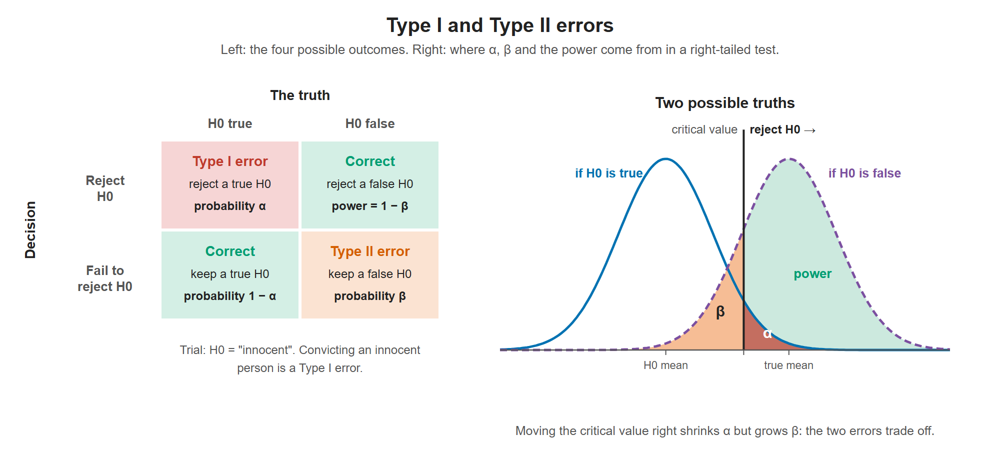

# Lesson 10.2 - How to Identify Type I and Type II Errors

> **Video:** [How To Identify Type I and Type II Errors In Statistics](https://www.youtube.com/watch?v=9yQm9F2_yIk) by The Organic Chemistry Tutor
> **Chapter:** [10 - Hypothesis Testing - 1 Sample](https://www.video-tutor.net/hypothesis-testing-with-one-sample.html)

## Definitions

| Error | What happens | Probability |
|---|---|---|
| **Type I** | **Reject** $H_0$ when $H_0$ is actually **true** | $\alpha$ (the significance level) |
| **Type II** | **Fail to reject** $H_0$ when $H_0$ is actually **false** | $\beta$ |
| *(correct)* Power | Reject $H_0$ when it is false | $1 - \beta$, the **power of the test** |

## Decision table

| | $H_0$ is **true** | $H_0$ is **false** |
|---|---|---|
| **Reject** $H_0$ | ❌ **Type I error** ($\alpha$) | ✅ Correct (power $= 1 - \beta$) |
| **Fail to reject** $H_0$ | ✅ Correct | ❌ **Type II error** ($\beta$) |

We can't control whether $H_0$ is true. We only control the decision. (The video sometimes says "accept $H_0$"; the standard wording is "fail to reject $H_0$".)

Left: the four combinations of decision and truth. Right: if H0 is true, the red tail beyond the critical value (α) is the chance of a false alarm. If H0 is false, the orange area left of the critical value (β) is the chance of missing the effect, and the green area is the power.

## How to identify the error type

1. Mark each scenario as a **good** decision or a **bad** decision (an error).
2. For each error, ask whether the facts make **$H_0$ true or false**:
   - $H_0$ true but rejected → **Type I**
   - $H_0$ false but not rejected → **Type II**

---

## Example 1 - is John's car safe?

$H_0$: *John's used car is safe to drive.*

| Choice | Situation | Good or bad? | Error |
|---|---|---|---|
| A | Thinks the car is safe, but it is **not** safe | Bad | $H_0$ false, not rejected → **Type II** |
| B | Thinks the car is safe, and it **is** safe | Good | — |
| C | Thinks it may not be safe, and it is **not** safe | Good | — |
| D | Thinks it may not be safe, but it **is** safe | Bad | $H_0$ true, rejected → **Type I** |

**Which error is worse?** The Type II error (A): he drives an unsafe car and could be badly hurt. The Type I error (D) only means he stays home unnecessarily.

---

## Example 2 - a criminal trial

$H_0$: *The defendant is innocent* (presumed innocent).

| Choice | Situation | Good or bad? | Error |
|---|---|---|---|
| A | Jury says **guilty**, but he is **innocent** | Bad | $H_0$ true, rejected → **Type I** |
| B | Jury says guilty, and he is **not** innocent | Good | — |
| C | Jury says **not guilty**, but he is **not** innocent | Bad | $H_0$ false, not rejected → **Type II** |
| D | Jury says not guilty, and he **is** innocent | Good | — |

**Which error is worse?** Usually the Type I error: an innocent person goes to prison. Letting a guilty person go free (Type II) is also bad, but courts are designed to avoid convicting the innocent. This is partly a judgment call.

---

## Key takeaways

- Type I = **false alarm**: rejecting a true $H_0$, probability $\alpha$.
- Type II = **missed detection**: failing to reject a false $H_0$, probability $\beta$.
- Power = $1 - \beta$, the probability of correctly rejecting a false $H_0$.
- Which error is "worse" depends on the real-world consequences in context.
