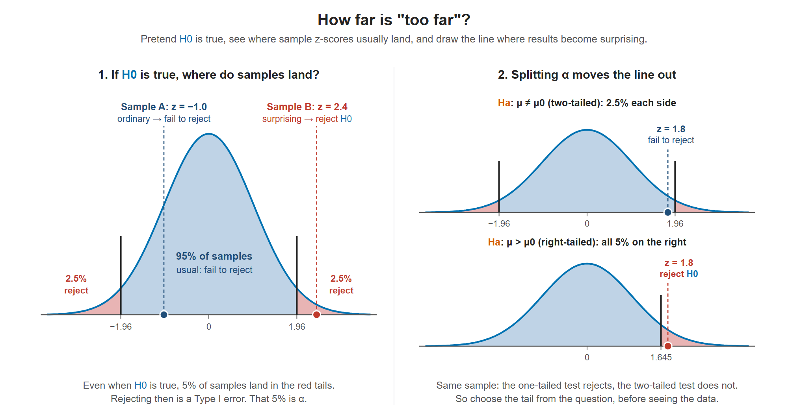
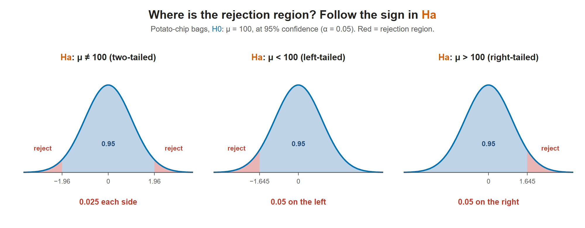

# Lesson 10.3 - One Tailed and Two Tailed Tests

> **Video:** [One Tailed and Two Tailed Tests, Critical Values, & Significance Level](https://www.youtube.com/watch?v=XHPIEp-3yC0) by The Organic Chemistry Tutor
> **Chapter:** [10 - Hypothesis Testing - 1 Sample](https://www.video-tutor.net/hypothesis-testing-with-one-sample.html)

## The big picture: how far is "too far"?

In Lesson 10.1 we wrote ${\color{#0072B2}H_0}$ and ${\color{#D55E00}H_a}$. In Lesson 10.2 we saw that we might make a wrong decision. This lesson answers the next question: **how far does the sample have to be from ${\color{#0072B2}H_0}$ before we reject it?**

**1. Start by pretending ${\color{#0072B2}H_0}$ is true.** If the true mean really is $\mu_0$, sample means still bounce around it by random chance. When we convert the sample mean to a z-score (the **test statistic**, Lesson 10.4), those scores follow the standard normal curve, centered at 0.

**2. Near the middle = normal. Far out in a tail = surprising.** Most samples land close to 0. A z-score far out in a tail would be very rare **if ${\color{#0072B2}H_0}$ were true**. So if we get one, we doubt ${\color{#0072B2}H_0}$.

**3. Draw a line: the critical value.** We need a cutoff for "far enough". That cutoff is the **critical value**, and the tail area beyond it is the **rejection region**.

**4. The tail area is $\alpha$, your false-alarm risk.** Even when ${\color{#0072B2}H_0}$ is true, a sample lands in the rejection region $\alpha$ of the time (for example 5%). Those are exactly the Type I errors from Lesson 10.2. So **you choose $\alpha$ first**, and it sets where the line goes.

**5. Which tail counts depends on ${\color{#D55E00}H_a}$.** Only results that point **toward** ${\color{#D55E00}H_a}$ count as evidence.

- Chip bags, ${\color{#D55E00}H_a}: \mu < 100$ (bags are underfilled). A very **light** sample is evidence. A very heavy sample isn't evidence of underfilling, so only the **left** tail counts.
- ${\color{#D55E00}H_a}: \mu \ne 100$ (just "different"). Too light **or** too heavy are both evidence, so **both** tails count. The total risk must still be $\alpha$, so it is **split**: $\alpha/2$ in each tail.

**Why the critical values differ.** Splitting $\alpha$ pushes each line further out: $\pm 1.96$ for two-tailed, versus $1.645$ for one-tailed (both at $\alpha = 0.05$). So a one-tailed test rejects more easily in its chosen direction, but can't detect anything in the other direction.



Left: if ${\color{#0072B2}H_0}$ is true, 95% of samples land in the middle. Sample A is ordinary, so we fail to reject. Sample B is out in a tail, so we reject. The red tails still catch 5% of samples even when ${\color{#0072B2}H_0}$ is true: that's $\alpha$, the Type I error rate. Right: the same sample $z = 1.8$ is not far enough for a two-tailed test (line at 1.96) but is far enough for a right-tailed test (line at 1.645).

> **Pick the direction before looking at the data.** It comes from the research question (the wording of ${\color{#D55E00}H_a}$), not from which way the sample happened to go. Choosing the tail after seeing the data quietly doubles your real false-alarm risk.

**Where this lesson fits in a full test:**

1. Write ${\color{#0072B2}H_0}$ and ${\color{#D55E00}H_a}$ (Lesson 10.1).
2. Choose $\alpha$ (often 0.05).
3. **Use the sign in ${\color{#D55E00}H_a}$ to pick the tail(s) and find the critical value(s).** ← this lesson
4. Compute the test statistic from the sample (Lesson 10.4).
5. Compare: in the rejection region → reject ${\color{#0072B2}H_0}$. Otherwise → fail to reject ${\color{#0072B2}H_0}$.

**Where 1.96 and 1.645 come from.** They are z-table lookups. For two-tailed at $\alpha = 0.05$, the area to the left of the cutoff is $1 - 0.025 = 0.975$, so $z = 1.96$. For one-tailed, it is $1 - 0.05 = 0.95$, so $z = 1.645$.

| $\alpha$ | Two-tailed critical $z$ | One-tailed critical $z$ |
|---|---|---|
| 0.10 | $\pm 1.645$ | $1.28$ |
| 0.05 | $\pm 1.96$ | $1.645$ |
| 0.01 | $\pm 2.576$ | $2.33$ |

(For a left-tailed test, the one-tailed value is negative: for example $-1.645$.)

---

## Vocabulary

| Term | Meaning |
|---|---|
| **Rejection region** | The shaded tail area(s). If the test statistic lands here, reject ${\color{#0072B2}H_0}$ |
| **Fail-to-reject region** | The unshaded middle. If the statistic lands here, keep ${\color{#0072B2}H_0}$ |
| **Critical value(s)** | The z (or t) value(s) separating the two regions |
| **Confidence level** $c$ | The area of the fail-to-reject region |
| **Significance level** $\alpha$ | The total area of the rejection region: $\alpha = 1 - c$ |
| **Calculated value** $z_c$ | The **test statistic** computed from the sample (see Lesson 10.4) |

**Decision:** if $z_c$ falls in the rejection region (beyond the critical value), **reject ${\color{#0072B2}H_0}$**. Otherwise, **fail to reject ${\color{#0072B2}H_0}$**.

---

## Which test? Read the sign in ${\color{#D55E00}H_a}$

| ${\color{#D55E00}H_a}$ | Test | Rejection region | At 95% ($\alpha = 0.05$) |
|---|---|---|---|
| $\mu \ne \mu_0$ | **Two-tailed** | Both tails, $\alpha/2$ each | 0.025 in each tail, critical $z = \pm 1.96$ |
| $\mu < \mu_0$ | **Left-tailed** | Left tail only, area $\alpha$ | 0.05 on the left, critical $z = -1.645$ |
| $\mu > \mu_0$ | **Right-tailed** | Right tail only, area $\alpha$ | 0.05 on the right, critical $z = +1.645$ |

```
 Two-tailed:      ███|                 |███      (α/2 each side)
 Left-tailed:  █████|                           (α on the left)
 Right-tailed:                         |█████   (α on the right)
                    -z       mean       +z
```

The **arrow** in ${\color{#D55E00}H_a}$ points to the tail: $<$ → left, $>$ → right, $\ne$ → both.



The sign in ${\color{#D55E00}H_a}$ decides where α goes: split between both tails for ≠, all in the left tail for <, and all in the right tail for >.

---

## Example - potato-chip bags

A company says its chip bags average **100 g**.

- An employee thinks the mean is **not** 100 g: ${\color{#0072B2}H_0}: \mu = 100$, ${\color{#D55E00}H_a}: \mu \ne 100$ → **two-tailed**. At 95% confidence, $\alpha = 0.05$ is split into 0.025 per tail, and 0.95 is in the middle.
- If instead ${\color{#D55E00}H_a}: \mu < 100$ → **left-tailed**, with all 0.05 in the left tail.
- If instead ${\color{#D55E00}H_a}: \mu > 100$ → **right-tailed**, with all 0.05 in the right tail.

---

## Key takeaways

- $\alpha = 1 - c$ is the significance level, the size of the rejection region.
- $\ne$ → two tails (split $\alpha$). $<$ → left tail. $>$ → right tail.
- Compare the calculated statistic with the critical value(s) to decide.
