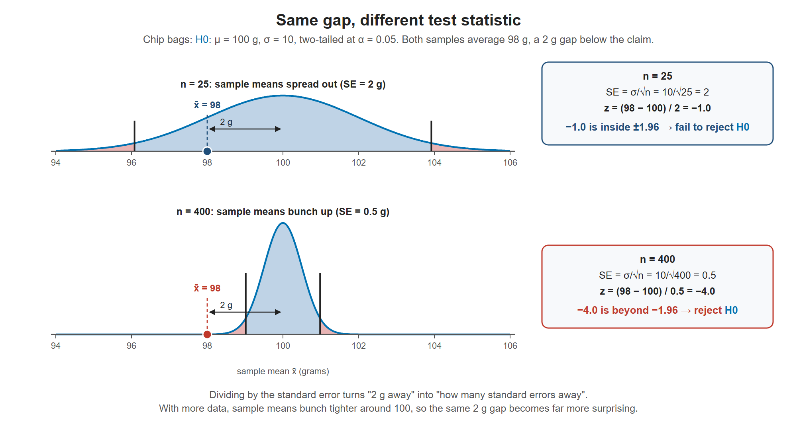
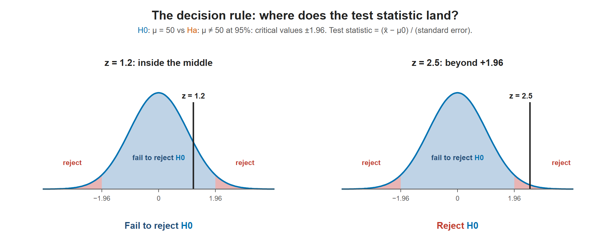

# Lesson 10.4 - Test Statistic for Means and Population Proportions

> **Video:** [Test Statistic For Means and Population Proportions](https://www.youtube.com/watch?v=Hag0GW9B6EY) by The Organic Chemistry Tutor
> **Chapter:** [10 - Hypothesis Testing - 1 Sample](https://www.video-tutor.net/hypothesis-testing-with-one-sample.html)

## The big picture: turning a sample into one number

In Lesson 10.3 we drew the line: the **critical value** (like $\pm 1.96$) that separates "ordinary" from "surprising". This lesson answers the other half: **where does our sample land on that same scale?**

**1. The problem: different units.** Say ${\color{#0072B2}H_0}: \mu = 100$ g and our sample of chip bags averages $\bar x = 98$ g. We can't compare "98 grams" with "1.96" directly. They're on different scales. We need to convert the sample into a z-score (or t-score), the same scale as the critical value.

**2. The idea: count standard errors.** The **test statistic** answers one question: *how many standard errors is the sample away from what ${\color{#0072B2}H_0}$ claims?*

$$\text{test statistic} = \frac{\text{what we got} - \text{what } {\color{#0072B2}H_0} \text{ claims}}{\text{standard error}}$$

- The **top** is the gap: how far the sample is from the claim ($98 - 100 = -2$ g).
- The **bottom** is the **standard error (SE)**: how much sample results normally wobble by chance alone. For a mean, $SE = \sigma/\sqrt n$.

**3. Why divide by the standard error?** Because a 2 g gap can be ordinary or shocking, depending on how much sample means normally wobble.

- With $n = 25$ bags ($\sigma = 10$): $SE = \sigma/\sqrt n = 10/\sqrt{25} = 2$, so $z = \dfrac{\bar x - \mu}{SE} = -2/2 = -1.0$. That's a normal wobble → fail to reject.
- With $n = 400$ bags: $SE = \sigma/\sqrt n = 10/\sqrt{400} = 0.5$, so $z = \dfrac{\bar x - \mu}{SE} = -2/0.5 = -4.0$. That's way out in the tail → reject.

Same gap, different verdict. Bigger samples wobble less ($\sqrt n$ is in the denominator), so the same gap becomes more convincing.

Top: with 25 bags, sample means spread widely around 100, so 98 is well inside the fail-to-reject region. Bottom: with 400 bags, sample means bunch tightly around 100, so 98 is far beyond the critical value. The gap is 2 g in both cases.

**4. Why use ${\color{#0072B2}H_0}$'s value in the formula?** The test pretends ${\color{#0072B2}H_0}$ is true (Lesson 10.3), so we measure the distance **from ${\color{#0072B2}H_0}$'s claim**. That's why $\mu$ (or $p$) in every formula below is the hypothesized value, not something from the sample.

**5. z or t?** If you know the population $\sigma$, the statistic follows the normal curve: use **z**. If you have to estimate it with the sample's $s$, that estimate adds extra uncertainty, especially for small samples. The **t-distribution** accounts for this. It has fatter tails, so its critical values are a bit larger than z's.

**Where this lesson fits in a full test:**

1. Write ${\color{#0072B2}H_0}$ and ${\color{#D55E00}H_a}$ (Lesson 10.1).
2. Choose $\alpha$.
3. Use the sign in ${\color{#D55E00}H_a}$ to find the critical value(s) (Lesson 10.3).
4. **Compute the test statistic from the sample.** ← this lesson
5. Compare: beyond the critical value → reject ${\color{#0072B2}H_0}$. Otherwise → fail to reject ${\color{#0072B2}H_0}$.

> **Same building blocks as confidence intervals (Chapter 9).** A confidence interval is *estimate ± critical value × SE*. A test statistic is *(estimate − claim) ÷ SE*. Same three pieces, rearranged.

---

## The decision rule

1. Find the **critical value(s)** from the significance level and the type of test. For a two-tailed test at 95%, $\pm 1.96$.
2. Compute the **test statistic** $z_c$ (or $t$) from the sample.
3. Statistic in the rejection region → **reject ${\color{#0072B2}H_0}$**. Statistic in the fail-to-reject region → **fail to reject ${\color{#0072B2}H_0}$**.

*Example:* ${\color{#0072B2}H_0}: \mu = 50$ vs ${\color{#D55E00}H_a}: \mu \ne 50$ at 95% has critical values $\pm 1.96$. A calculated $z_c$ beyond 1.96 (or below −1.96) means reject.

Compute the test statistic, then see which region it lands in. Between −1.96 and 1.96, fail to reject ${\color{#0072B2}H_0}$. Beyond either critical value, reject ${\color{#0072B2}H_0}$.

---

## Test statistic for a mean

| Sample size | $\sigma$ known? | Distribution | Test statistic |
|---|---|---|---|
| $n < 30$ | **No** (only $s$) | **t**, df $= n - 1$ | $t = \dfrac{\bar x - \mu}{s/\sqrt n}$ |
| $n < 30$ | Yes | z | $z = \dfrac{\bar x - \mu}{\sigma/\sqrt n}$ |
| $n \ge 30$ | No (use $s$) | z (approximately normal) | $z = \dfrac{\bar x - \mu}{s/\sqrt n}$ |
| $n \ge 30$ | Yes | z | $z = \dfrac{\bar x - \mu}{\sigma/\sqrt n}$ |

Here $\mu$ is the value claimed in ${\color{#0072B2}H_0}$.

> Many textbooks use the t-distribution **whenever $\sigma$ is unknown**, whatever the sample size. For $n \ge 30$, $t$ and $z$ give nearly the same answer, so the video's rule is a common shortcut.

---

## Test statistic for a proportion

$$z = \frac{\hat p - p}{\sqrt{\dfrac{pq}{n}}}, \qquad q = 1 - p$$

- $\hat p$ = sample proportion ($x/n$)
- $p$ = the proportion claimed in ${\color{#0072B2}H_0}$ (sometimes written $p_0$). Use this hypothesized value under the square root, not $\hat p$.

---

## Key takeaways

- Test statistic = (sample value − hypothesized value) ÷ standard error = "how many standard errors from ${\color{#0072B2}H_0}$".
- The same gap is more convincing with a bigger sample, because the standard error shrinks like $1/\sqrt n$.
- Mean: use $t$ with $s$ when $n < 30$ and $\sigma$ is unknown. Otherwise use $z$.
- Proportion: $z = (\hat p - p)/\sqrt{pq/n}$, with $p$ from ${\color{#0072B2}H_0}$.
- Compare with the critical value(s) to reject or fail to reject ${\color{#0072B2}H_0}$.
