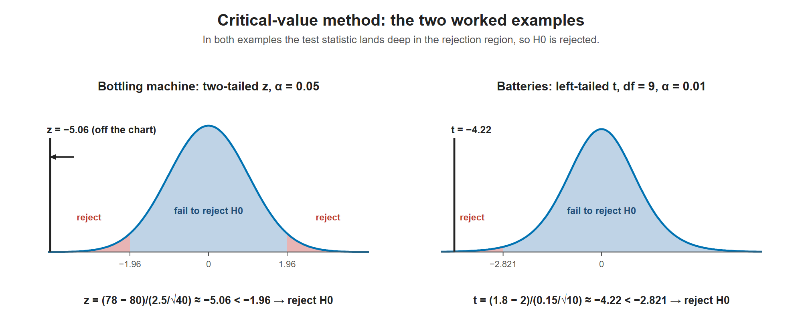

# Lesson 10.5 - Hypothesis Testing Problems - Z Test and T Statistics

> **Video:** [Hypothesis Testing Problems - Z Test & T Statistics - One & Two Tailed Tests](https://www.youtube.com/watch?v=zJ8e_wAWUzE) by The Organic Chemistry Tutor
> **Chapter:** [10 - Hypothesis Testing - 1 Sample](https://www.video-tutor.net/hypothesis-testing-with-one-sample.html)

## Procedure (critical-value method)

1. State $H_0$ (status quo, with the equality) and $H_a$ (the claim being tested).
2. Decide on the tails from $H_a$: $\ne$ → two-tailed, $<$ → left, $>$ → right.
3. Find the **critical value** from $\alpha$ ($z$-table, or $t$-table with df $= n - 1$).
4. Compute the **test statistic**: $\dfrac{\bar x - \mu_0}{s/\sqrt n}$, treated as $z$ if $n \ge 30$ or as $t$ if $n < 30$ and $\sigma$ is unknown.
5. If the statistic is in the rejection region, **reject $H_0$**. Otherwise, **fail to reject $H_0$**.

---

## Example 1 - two-tailed z-test (a bottling machine)

A machine is supposed to dispense **80 mL**. An employee thinks the mean is not 80 mL. A sample of **40** bottles has $\bar x = 78$ mL and $s = 2.5$ mL.

**(a) Hypotheses**
$$H_0: \mu = 80 \qquad H_a: \mu \ne 80$$

**(b) Is there evidence at 95% confidence that the machine is off?**

- $H_a$ uses $\ne$, so this is **two-tailed**: 0.025 in each tail, critical values $z = \pm 1.96$.
- $n = 40 \ge 30$, so use $z$ (with $s$ in place of $\sigma$).

$$z = \frac{78 - 80}{2.5/\sqrt{40}} = \frac{-2}{0.39528} \approx -5.06$$

$-5.06 < -1.96$, so the statistic is far into the left rejection region. **Reject $H_0$.** At the 5% significance level there is strong evidence that the machine does not dispense 80 mL on average.

Both worked examples. The bottling statistic (−5.06) is so extreme it lies off the chart. The battery test uses a t-distribution with 9 degrees of freedom, so its left critical value is −2.821, not a z value.

---

## Example 2 - left-tailed t-test (car batteries)

The company says its batteries last **2 or more years** on average. An engineer thinks it's less. A sample of **10** batteries has $\bar x = 1.8$ years and $s = 0.15$ years.

**(a) Hypotheses**
$$H_0: \mu \ge 2 \qquad H_a: \mu < 2$$

**(b) Test at 99% confidence**

- $H_a$ uses $<$, so this is **left-tailed**, with $\alpha = 0.01$ entirely in the left tail.
- $n = 10 < 30$ and $\sigma$ is unknown, so use the **t-distribution** with df $= 10 - 1 = 9$.
- One-tail t-table, df = 9, $\alpha = 0.01$: $t = 2.821$, so the critical value is **$-2.821$** (left side).

$$t = \frac{1.8 - 2}{0.15/\sqrt{10}} = \frac{-0.2}{0.047434} \approx -4.22$$

$-4.22 < -2.821$, which is in the rejection region. **Reject $H_0$.** At the 1% significance level there is enough evidence that the mean battery life is less than 2 years.

> **Wording:** the video sometimes says "accept the null hypothesis". The standard phrasing is **"fail to reject $H_0$"**. Not rejecting doesn't prove $H_0$ is true.

---

## Key takeaways

- $H_a$ decides the tails. $n$ and whether $\sigma$ is known decide $z$ or $t$.
- Test statistic = (sample mean − hypothesized mean) ÷ (SD / √n).
- If the statistic is beyond the critical value, reject $H_0$. Otherwise, fail to reject $H_0$.
- A 95% (99%) "confidence level" in a test corresponds to $\alpha = 0.05$ (0.01).
