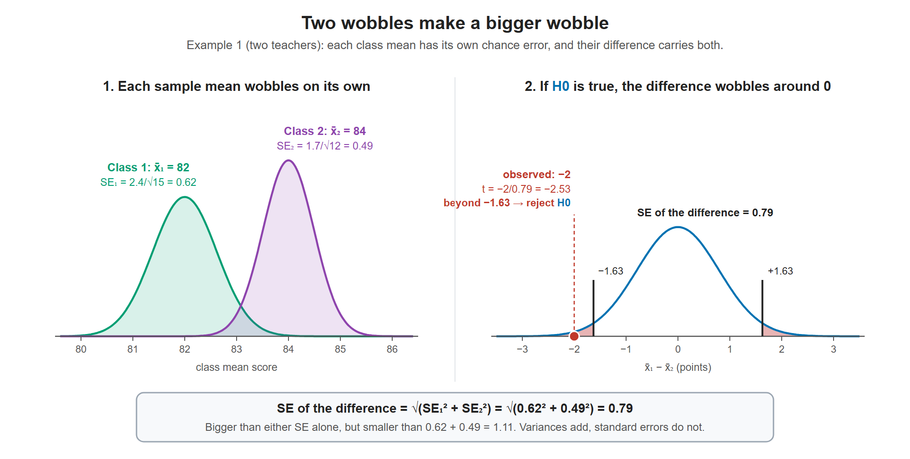
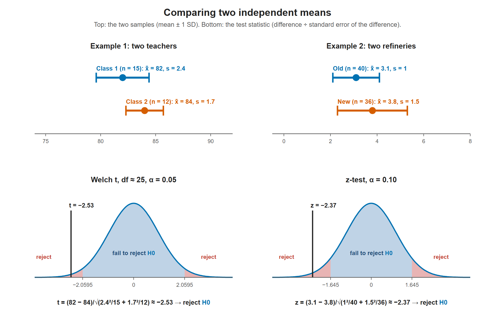

# Lesson 11.1 - Hypothesis Testing - Difference of Two Means

> **Video:** [Hypothesis Testing - Difference of Two Means - Student's t-Distribution & Normal Distribution](https://www.youtube.com/watch?v=UcZwyzwWU7o) by The Organic Chemistry Tutor
> **Chapter:** [11 - Hypothesis Testing - 2 Samples](https://www.video-tutor.net/hypothesis-testing-with-two-samples.html)

## The big picture: from one sample to two

In Chapter 10 we compared **one** sample with a number that ${\color{#0072B2}H_0}$ claimed (for example $\mu = 100$ g). In this chapter there is no outside number. We compare **two groups with each other**: two teachers, two factories, two batches, before vs after.

**1. The question: is the gap real, or just luck?** Even if two teachers were exactly equally good, their class averages would still differ a little, because each class is a random sample of students. The test asks whether the gap we see is bigger than chance alone would usually produce.

**2. ${\color{#0072B2}H_0}$ says "no difference".** ${\color{#0072B2}H_0}: \mu_1 - \mu_2 = 0$. This gives ${\color{#0072B2}H_0}$ the one exact number it needs (Lesson 10.1): the difference is **0**. ${\color{#D55E00}H_a}$ says the difference is not 0 (or is $<0$, or $>0$).

**3. Turn two samples into one number: the difference.** Compute $\bar x_1 - \bar x_2$, then use the same recipe as Lesson 10.4:

$$\text{test statistic} = \frac{\text{what we got} - \text{what } {\color{#0072B2}H_0} \text{ claims}}{\text{standard error}} = \frac{(\bar x_1 - \bar x_2) - 0}{SE_{\text{difference}}}$$

**4. Why the standard error gets bigger.** Each sample mean has its own chance error. The difference picks up **both** of them, so it wobbles more than either mean alone. Variances add (never subtract):

$$SE_{\text{difference}} = \sqrt{SE_1^2 + SE_2^2} = \sqrt{\frac{s_1^2}{n_1} + \frac{s_2^2}{n_2}}$$

In Example 1 below, $SE_1 = 0.62$ and $SE_2 = 0.49$, so $SE_{\text{difference}} = \sqrt{0.62^2 + 0.49^2} = 0.79$. That is bigger than either one, but smaller than simply adding them ($1.11$).

**Where the formula comes from.** It follows from three rules about variance, where $\text{Var}(X) = E[(X - \mu)^2]$ is the square of the SD.

*Rule 1: scaling a variable scales its variance by the square.*

$$\text{Var}(cX) = E[(cX - c\mu)^2] = c^2\,E[(X - \mu)^2] = c^2\,\text{Var}(X)$$

So $\text{Var}(-Y) = (-1)^2\,\text{Var}(Y) = \text{Var}(Y)$. Flipping the sign doesn't shrink the spread.

*Rule 2: for independent variables, variances add.* Expand the square:

$$\begin{aligned}
\text{Var}(X + Y) &= E\big[\big((X - \mu_X) + (Y - \mu_Y)\big)^2\big] \\
&= \text{Var}(X) + \text{Var}(Y) + 2\,\underbrace{E[(X - \mu_X)(Y - \mu_Y)]}_{\text{Cov}(X,\,Y)}
\end{aligned}$$

If $X$ and $Y$ are independent, $\text{Cov}(X, Y) = 0$, so $\text{Var}(X + Y) = \text{Var}(X) + \text{Var}(Y)$.

*Rule 3: so does the variance of a difference.* Write $X - Y = X + (-Y)$ and use Rules 1 and 2:

$$\text{Var}(X - Y) = \text{Var}(X) + \text{Var}(-Y) = \text{Var}(X) + \text{Var}(Y)$$

Now apply the rules to sample means.

- **One mean.** $\bar x = (X_1 + \dots + X_n)/n$, with independent $X_i$ that each have variance $\sigma^2$. Rule 2 gives $\text{Var}(X_1 + \dots + X_n) = n\sigma^2$. Rule 1 with $c = 1/n$ then gives $\text{Var}(\bar x) = \frac{1}{n^2} \cdot n\sigma^2 = \frac{\sigma^2}{n}$, so $SE = \sigma/\sqrt n$.
- **Two means.** The samples are independent, so Rule 3 gives:

$$\text{Var}(\bar x_1 - \bar x_2) = \frac{\sigma_1^2}{n_1} + \frac{\sigma_2^2}{n_2} \quad\Rightarrow\quad SE_{\text{difference}} = \sqrt{\frac{\sigma_1^2}{n_1} + \frac{\sigma_2^2}{n_2}} = \sqrt{SE_1^2 + SE_2^2}$$

We don't know $\sigma_1$ and $\sigma_2$, so we plug in $s_1$ and $s_2$. That's why the test uses t.

- **Like a right triangle.** Variances (squares) add, not SDs, so the SEs combine like the two shorter sides of a right triangle: $\sqrt{0.62^2 + 0.49^2} = 0.79$ is the long side. That's why it is bigger than each SE but less than their sum.
- **When the groups are not independent** (the same people measured twice), the covariance term stays: $\text{Var}(X - Y) = \text{Var}(X) + \text{Var}(Y) - 2\,\text{Cov}(X, Y)$. Before and after weights move together, so the covariance is large and positive, and subtracting it removes most of the variance. That's why pairing helps (Lesson 11.4).

Left: each class mean has its own wobble. Right: if ${\color{#0072B2}H_0}$ is true, the difference $\bar x_1 - \bar x_2$ wobbles around 0, and the wobble is wider than either one alone. The observed difference, $-2$, is $2.53$ standard errors below 0, beyond the critical value, so we reject ${\color{#0072B2}H_0}$.

**5. "Independent" matters.** This lesson assumes two separate groups of different people, with nothing linking someone in group 1 to someone in group 2. If the **same** people are measured twice (before and after), the groups are paired. Use Lesson 11.4 instead.

**Which lesson for which question (Chapter 11 map):**

| What are you comparing? | Lesson | Tool |
|---|---|---|
| Means of two **independent** groups | 11.1 (this one) | t (Welch) or z |
| **How big** is the difference between two means? | 11.2 | Cohen's $d$ |
| **Proportions** (yes/no data) of two groups | 11.3 | z with a pooled $\bar p$ |
| The **same subjects twice**, or matched pairs | 11.4 | paired t on the differences |

The 5 steps are the same as in Chapter 10. Only the formula in step 4 changes:

1. Write ${\color{#0072B2}H_0}$ (difference $= 0$) and ${\color{#D55E00}H_a}$.
2. Choose $\alpha$.
3. Use the sign in ${\color{#D55E00}H_a}$ to find the critical value(s).
4. **Compute the test statistic from both samples.** ← this lesson
5. Compare: beyond the critical value → reject ${\color{#0072B2}H_0}$. Otherwise → fail to reject ${\color{#0072B2}H_0}$.

---

## Setup

Two **independent** groups. Does their population mean differ?

$${\color{#0072B2}H_0}: \mu_1 = \mu_2 \;\;(\mu_1 - \mu_2 = 0) \qquad {\color{#D55E00}H_a}: \mu_1 \ne \mu_2 \;\;(\mu_1 - \mu_2 \ne 0)$$

## Test statistic

$$t \text{ (or } z) = \frac{(\bar x_1 - \bar x_2) - (\mu_1 - \mu_2)}{\sqrt{\dfrac{s_1^2}{n_1} + \dfrac{s_2^2}{n_2}}}$$

Under ${\color{#0072B2}H_0}$, $\mu_1 - \mu_2 = 0$. The denominator is the **standard error of the difference**.

| Sample sizes | Use |
|---|---|
| Small ($< 30$) | **t-distribution** (Welch), with the degrees of freedom below |
| Large ($\ge 30$) | **z** (normal distribution) |

**Degrees of freedom (Welch-Satterthwaite):**

$$\text{df} = \frac{\left(\dfrac{s_1^2}{n_1} + \dfrac{s_2^2}{n_2}\right)^2}{\dfrac{\left(s_1^2/n_1\right)^2}{n_1 - 1} + \dfrac{\left(s_2^2/n_2\right)^2}{n_2 - 1}}$$

---

## Example 1 - two teachers (t-test)

Do two teachers' classes score differently? $\alpha = 0.05$.

| | Class 1 | Class 2 |
|---|---:|---:|
| $n$ | 15 | 12 |
| $\bar x$ | 82 | 84 |
| $s$ | 2.4 | 1.7 |

**Hypotheses:** ${\color{#0072B2}H_0}: \mu_1 - \mu_2 = 0$, $\;{\color{#D55E00}H_a}: \mu_1 - \mu_2 \ne 0$ (two-tailed, $\alpha/2 = 0.025$).

**Both samples are small → t-test.**

**Degrees of freedom:**

- $s_1^2/n_1 = 5.76/15 = 0.384$ and $s_2^2/n_2 = 2.89/12 = 0.24083$
- Numerator: $(0.384 + 0.24083)^2 = (0.62483)^2 = 0.390417$
- Denominator: $\dfrac{0.384^2}{14} + \dfrac{0.24083^2}{11} = 0.010533 + 0.005273 = 0.015805$
- $\text{df} = 0.390417 / 0.015805 \approx 24.7$

The video rounds this to **25**, giving $t_{0.025,\,25} = 2.0595$. Many textbooks round df **down** to be conservative ($24 \to t = 2.064$). Both give the same decision here.

**Test statistic:**
$$t = \frac{82 - 84 - 0}{\sqrt{0.384 + 0.24083}} = \frac{-2}{0.79046} \approx -2.53$$

$-2.53 < -2.0595$, which is in the rejection region. **Reject ${\color{#0072B2}H_0}$.** At the 5% level there is a significant difference between the two teachers' class means.

Top: the two samples in each example. Bottom: the difference in means divided by its standard error. In both examples the statistic lands in the left rejection region, so the means differ significantly.

---

## Example 2 - two oil refineries (z-test)

Is there a difference in refining rate (liters per second)? $\alpha = 0.10$.

| | Old factory | New factory |
|---|---:|---:|
| $n$ | 40 | 36 |
| $\bar x$ | 3.1 | 3.8 |
| $s$ | 1.0 | 1.5 |

**Hypotheses:** ${\color{#0072B2}H_0}: \mu_1 = \mu_2$, $\;{\color{#D55E00}H_a}: \mu_1 \ne \mu_2$ (two-tailed).

**Both samples are large → z-test.** The confidence level is 90%, so the left area for the critical value is 0.95: $z = \pm 1.645$.

$$z = \frac{3.1 - 3.8}{\sqrt{\dfrac{1^2}{40} + \dfrac{1.5^2}{36}}} = \frac{-0.7}{\sqrt{0.025 + 0.0625}} = \frac{-0.7}{0.2958} \approx -2.37$$

$-2.37 < -1.645$ → **reject ${\color{#0072B2}H_0}$**. At the 10% level there is a significant difference between the factories; the new one refines faster.

---

## Key takeaways

- ${\color{#0072B2}H_0}$: equal means (difference 0). Test statistic = (difference in sample means) ÷ $\sqrt{s_1^2/n_1 + s_2^2/n_2}$.
- The standard error of a difference is $\sqrt{SE_1^2 + SE_2^2}$: two sources of chance error, so it is bigger than either one alone.
- Small samples → t with Welch's df. Large samples → z.
- Compare with the critical value(s), or with the p-value, as in the one-sample case.
