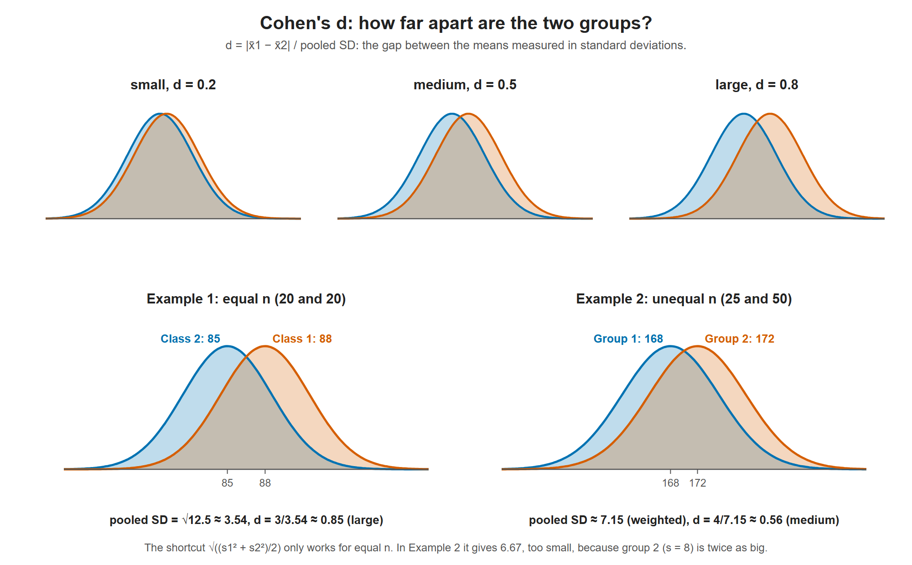

# Lesson 11.2 - How to Find Cohen's D to Determine the Effect Size

> **Video:** [How to find Cohen's D to determine the Effect Size Using Pooled Standard Deviation](https://www.youtube.com/watch?v=GDe4M0xEghs) by The Organic Chemistry Tutor
> **Chapter:** [11 - Hypothesis Testing - 2 Samples](https://www.video-tutor.net/hypothesis-testing-with-two-samples.html)

## What Cohen's d measures

Cohen's $d$ expresses the difference between two means **in standard-deviation units**:

$$d = \frac{|\bar x_1 - \bar x_2|}{s_{\text{pooled}}}$$

- $d = 1$: the means are 1 standard deviation apart.
- $d = 2$: 2 standard deviations apart.
- $d = 0.5$: half a standard deviation apart.

| $d$ | Effect size |
|---:|---|
| ≈ 0.2 | Small |
| ≈ 0.5 | Medium |
| ≥ 0.8 | Large |

Cohen's d measures how far apart the two curves sit, in units of the pooled standard deviation. The more the curves overlap, the smaller the effect. Example 1 (d ≈ 0.85) is a large effect; Example 2 (d ≈ 0.56) is medium.

## Pooled standard deviation

**General formula** (use it when the sample sizes differ):
$$s_{\text{pooled}} = \sqrt{\frac{(n_1 - 1)s_1^2 + (n_2 - 1)s_2^2}{n_1 + n_2 - 2}}$$

**Shortcut** (only when $n_1 = n_2$, or nearly so):
$$s_{\text{pooled}} = \sqrt{\frac{s_1^2 + s_2^2}{2}}$$

---

## Example 1 - two classes, equal sample sizes

| | Class 1 | Class 2 |
|---|---:|---:|
| $n$ | 20 | 20 |
| $\bar x$ | 88 | 85 |
| $s$ | 3 | 4 |

**Pooled SD (general formula):**
$$s_p = \sqrt{\frac{19(3^2) + 19(4^2)}{20 + 20 - 2}} = \sqrt{\frac{171 + 304}{38}} = \sqrt{\frac{475}{38}} = \sqrt{12.5} \approx 3.5355$$

**Shortcut (equal $n$):** $\sqrt{\dfrac{9 + 16}{2}} = \sqrt{12.5} \approx 3.5355$, the same answer ✓

**Cohen's d:**
$$d = \frac{88 - 85}{3.5355} \approx 0.85 \;\Rightarrow\; \textbf{large effect}$$

---

## Example 2 - two groups, unequal sample sizes

| | Group 1 | Group 2 |
|---|---:|---:|
| $n$ | 25 | 50 |
| $\bar x$ (lb) | 168 | 172 |
| $s$ (lb) | 5 | 8 |

**Pooled SD** (must use the general formula, because the sizes differ):
$$s_p = \sqrt{\frac{24(5^2) + 49(8^2)}{25 + 50 - 2}} = \sqrt{\frac{600 + 3136}{73}} = \sqrt{\frac{3736}{73}} \approx 7.154$$

The shortcut would give $\sqrt{(25 + 64)/2} \approx 6.671$, which is **wrong** here. Group 2 is twice as large, so its SD (8) should carry more weight, and the correct pooled SD (7.15) is closer to 8.

**Cohen's d:**
$$d = \frac{|168 - 172|}{7.154} = \frac{4}{7.154} \approx 0.56 \;\Rightarrow\; \textbf{medium effect}$$

---

## Key takeaways

- $d$ = |difference in means| ÷ pooled SD, a **unitless** measure of how big the difference is.
- Benchmarks: 0.2 small, 0.5 medium, 0.8+ large.
- Use the weighted pooled-SD formula unless the sample sizes are equal.
- A hypothesis test asks *whether* there is a difference. Cohen's $d$ asks *how large* it is.
