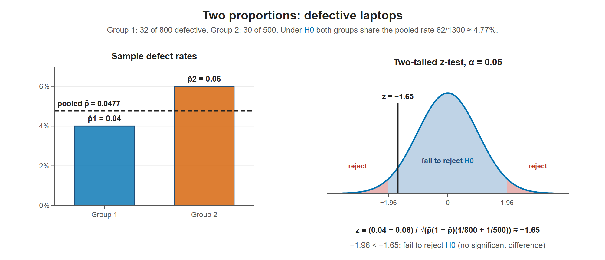

# Lesson 11.3 - Hypothesis Testing with Two Proportions

> **Video:** [Hypothesis Testing With Two Proportions](https://www.youtube.com/watch?v=pCbNUnZ98oE) by The Organic Chemistry Tutor
> **Chapter:** [11 - Hypothesis Testing - 2 Samples](https://www.video-tutor.net/hypothesis-testing-with-two-samples.html)

## The big picture: comparing two rates

Lessons 11.1 and 11.2 compared **averages** (scores, weights). Many questions are about **yes/no** data instead: defective or not, passed or failed, clicked or didn't. Each group is then summarized by a **proportion** (a rate), and we ask whether the two rates really differ.

**1. The question.** Batch 1 has 4% defective laptops and batch 2 has 6%. Is batch 2 really worse, or could a 2-point gap happen by chance with samples this size?

**2. ${\color{#0072B2}H_0}$ says "no difference".** ${\color{#0072B2}H_0}: p_1 = p_2$, which is the same as $p_1 - p_2 = 0$. The recipe is the same as always:

$$z = \frac{(\hat p_1 - \hat p_2) - 0}{SE}$$

**3. Why pool? ${\color{#0072B2}H_0}$ says "equal", but not equal to what.** For proportions, the spread depends on the proportion itself: $SE = \sqrt{p(1-p)/n}$. A rate near 50% wobbles more than a rate near 4%. So we need a value of $p$ to compute the SE.

- **One proportion (Lesson 10.4):** ${\color{#0072B2}H_0}: p = 0.05$ hands us the number. Plug it in.
- **Two proportions (this lesson):** ${\color{#0072B2}H_0}: p_1 = p_2$ gives no number. But if ${\color{#0072B2}H_0}$ is true, both groups share **one** rate, and the best estimate of that rate uses **all** the data together:

$$\bar p = \frac{x_1 + x_2}{n_1 + n_2} = \frac{\text{total successes}}{\text{total sample size}}$$

If ${\color{#0072B2}H_0}$ is true, the two batches are really one population, so we estimate its single defect rate from all 1300 laptops. That pooled rate goes into the standard error.

**4. Why no pooling for means (Lesson 11.1)?** A mean and its spread are separate numbers. ${\color{#0072B2}H_0}: \mu_1 = \mu_2$ says nothing about $s_1$ and $s_2$, so each group keeps its own. For proportions, the spread is tied to $p$, so assuming equal $p$'s also means assuming equal spreads.

**5. Why z, not t?** There is no separate $s$ to estimate, because the spread comes straight from $\bar p$. With large samples the sample proportions are approximately normal, so we use z. A common check is at least about 10 successes and 10 failures in each group. Here there are 32 and 30 defectives, so that's fine.

---

## Formulas

| Quantity | Formula |
|---|---|
| Sample proportions | $\hat p_1 = \dfrac{x_1}{n_1}$, $\;\hat p_2 = \dfrac{x_2}{n_2}$ |
| **Pooled proportion** | $\bar p = \dfrac{x_1 + x_2}{n_1 + n_2}$ |
| Test statistic | $z = \dfrac{(\hat p_1 - \hat p_2) - (p_1 - p_2)}{\sqrt{\bar p\,(1 - \bar p)\left(\dfrac{1}{n_1} + \dfrac{1}{n_2}\right)}}$ |

Under ${\color{#0072B2}H_0}: p_1 = p_2$, the term $p_1 - p_2$ is **0**. The proportions are pooled because ${\color{#0072B2}H_0}$ assumes both groups share one common proportion. Large samples → use the normal ($z$) distribution.

---

## Example - defective laptops

Two batches of laptops were tested: 32 of 800 were defective in group 1 and 30 of 500 in group 2. Is the difference significant at $\alpha = 0.05$?

**Hypotheses** (the test is run because someone suspects a difference):
$${\color{#0072B2}H_0}: p_1 = p_2 \qquad {\color{#D55E00}H_a}: p_1 \ne p_2$$

**Sample proportions:**
$$\hat p_1 = \frac{32}{800} = 0.04, \qquad \hat p_2 = \frac{30}{500} = 0.06$$

**Critical values** (two-tailed, $\alpha/2 = 0.025$ per tail, left area 0.975): $z = \pm 1.96$

**Pooled proportion:**
$$\bar p = \frac{32 + 30}{800 + 500} = \frac{62}{1300} \approx 0.04769$$

**Test statistic:**
$$z = \frac{0.04 - 0.06 - 0}{\sqrt{0.04769(1 - 0.04769)\left(\dfrac{1}{800} + \dfrac{1}{500}\right)}} = \frac{-0.02}{0.012149} \approx -1.65$$

$-1.96 < -1.65 < 0$, which is in the fail-to-reject region.

**Fail to reject ${\color{#0072B2}H_0}$.** At the 5% level the difference in defect rates (4% vs 6%) is **not statistically significant**. This doesn't prove the rates are equal; the data just don't show a clear difference.

The two sample rates differ by 2 percentage points, but with these sample sizes that gives only z ≈ −1.65, which is inside ±1.96. The difference is not statistically significant.

---

## Key takeaways

- We pool because ${\color{#0072B2}H_0}$ says the rates are equal without saying what they equal, and the SE of a proportion needs a value of $p$.
- ${\color{#0072B2}H_0}: p_1 = p_2$. Use the **pooled** proportion $\bar p = (x_1 + x_2)/(n_1 + n_2)$ in the standard error.
- $z = (\hat p_1 - \hat p_2)/\sqrt{\bar p(1-\bar p)(1/n_1 + 1/n_2)}$.
- Compare with the critical value(s) or use a p-value. Fail to reject means "no significant difference found", not "proven equal".
