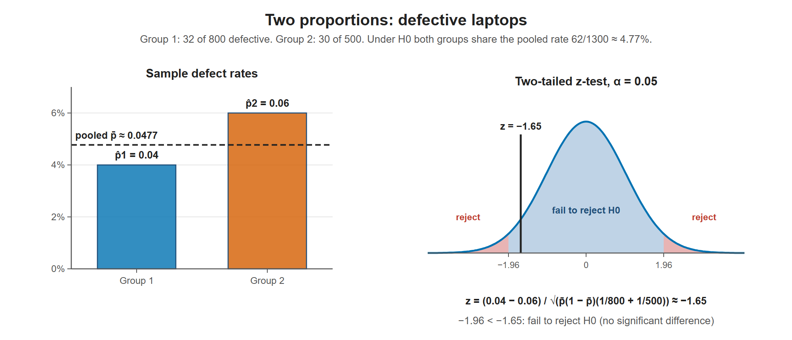

# Lesson 11.3 - Hypothesis Testing with Two Proportions

> **Video:** [Hypothesis Testing With Two Proportions](https://www.youtube.com/watch?v=pCbNUnZ98oE) by The Organic Chemistry Tutor
> **Chapter:** [11 - Hypothesis Testing - 2 Samples](https://www.video-tutor.net/hypothesis-testing-with-two-samples.html)

## Formulas

| Quantity | Formula |
|---|---|
| Sample proportions | $\hat p_1 = \dfrac{x_1}{n_1}$, $\;\hat p_2 = \dfrac{x_2}{n_2}$ |
| **Pooled proportion** | $\bar p = \dfrac{x_1 + x_2}{n_1 + n_2}$ |
| Test statistic | $z = \dfrac{(\hat p_1 - \hat p_2) - (p_1 - p_2)}{\sqrt{\bar p\,(1 - \bar p)\left(\dfrac{1}{n_1} + \dfrac{1}{n_2}\right)}}$ |

Under $H_0: p_1 = p_2$, the term $p_1 - p_2$ is **0**. The proportions are pooled because $H_0$ assumes both groups share one common proportion. Large samples → use the normal ($z$) distribution.

---

## Example - defective laptops

Two batches of laptops were tested: 32 of 800 were defective in group 1 and 30 of 500 in group 2. Is the difference significant at $\alpha = 0.05$?

**Hypotheses** (the test is run because someone suspects a difference):
$$H_0: p_1 = p_2 \qquad H_a: p_1 \ne p_2$$

**Sample proportions:**
$$\hat p_1 = \frac{32}{800} = 0.04, \qquad \hat p_2 = \frac{30}{500} = 0.06$$

**Critical values** (two-tailed, $\alpha/2 = 0.025$ per tail, left area 0.975): $z = \pm 1.96$

**Pooled proportion:**
$$\bar p = \frac{32 + 30}{800 + 500} = \frac{62}{1300} \approx 0.04769$$

**Test statistic:**
$$z = \frac{0.04 - 0.06 - 0}{\sqrt{0.04769(1 - 0.04769)\left(\dfrac{1}{800} + \dfrac{1}{500}\right)}} = \frac{-0.02}{0.012149} \approx -1.65$$

$-1.96 < -1.65 < 0$, which is in the fail-to-reject region.

**Fail to reject $H_0$.** At the 5% level the difference in defect rates (4% vs 6%) is **not statistically significant**. This doesn't prove the rates are equal; the data just don't show a clear difference.

The two sample rates differ by 2 percentage points, but with these sample sizes that gives only z ≈ −1.65, which is inside ±1.96. The difference is not statistically significant.

---

## Key takeaways

- $H_0: p_1 = p_2$. Use the **pooled** proportion $\bar p = (x_1 + x_2)/(n_1 + n_2)$ in the standard error.
- $z = (\hat p_1 - \hat p_2)/\sqrt{\bar p(1-\bar p)(1/n_1 + 1/n_2)}$.
- Compare with the critical value(s) or use a p-value. Fail to reject means "no significant difference found", not "proven equal".
