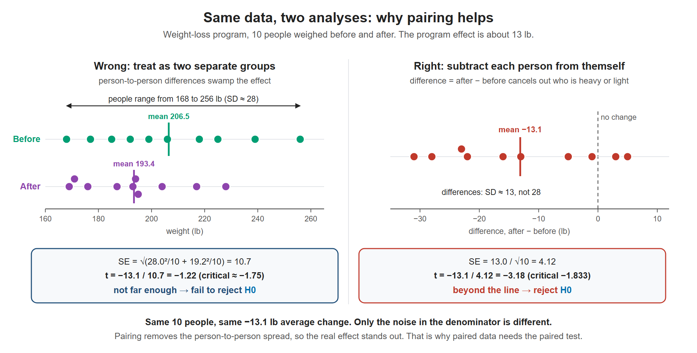
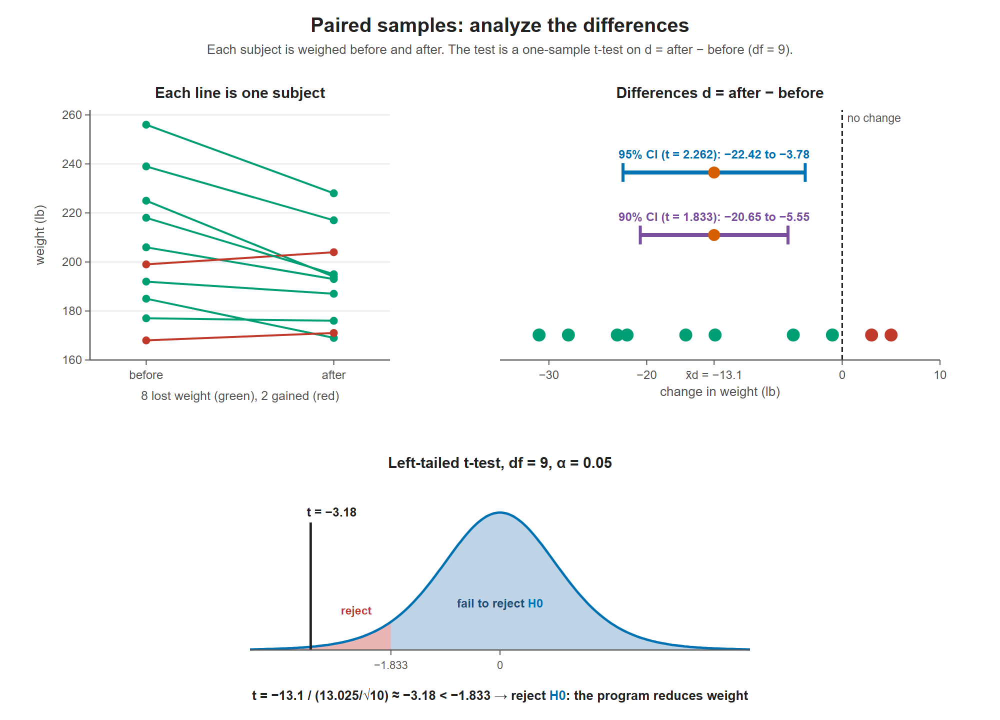

# Lesson 11.4 - Matched or Paired Samples

> **Video:** [Matched or Paired Samples T-Test - Hypothesis Testing](https://www.youtube.com/watch?v=JiQR0lHLe74) by The Organic Chemistry Tutor
> **Chapter:** [11 - Hypothesis Testing - 2 Samples](https://www.video-tutor.net/hypothesis-testing-with-two-samples.html)

## The big picture: why pairing helps

Lesson 11.1 compared two **separate** groups of people. Here the two columns of numbers come from the **same** people, weighed before and after a program. This is a different kind of data and needs a different test.

**1. The two columns are linked.** A heavy person before the program is still heavy after it. Row 7 (256 → 228) and row 6 (168 → 171) are different people, but each row is the same person measured twice. The data come in **pairs**.

**2. People differ much more than the program does.** Before the program, weights range from 168 to 256 lb, with an SD of about 28 lb. The program changes weight by only about 13 lb. If we treat before and after as two separate groups (Lesson 11.1), that 28 lb person-to-person spread goes into the standard error and hides the effect:

$$SE = \sqrt{\frac{s_1^2}{n_1} + \frac{s_2^2}{n_2}} = \sqrt{\frac{28.0^2}{10} + \frac{19.2^2}{10}} = 10.7, \qquad t = \frac{\bar x_{\text{after}} - \bar x_{\text{before}}}{SE} = \frac{-13.1}{10.7} = -1.22 \;\Rightarrow\; \text{fail to reject } {\color{#0072B2}H_0}$$

**3. Subtract each person from themself.** Taking $x_d = \text{after} - \text{before}$ cancels out who is heavy and who is light, leaving only each person's **change**. The differences vary much less (SD ≈ 13 lb):

$$SE = \frac{s_d}{\sqrt n} = \frac{13.0}{\sqrt{10}} = 4.12, \qquad t = \frac{\bar x_d}{SE} = \frac{-13.1}{4.12} = -3.18 \;\Rightarrow\; \text{reject } {\color{#0072B2}H_0}$$

Same 10 people and the same average change of −13.1 lb. Only the noise in the denominator is different. Treating the data as two separate groups lets person-to-person differences drown out the effect. Pairing removes them.

**4. A paired test is just a one-sample test on the differences.** Once you have the column of differences, the original pairs are no longer needed. Run the Lesson 10.4 t-test on $x_d$:

- ${\color{#0072B2}H_0}$: $\mu_d = 0$ (no change on average), or $\mu_d \ge 0$ for a one-sided claim.
- $n$ = the number of **pairs**, so df $= n - 1$.

**5. How to spot paired data.** Ask: *does each value in group 1 have a specific partner in group 2?*

| Paired (this lesson) | Independent (Lesson 11.1) |
|---|---|
| Same people before and after | Two different groups of people |
| Same subject under two conditions (left hand vs right hand) | Treatment group vs a separate control group |
| Twins, or deliberately matched pairs | Two classes, two factories, two batches |

> **Using the wrong test matters.** Running an independent test on paired data ignores the pairing and usually misses real effects, as in step 2. Running a paired test on independent data is meaningless, because there are no real partners to subtract.

---

## When samples are paired

A **matched (paired) sample** measures the **same subjects twice**, for example before and after a treatment. Instead of comparing two separate groups, analyze the **difference** for each subject:

$$x_d = \text{after} - \text{before}$$

## Formulas

| Quantity | Formula |
|---|---|
| Mean difference | $\bar x_d = \dfrac{\sum x_d}{n}$ |
| SD of the differences | $s_d = \sqrt{\dfrac{\sum (x_d - \bar x_d)^2}{n - 1}}$ (or `=STDEV.S(...)` in Excel) |
| Test statistic | $t = \dfrac{\bar x_d - \mu_d}{s_d/\sqrt n}$, df $= n - 1$ |
| Confidence interval | $\bar x_d \pm t\,\dfrac{s_d}{\sqrt n}$ |

---

## Example - a weight-loss program

Is the program effective at reducing weight? $\alpha = 0.05$, 10 subjects.

| Subject | Before (lb) | After (lb) | $x_d$ = after − before |
|---:|---:|---:|---:|
| 1 | 185 | 169 | −16 |
| 2 | 192 | 187 | −5 |
| 3 | 206 | 193 | −13 |
| 4 | 177 | 176 | −1 |
| 5 | 225 | 194 | −31 |
| 6 | 168 | 171 | +3 |
| 7 | 256 | 228 | −28 |
| 8 | 239 | 217 | −22 |
| 9 | 199 | 204 | +5 |
| 10 | 218 | 195 | −23 |

A negative difference means the subject lost weight.

**Hypotheses.** An effective program means the mean difference is **negative**:
$${\color{#0072B2}H_0}: \mu_d \ge 0 \qquad {\color{#D55E00}H_a}: \mu_d < 0 \quad\text{(left-tailed)}$$

**Sample statistics:**
$$\bar x_d = \frac{\sum x_d}{n} = \frac{-131}{10} = -13.1, \qquad s_d = \sqrt{\frac{\sum (x_d - \bar x_d)^2}{n - 1}} = \sqrt{\frac{1526.9}{9}} \approx 13.025$$

**Critical value:** left-tailed, df $= 9$, $\alpha = 0.05$ gives $t = -1.833$.

**Test statistic:**
$$t = \frac{\bar x_d - \mu_d}{s_d/\sqrt n} = \frac{-13.1 - 0}{13.025/\sqrt{10}} = \frac{-13.1}{4.119} \approx -3.18$$

$-3.18 < -1.833$, which is in the rejection region. **Reject ${\color{#0072B2}H_0}$.** There is sufficient evidence at the 5% level that the program reduces weight.

### Confidence interval for $\mu_d$

**Using $t = 1.833$ (as in the video):**
$$\bar x_d \pm t\,\frac{s_d}{\sqrt n} = -13.1 \pm 1.833\,(4.119) = -13.1 \pm 7.55 \;\Rightarrow\; (-20.65,\; -5.55)$$

> **Correction:** 1.833 is the critical value with **5% in one tail**, so a two-sided interval built from it is a **90%** confidence interval, not 95%.
> For a **95%** interval, use $t_{0.025,\,9} = 2.262$: $\;\bar x_d \pm t\,\frac{s_d}{\sqrt n} = -13.1 \pm 2.262(4.119) = -13.1 \pm 9.32 \Rightarrow (-22.42,\; -3.78)$.

Either way, the whole interval is **below 0**: there are no zero or positive values, which supports rejecting ${\color{#0072B2}H_0}$. The margin of error is 7.55 for the 90% interval, or 9.32 for 95%.

Top left: most subjects lost weight. Top right: the ten differences, with the 90% and 95% intervals for the mean difference; both sit entirely below 0. Bottom: t = −3.18 is beyond the critical value −1.833, so ${\color{#0072B2}H_0}$ is rejected.

---

## Key takeaways

- Paired data → work with the **differences** $x_d$ and run a one-sample t-test on them.
- Pairing removes person-to-person variation, so the SE is smaller and real effects are easier to detect (here $t = -3.18$ paired vs $-1.22$ if wrongly treated as independent).
- df $= n - 1$, where $n$ is the number of **pairs**.
- Choose the direction of ${\color{#D55E00}H_a}$ to match the claim (e.g. "reduces" → $\mu_d < 0$ when $x_d$ = after − before).
- Match the CI's $t$ to its confidence level: two-sided 95% uses $\alpha/2 = 0.025$.
