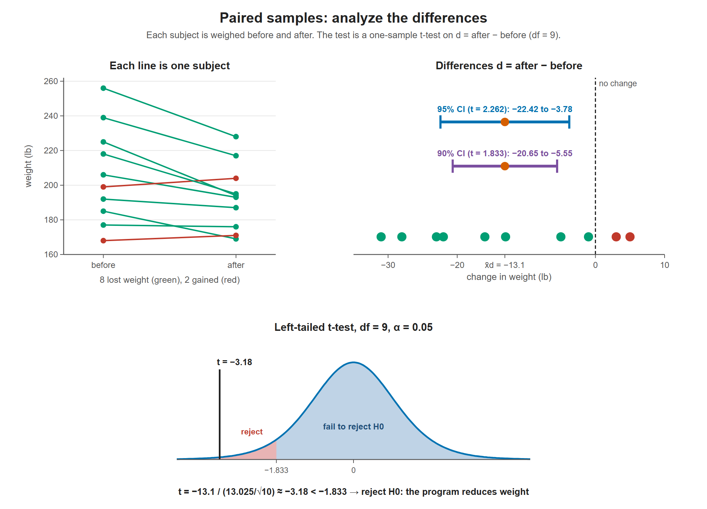

# Lesson 11.4 - Matched or Paired Samples

> **Video:** [Matched or Paired Samples T-Test - Hypothesis Testing](https://www.youtube.com/watch?v=JiQR0lHLe74) by The Organic Chemistry Tutor
> **Chapter:** [11 - Hypothesis Testing - 2 Samples](https://www.video-tutor.net/hypothesis-testing-with-two-samples.html)

## When samples are paired

A **matched (paired) sample** measures the **same subjects twice**, for example before and after a treatment. Instead of comparing two separate groups, analyze the **difference** for each subject:

$$x_d = \text{after} - \text{before}$$

## Formulas

| Quantity | Formula |
|---|---|
| Mean difference | $\bar x_d = \dfrac{\sum x_d}{n}$ |
| SD of the differences | $s_d = \sqrt{\dfrac{\sum (x_d - \bar x_d)^2}{n - 1}}$ (or `=STDEV.S(...)` in Excel) |
| Test statistic | $t = \dfrac{\bar x_d - \mu_d}{s_d/\sqrt n}$, df $= n - 1$ |
| Confidence interval | $\bar x_d \pm t\,\dfrac{s_d}{\sqrt n}$ |

---

## Example - a weight-loss program

Is the program effective at reducing weight? $\alpha = 0.05$, 10 subjects.

| Subject | Before (lb) | After (lb) | $x_d$ = after − before |
|---:|---:|---:|---:|
| 1 | 185 | 169 | −16 |
| 2 | 192 | 187 | −5 |
| 3 | 206 | 193 | −13 |
| 4 | 177 | 176 | −1 |
| 5 | 225 | 194 | −31 |
| 6 | 168 | 171 | +3 |
| 7 | 256 | 228 | −28 |
| 8 | 239 | 217 | −22 |
| 9 | 199 | 204 | +5 |
| 10 | 218 | 195 | −23 |

A negative difference means the subject lost weight.

**Hypotheses.** An effective program means the mean difference is **negative**:
$$H_0: \mu_d \ge 0 \qquad H_a: \mu_d < 0 \quad\text{(left-tailed)}$$

**Sample statistics:**
$$\bar x_d = \frac{-131}{10} = -13.1, \qquad s_d = \sqrt{\frac{1526.9}{9}} \approx 13.025$$

**Critical value:** left-tailed, df $= 9$, $\alpha = 0.05$ gives $t = -1.833$.

**Test statistic:**
$$t = \frac{-13.1 - 0}{13.025/\sqrt{10}} = \frac{-13.1}{4.119} \approx -3.18$$

$-3.18 < -1.833$, which is in the rejection region. **Reject $H_0$.** There is sufficient evidence at the 5% level that the program reduces weight.

### Confidence interval for $\mu_d$

**Using $t = 1.833$ (as in the video):**
$$-13.1 \pm 1.833\,(4.119) = -13.1 \pm 7.55 \;\Rightarrow\; (-20.65,\; -5.55)$$

> **Correction:** 1.833 is the critical value with **5% in one tail**, so a two-sided interval built from it is a **90%** confidence interval, not 95%.
> For a **95%** interval, use $t_{0.025,\,9} = 2.262$: $\;-13.1 \pm 2.262(4.119) = -13.1 \pm 9.32 \Rightarrow (-22.42,\; -3.78)$.

Either way, the whole interval is **below 0**: there are no zero or positive values, which supports rejecting $H_0$. The margin of error is 7.55 for the 90% interval, or 9.32 for 95%.

Top left: most subjects lost weight. Top right: the ten differences, with the 90% and 95% intervals for the mean difference; both sit entirely below 0. Bottom: t = −3.18 is beyond the critical value −1.833, so H0 is rejected.

---

## Key takeaways

- Paired data → work with the **differences** $x_d$ and run a one-sample t-test on them.
- df $= n - 1$, where $n$ is the number of **pairs**.
- Choose the direction of $H_a$ to match the claim (e.g. "reduces" → $\mu_d < 0$ when $x_d$ = after − before).
- Match the CI's $t$ to its confidence level: two-sided 95% uses $\alpha/2 = 0.025$.
