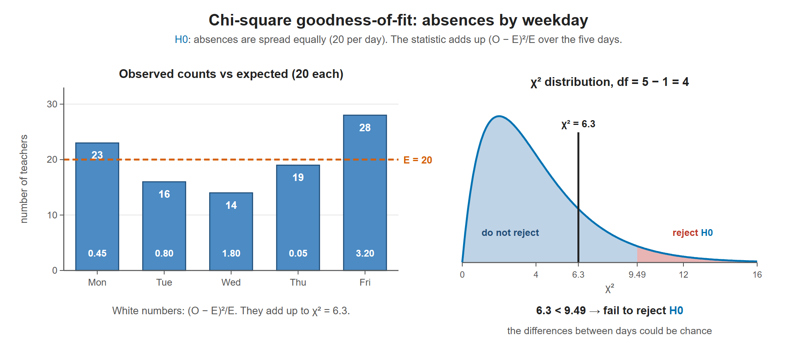

# Lesson 12.1 - The Chi Square Test

> **Video:** [Chi Square Test](https://www.youtube.com/watch?v=HKDqlYSLt68) by The Organic Chemistry Tutor
> **Chapter:** [12 - The Chi-Square Distribution](https://www.video-tutor.net/chi-square-distributions.html)

## The big picture: testing counts, not averages

Chapters 10 and 11 tested **one number**: a mean, a proportion, or a difference. Many questions are about **how counts are spread across several categories**: absences on each weekday, M&M colors in a bag, votes for 4 candidates. There is no single average to test. We need a way to compare a **whole table of counts** with what $H_0$ predicts.

**1. $H_0$ gives the expected counts.** $H_0$ says what share each category should get. Multiply by the sample size:

$$E = n \times p$$

With 100 teachers and "absences are spread equally over 5 days", each day expects $E = 100 \times \frac15 = 20$.

**2. Why not just add up the gaps $O - E$?** Because they always add up to 0. The observed and expected counts both total 100, so every extra absence on one day is a missing one somewhere else: $+3 - 4 - 6 - 1 + 8 = 0$.

**3. Square, then divide by $E$.**

- **Squaring** makes every gap positive, so the gaps can't cancel. It also gives big gaps extra weight.
- **Dividing by $E$** measures each gap **relative to what was expected**. Missing by 8 is a lot when you expect 20, but almost nothing when you expect 1000.

Add up the pieces for every category, and you get one number for the total mismatch:

$$\chi^2 = \sum \frac{(O - E)^2}{E}$$

The five gaps cancel out, so they are squared and scaled by $E$ before being added. The total, 6.3, is then compared with the χ² curve to see whether it is unusually large.

**4. Why the test is always right-tailed.** χ² can't be negative, and $\chi^2 = 0$ means a perfect fit. Only a **large** χ² is evidence against $H_0$, so the rejection region is always the right tail. A χ² near 0 just means the data fit very well.

**5. Where the χ² curve comes from.** Each piece $\frac{O - E}{\sqrt E}$ behaves roughly like a z-score, so χ² is roughly a **sum of squared z-scores**. That sum has its own distribution, the **chi-square distribution**:

- It starts at 0 and is skewed right, because squares are never negative.
- Its shape depends on the **degrees of freedom**. On average, χ² is about **df** when $H_0$ is true. Here df = 4 and we got 6.3, a bit more than average but not unusual.

**6. Why df $= k - 1$.** The counts must add up to the total. Once you know 4 of the 5 days, the 5th is forced: $100 - 23 - 16 - 14 - 19 = 28$. Only $k - 1$ counts are free to vary.

The 5 steps are the same as in Chapters 10 and 11:

1. Write $H_0$ (the expected distribution) and $H_a$ (it doesn't fit).
2. Choose $\alpha$.
3. Find the critical value from the χ² table, with df $= k - 1$ and right-tail area $\alpha$.
4. **Compute** $\chi^2 = \sum (O - E)^2/E$. ← this lesson
5. $\chi^2$ greater than the critical value → reject $H_0$. Otherwise → fail to reject $H_0$.

---

## The goodness-of-fit test

Does the **observed** distribution of counts across categories match an **expected** distribution?

$$\chi^2 = \sum \frac{(O - E)^2}{E}$$

- $O$ = observed count, $E$ = expected count, for each category
- **Degrees of freedom** = $k - 1$, where $k$ = number of categories
- It is always a **right-tailed** test: a large $\chi^2$ means the observed counts are far from the expected ones

**The chi-square distribution** is **not symmetric**; it is skewed to the right. The critical value $\chi^2_\alpha$ cuts off area $\alpha$ in the right tail:

- calculated $\chi^2$ > critical value → **rejection region** → reject $H_0$
- calculated $\chi^2$ ≤ critical value → **do-not-reject region**

---

## Example - which weekday has the most absences?

A principal expects absences to be spread **equally** over the 5-day school week. 100 teachers were asked which day had the most absences. Test at $\alpha = 0.05$.

| Day | Mon | Tue | Wed | Thu | Fri | Total |
|---|---:|---:|---:|---:|---:|---:|
| Observed $O$ | 23 | 16 | 14 | 19 | 28 | 100 |
| Expected $E$ | 20 | 20 | 20 | 20 | 20 | 100 |

**Expected counts:** $E = n \times p = 100 \times \dfrac15 = 20$ for each day.

**Hypotheses:**

- $H_0$: absences happen with **equal frequencies** (a uniform distribution)
- $H_a$: absences do **not** happen with equal frequencies

**Critical value:** df $= k - 1 = 5 - 1 = 4$. In the χ² table with right-tail area 0.05: $\chi^2_{0.05,\,4} = 9.49$.

**Test statistic:**

| Day | $O - E$ | $(O - E)^2$ | $(O - E)^2 / E$ |
|---|---:|---:|---:|
| Mon | 3 | 9 | 0.45 |
| Tue | −4 | 16 | 0.80 |
| Wed | −6 | 36 | 1.80 |
| Thu | −1 | 1 | 0.05 |
| Fri | 8 | 64 | 3.20 |
| **Sum** | | **126** | **6.30** |

$$\chi^2 = \sum \frac{(O - E)^2}{E} = \frac{9 + 16 + 36 + 1 + 64}{20} = \frac{126}{20} = 6.3$$

(Every $E$ is 20 here, so you can add the squares first and divide once.)

$6.3 < 9.49$, which is in the do-not-reject region. **Fail to reject $H_0$.** The variation between days is not large enough to say that absences are unevenly spread across the week.

Left: Friday and Wednesday are furthest from the expected 20, so they contribute the most to χ². Right: the total, 6.3, is still below the critical value 9.49, so the uneven pattern could be due to chance.

---

## Key takeaways

- The gaps $O - E$ always add up to 0, so they are squared and divided by $E$ before being added.
- $\chi^2 = \sum (O - E)^2/E$ measures how far the observed counts are from the expected ones.
- Goodness of fit: df = number of categories − 1. It is always right-tailed.
- Large $\chi^2$ (beyond the critical value) → reject $H_0$ (the data don't fit the expected distribution).
